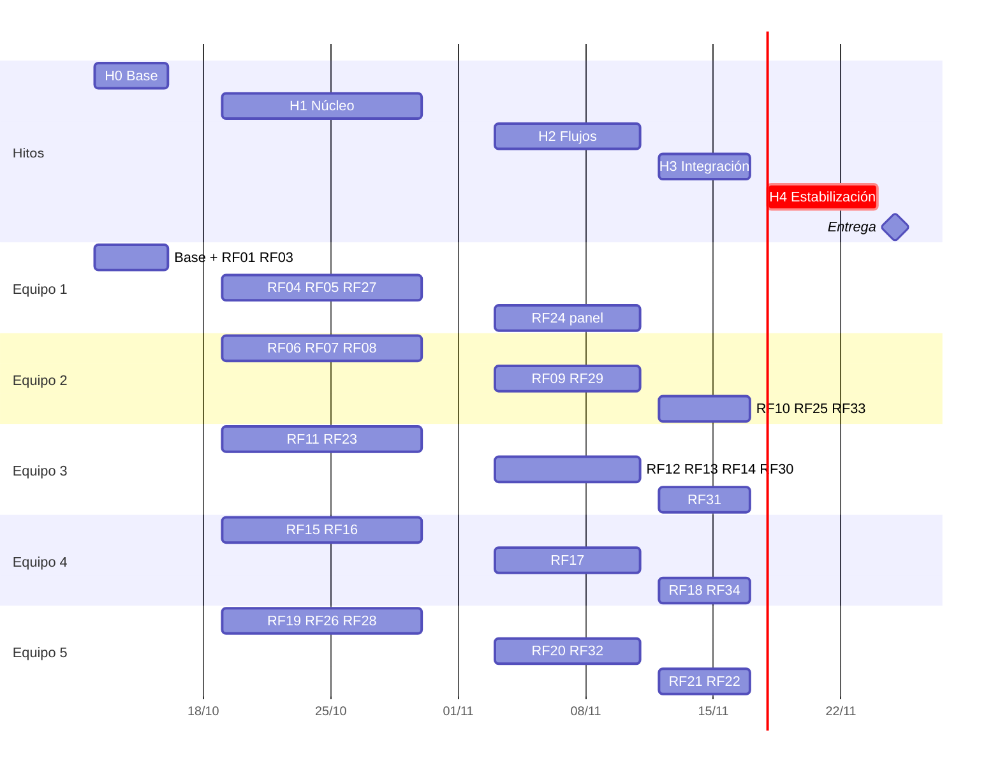
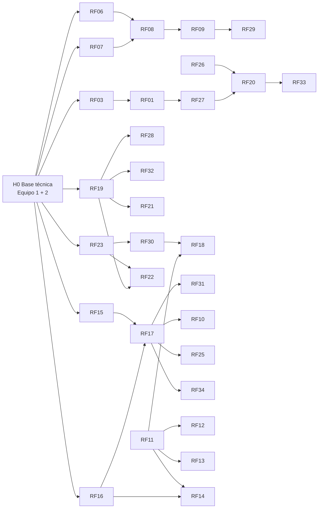

# Plan de desarrollo del LMS

**Entrega:** miércoles **25/11/2026** · **Alcance:** los 33 RF vigentes · **Equipo:** 20 personas en 5 equipos de 4 (back, front y test; cada equipo reparte sus roles) · **Sin sprints:** flujo continuo con hitos.

> [!important] Dónde se registra el trabajo
> El avance por módulo está en el [[Roadmap]] y su [tablero](https://claude.ai/artifact/1QNY5M8X5WMjDYvNDDno98).
> **OpenProject** es la fuente de verdad de tareas, hitos, defectos, horas y estado ([[ADR-025 OpenProject como gestor del trabajo]]). GitHub es solo para código, PR y CI, enlazados con `OP#id`. El vault es la especificación. Configuración y carga en [[OpenProject]].

## Equipos y módulos
| Equipo | Módulos | RF | Responsabilidad extra |
|---|---|---|---|
| **Equipo 1** | [[Identidad y acceso]] · [[Auditoría]] · panel ([[RF24]]) | RF01, RF03, RF04, RF05, RF24, RF27 | **Base técnica (H0)**: esqueleto, UI, CI, roles, seeders, Boost |
| **Equipo 2** | [[Gestión académica]] · reportes y KPIs | RF06–RF10, RF25, RF29, RF33 | Migraciones núcleo académicas (H0) |
| **Equipo 3** | [[Contenidos]] · [[Comunicación y notificaciones]] | RF11–RF14, RF23, RF30, RF31 | **Reverb y notificaciones**, que usan todos |
| **Equipo 4** | [[Actividades y evaluaciones]] · [[Calificaciones y progreso]] | RF15–RF18, RF34 | Cuestionarios con reconexión (riesgo técnico); actas y cierre |
| **Equipo 5** | [[Asistencia]] | RF19–RF22, RF26, RF28, RF32 | Prioridad n.º 1 de la investigación |

Paneles ([[RF24]]) y reportes ([[RF25]]): el dueño arma la estructura y **cada equipo aporta los widgets y reportes de su módulo**; son tareas propias en OpenProject.

## Hitos
| Hito | Fechas | Meta |
|---|---|---|
| **H0 Base** | 12–16/10 | Base técnica, **todas las migraciones y factories núcleo**, roles sembrados, inicio de sesión de desarrollo, CI en verde; RF01 y RF03 |
| **H1 Núcleo** | 19–30/10 | CRUD y modelos de cada módulo; notificaciones (RF23) y dispositivo (RF27) listos para otros |
| **H2 Flujos** | 3–11/11 | Flujos completos: QR, matrícula, cuestionarios, notas, foros. *El 2/11 es feriado* |
| **H3 Integración** | 12–17/11 | Google Calendar, reporte de Meet, alertas, reportes, KPIs |
| **Congelado** | **18/11** | Desde aquí solo correcciones |
| **H4 Estabilización** | 18–24/11 | Regresión completa, k6 en staging, pruebas con docentes, capturas de los manuales |
| **Entrega** | **25/11** | `test` → `main` con 2 aprobaciones |



## Requisitos por equipo y por hito
El equipo, el hito y las dependencias son **propiedades de cada RF** (`equipo`, `hito`, `depende`). Esta tabla y el script de OpenProject las leen de ahí.
```base
filters:
  and:
    - tipo == "rf"
    - estado != "descartado"
views:
  - type: table
    name: Por equipo
    groupBy:
      property: equipo
      direction: ASC
    order: [file.name, nombre, hito, rama, op, depende, prioridad, estado]
    sort:
      - property: hito
        direction: ASC
  - type: table
    name: Por hito
    groupBy:
      property: hito
      direction: ASC
    order: [file.name, nombre, equipo, rama, op, depende, estado]
  - type: table
    name: Avance
    groupBy:
      property: estado
      direction: ASC
    order: [file.name, nombre, equipo, hito]
```

## Ruta crítica y dependencias entre equipos

**Puntos de entrega entre equipos** (si se atrasan, bloquean a otros):
| Entrega | De | A | Fecha límite |
|---|---|---|---|
| Migraciones, factories y seeders núcleo | E1 + E2 | Todos | **16/10** |
| Roles y permisos sembrados + inicio de sesión de desarrollo | E1 | Todos | **16/10** |
| Componentes UI | E1 | Todos | **16/10** (se amplían en H1) |
| Servicio de notificaciones + Reverb (RF23) | E3 | E2, E4, E5 | **30/10** |
| Token de dispositivo (RF27) | E1 | E5 (RF20) | **30/10** |
| Secciones y matrículas (RF08, RF09) | E2 | Todos (datos reales) | RF08 **30/10**; RF09 **11/11** (mientras, factories) |
| Calificaciones (RF17) | E4 | E2 (RF10, RF25), E3 (RF31) | **11/11** |

## Reglas de trabajo
- **Contrato primero:** nadie espera a otro equipo. Se trabaja contra las factories y seeders de H0 y contra las interfaces (Services y Events) acordadas en el ER y en los flujos.
- **Cada RF en OpenProject:** Feature con tareas **Back · Front · Test**. Rama `<modulo>-rfxx-<corto>` (propiedad `rama` del RF, p. ej. `asistencia-rf20-qr`), creada desde `test`; PR a `test` con `OP#<ID>` en el título.
- **Done** = [[Definition of Done]] + el paquete de trabajo en *En test* tras el merge a `test`, y *Cerrado* tras la regresión.
- **IA:** en [[Directrices de IA]], modo orquesta; registra el progreso en OpenProject.
- **Seguimiento:** una reunión diaria de 15 min por equipo y una de líderes de equipo dos veces por semana, revisando el Gantt de OpenProject.

## Riesgos
| Riesgo | Impacto | Mitigación |
|---|---|---|
| H0 se atrasa | Bloquea a los 5 equipos | E1 y E2 completos en H0; congelar el ER el 14/10 |
| TI no entrega OAuth ni Calendar a tiempo | RF01 y RF21 sin probar en real | Inicio de sesión de desarrollo; Calendar detrás de `CalendarGateway` con un fake; trámite ya |
| Workspace sin reporte de asistencia de Meet | RF21 incompleto | Pedir un reporte real ya; carga manual de asistencia (RF19) como respaldo |
| H3 muy corto (4 días) | Integraciones a medias | Empezar Calendar y el lector del reporte de Meet en H2 con fakes |
| Cuestionarios con reconexión | Pérdida de respuestas | E4 empieza RF16 en H1; prueba Browser de reconexión desde el inicio |
| 20 personas sobre el mismo repo | Conflictos de migraciones | Migraciones núcleo en H0; prefijo de módulo en los nombres; revisión del ER por los líderes |
| Hosting sin definir (ADR-020) | Sin staging para k6 | Decidir antes del 30/10 |
