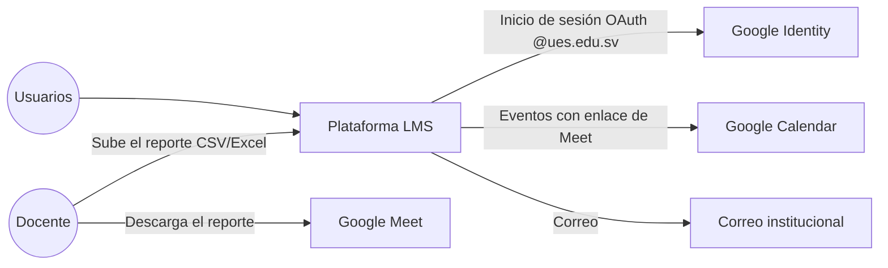

# Actores

## Usuarios del sistema
| Actor | Qué hace en el sistema | Cantidad aproximada |
|---|---|---|
| [[Estudiante]] | Consume contenidos, entrega, hace exámenes y registra asistencia | 244 en ISI: 161 del Plan 98 y 83 del Plan 25 |
| [[Docente]] | Gestiona el aula, evalúa y toma asistencia | Por definir. Una sección puede tener varios docentes |
| [[Coordinador]] | Opera la carrera: secciones, matrícula, corrección de notas de períodos cerrados | 1 por carrera |
| [[Jefe de Departamento]] | Supervisión, auditoría, KPIs y estadísticas de oferta | 1 por departamento (la facultad tiene 11) |
| [[Administrador]] | Infraestructura, usuarios, roles, integraciones | Pocos |
| [[Soporte Técnico]] | Autoriza cambios de teléfono | Pocos |

## Sistemas externos

## Interesados que no usan el sistema
- **TI de la UES:** dominio `ues.edu.sv`, certificados, cliente OAuth y permisos de Google Workspace.
- **Junta Directiva → Unidad Financiera → Administración Académica:** el circuito por el que pasan los casos especiales, según la [[Entrevista jefatura]]. Hoy queda fuera del sistema.
