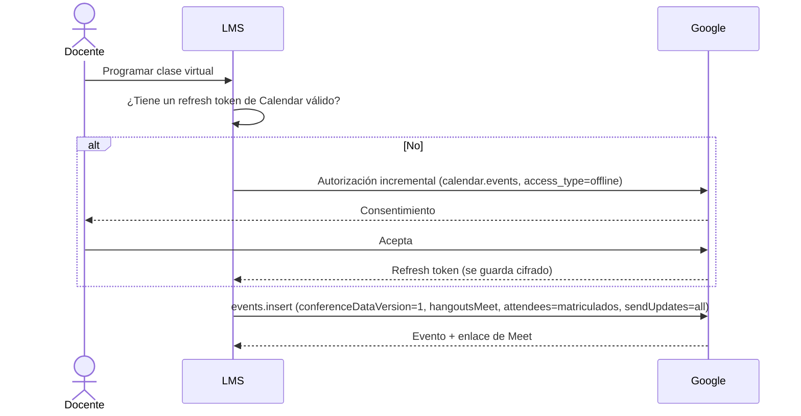

# Integraciones con Google

| Integración | Mecanismo | Scopes | Quién autoriza |
|---|---|---|---|
| **Inicio de sesión** ([[RF01]]) | OAuth 2.0 / OpenID Connect con Socialite | `openid email profile` | Cada usuario, la primera vez |
| **Calendar + Meet** ([[RF21]]) | OAuth **incremental del docente** ([[ADR-018 Calendar con OAuth del docente]]) | `https://www.googleapis.com/auth/calendar.events` | El docente, al programar su primera clase |
| **Asistencia de Meet** | **Sin API**: el docente sube el reporte ([[ADR-003 Asistencia virtual por reporte de Meet]]) | — | — |
| **Correo** | SMTP del correo institucional | — | TI de la UES |

## Inicio de sesión
- Cliente OAuth tipo **Web** en un proyecto de Google Cloud de la UES, con la pantalla de consentimiento de tipo **Interna**: solo admite cuentas del dominio.
- Validación en el servidor: `hd`, `email_verified` y el sufijo del correo ([[Flujo Inicio de sesión con Google]]).

## Calendar con OAuth del docente

- El **refresh token se cifra** con el cast `encrypted` de Laravel.
- Si Google lo revoca, se le pide al docente que vuelva a autorizar.
- Las llamadas van en la cola `google`, con reintentos y retroceso exponencial, respetando la cuota.
- Cancelaciones: `events.delete` al aprobarse la cancelación del día ([[RF32]]). Reprogramar no existe: la app no permite editar una clase virtual.

## Calendario de evaluaciones del período
[[RF06]]: en el calendario del **Administrador** que sincroniza, con el mismo OAuth, invitando a los docentes y estudiantes del período con la lista de invitados oculta ([[ADR-068 Calendario de evaluaciones por ámbito]]).

## Trámite con TI de la UES
1. Proyecto de Google Cloud de la universidad.
2. Pantalla de consentimiento **Interna** y cliente OAuth Web, con las URI de redirección de producción y staging.
3. Habilitar la **Google Calendar API**.
4. Confirmar que la edición de Workspace genera el **reporte de asistencia de Meet**.
5. Datos SMTP del correo institucional, o una cuenta de envío.
