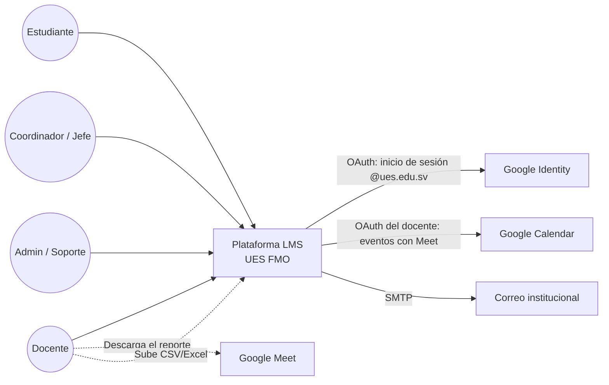
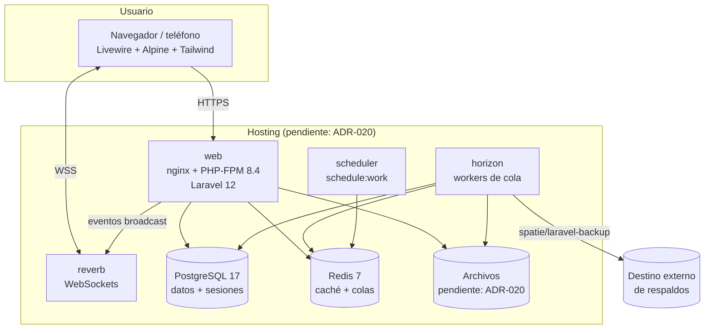

# Visión de arquitectura

Un **monolito modular Laravel 12 + Livewire 4** sin API pública ([[ADR-001 Stack Laravel y Livewire]]), con PostgreSQL, Redis + Horizon y Reverb, integrado con Google Workspace.

## Contexto (C4 nivel 1)

## Contenedores (C4 nivel 2)

| Contenedor | Responsabilidad | Escala |
|---|---|---|
| **web** | HTTP, componentes Livewire, Services (con autorización) | Horizontal: sin estado ([[RNF06]]) |
| **horizon** | Notificaciones, importaciones, reportes, llamadas a Google | Por supervisor ([[Colas, programador y tiempo real]]) |
| **scheduler** | Tareas periódicas | Una sola instancia (`onOneServer`) |
| **reverb** | Notificaciones en tiempo real ([[ADR-010 Notificaciones en tiempo real]]) | Con Redis como escalado |
| **PostgreSQL** | Datos, sesiones, auditoría | Vertical, más respaldos |
| **Redis** | Caché, colas, broadcasting | — |

## Notas de esta sección
[[Stack y paquetes]] · [[Estructura del código]] · [[Integraciones con Google]] · [[Seguridad]] · [[Colas, programador y tiempo real]] · [[Almacenamiento de archivos]] · [[Entornos]] · [[Respaldos y recuperación]] · [[Capacidad y rendimiento]] · [[Observabilidad]]

## Decisiones pendientes
- **Hosting y almacenamiento de archivos:** [[ADR-020 Hosting y almacenamiento]].
- **Monitoreo:** [[ADR-021 Monitoreo]].
