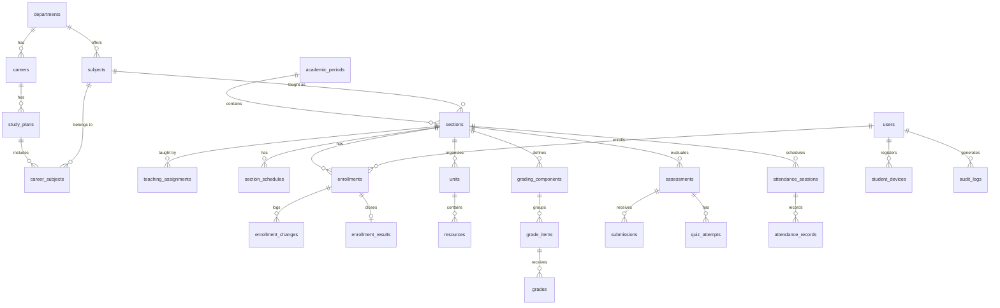
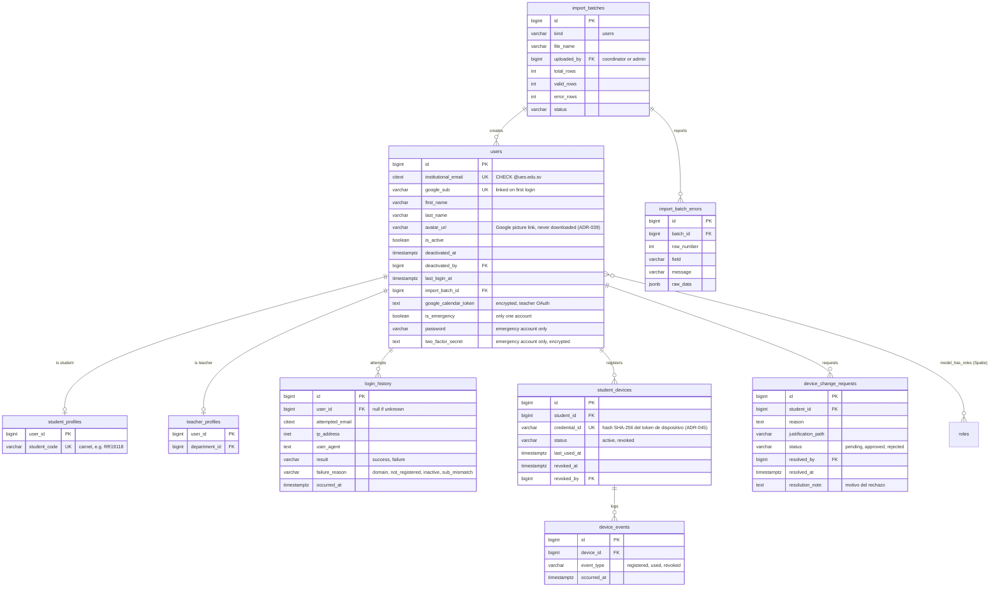
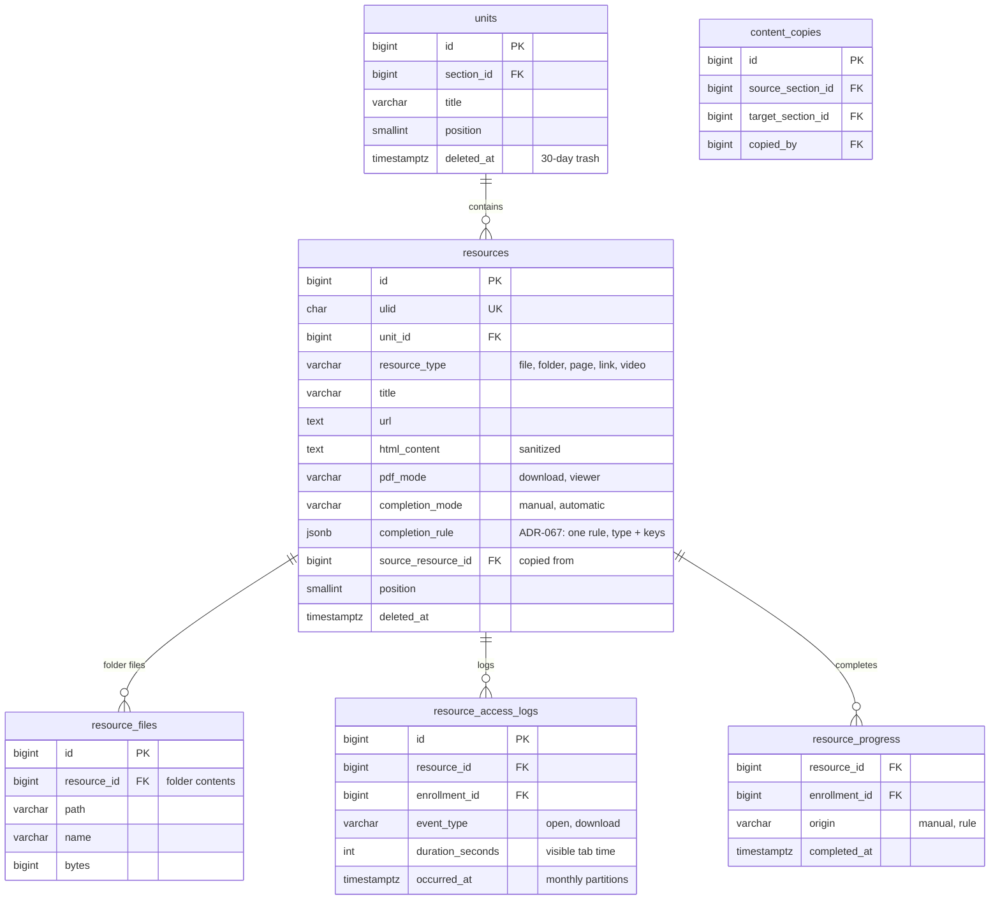
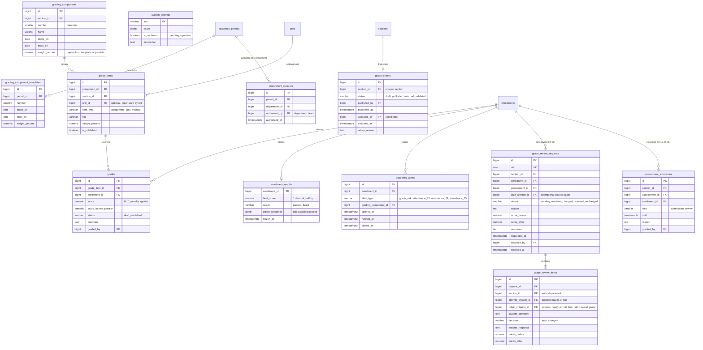
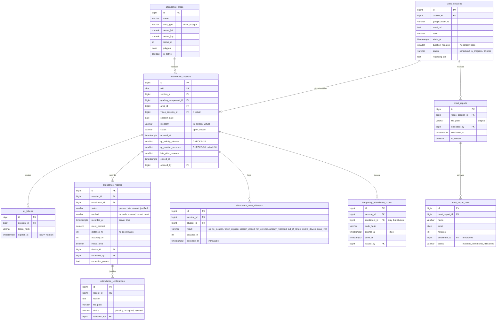
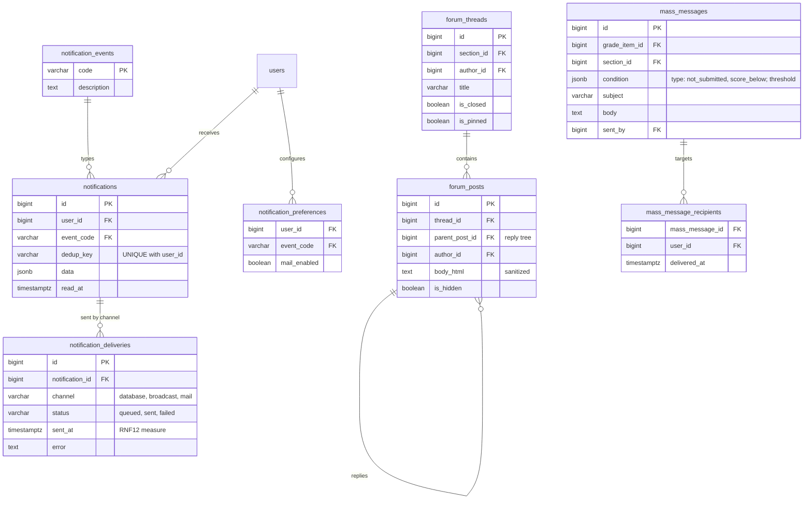
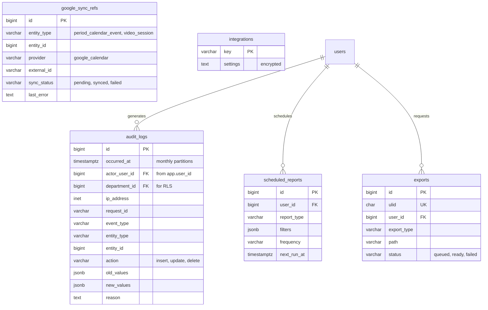

# Modelo entidad-relación (v2)

Modelo para **PostgreSQL 17**, en inglés ([[ADR-031 Modelo de datos v2 en inglés]]). Parte del diseño de @Alex (84 tablas), **adaptado a las ADR vigentes**:
- sin contraseñas de usuario ni tablas de recuperación (solo Google, [[ADR-007 Inicio de sesión con Google]]);
- sin evidencias virtuales ponderadas: se usa el reporte de Meet ([[ADR-003 Asistencia virtual por reporte de Meet]]);
- sin mesa de ayuda: hay solicitudes de cambio de teléfono;
- equipos por tarea.

Las restricciones y la auditoría viven en PostgreSQL; las operaciones de varios pasos, en los Services ([[ADR-027 Base de datos híbrida]]).

## Implementación (migraciones)
**Implementado el 11/10/2026** en `database/migrations/` con migraciones adaptativas ([[ADR-033 Migraciones adaptativas]]): SQLite por defecto y la capa completa en PostgreSQL.

| Migración | Tablas |
|---|---|
| `0001_01_01_000000_create_users_table` | `users`, `sessions` (+ extensiones `citext` y `btree_gist` en PostgreSQL) |
| `2026_10_11_034332_create_permission_tables` | Tablas de spatie/laravel-permission |
| `…100100_create_academic_structure_tables` | `departments`, `careers`, `study_plans`, `academic_periods`, `period_calendar_events`, `grading_component_templates`, `subjects`, `subject_prerequisites`, `career_subjects`, `classrooms` |
| `…100200_create_identity_tables` | `import_batches`, `import_batch_errors`, `student_profiles`, `teacher_profiles`, `department_heads`, `career_coordinators`, `student_careers`, `login_history`, `student_devices`, `device_events`, `device_change_requests` |
| `…100300_create_section_and_enrollment_tables` | `sections`, `enrollment_keys`, `section_schedules`, `teaching_assignments`, `enrollments`, `enrollment_changes`, `section_change_requests`, `class_cancellations` |
| `…100400_create_content_tables` | `units`, `resources`, `resource_files`, `resource_access_logs` (particionada en PostgreSQL), `resource_progress`, `content_copies` |
| `…100500_create_grading_tables` | `grading_components`, `grade_items`, `grades`, `grade_sheets`, `department_closures`, `enrollment_results`, `academic_alerts`, `system_settings` |
| `…100600_create_assessment_tables` | Rúbricas, `assessments` y settings, equipos, entregas, bancos, preguntas, cuestionarios e intentos |
| `…100700_create_attendance_tables` | Áreas, `video_sessions`, `attendance_sessions`, `qr_tokens`, registros, intentos, códigos, justificaciones, `meet_reports`, `meet_report_rows` |
| `…100800_create_communication_tables` | Notificaciones, foros, mensajes masivos |
| `…100900_create_reporting_and_audit_tables` | `audit_logs` (particionada en PostgreSQL), `scheduled_reports`, `exports`, `google_sync_refs`, `integrations` |
| `…101000_apply_database_rules_and_views` | Vistas portables + `database/sql/pgsql/01…05`: EXCLUDE, triggers, RLS, `v_teacher_kpis`, `mv_offer_stats`, particiones (`06` lo aplica la migración siguiente) |
| `2026_10_13_000000_audit_identity_assignments` | Sin tablas nuevas: `database/sql/pgsql/06_audit_assignments.sql` agrega `fn_audit_row` a `teacher_profiles`, `student_profiles`, `student_careers`, `career_coordinators` y `department_heads` ([[ADR-036 Auditoría de asignaciones académicas]]) |
| `2026_10_17_000000_audit_direct_permissions` | Sin tablas nuevas: `database/sql/pgsql/07_audit_permissions.sql` agrega `fn_audit_row` a `model_has_permissions` (permisos directos como `usuarios.crear-docente`, [[ADR-037 Jerarquía de creación y asignación de roles]]) |
| `2026_10_18_000629_create_grade_review_tables` | `grade_review_requests` y `grade_review_items` (RF35), y `assessment_extensions` (prórrogas), con CHECK, UNIQUE «una solicitud por actividad» y la auditoría `08_audit_grade_reviews.sql` ([[ADR-040 Solicitud de revisión de calificaciones]]) |
| `2026_10_17_234710_add_avatar_url_to_users_table` | `users.avatar_url`: enlace a la foto de Google; no se descarga ([[ADR-039 Foto de perfil enlazada desde Google]]) |
| `2026_10_25_121116_add_resolution_note_to_device_change_requests` | `device_change_requests.resolution_note`: el motivo con que Soporte rechaza un cambio de teléfono, para poder mostrarlo en «Resueltas»; también siembra el evento de aviso `device_request.pending` ([[RF27]]) |

> [!note] Ajustes al implementar
> - **`notifications`** es **compatible con el canal `database` de Laravel**: `uuid` como id, `notifiable` polimórfico, `data` y `read_at`. Se le agregan `event_code` y `dedup_key`, con un único parcial (`notifiable_type`, `notifiable_id`, `dedup_key`). `notification_deliveries.notification_id` es uuid.
> - `grades`, `attendance_records` y `submissions` llevan **`section_id`** para las FK compuestas. Las tablas destino tienen `UNIQUE (id, section_id)`.
> - `enrollments` tiene una FK de contexto `(section_id, period_id, subject_id)` hacia `sections`, solo en PostgreSQL.
> - Se agregaron `class_cancellations.requested_by`, `submission_events.actor_id`, `questions.accepted_answers` (respuesta corta), `assessments.instructions`, `quiz_attempts.score` y `resource_access_logs` sin `created_at`.

## Convenciones
| Tema | Regla |
|---|---|
| Nombres | Inglés snake_case. Tablas en plural, FK `<singular>_id`. Modelos Eloquent en singular (`Enrollment`, `AttendanceRecord`) |
| Identificadores | `id bigint GENERATED ALWAYS AS IDENTITY`. Las entidades que aparecen en URLs llevan además `ulid` único: `sections`, `resources`, `assessments`, `submissions`, `quiz_attempts`, `attendance_sessions` y `exports` |
| Fechas | `timestamptz` en UTC; se muestra en America/El_Salvador ([[RNF11]]). Toda tabla tiene `created_at` y `updated_at`, excepto los logs inmutables, que solo tienen la fecha del evento |
| Estados | `varchar` + `CHECK` (no ENUM de PostgreSQL), mapeados a Enums de PHP |
| Texto sin mayúsculas | `citext` en correos y códigos (`institutional_email`, `subjects.code`) |
| Borrado | Soft delete **solo** en `units` y `resources` (papelera de 30 días). Usuarios, materias y secciones se desactivan (`is_active`). Matrículas, notas, asistencia, períodos y logs **nunca se borran**: FK `RESTRICT` y el trigger `fn_block_delete` |
| Ubicación | Sin coordenadas del estudiante: solo distancia, precisión y si estaba dentro del área |
| Notas | `numeric(5,2)` entre 0 y 10 |
| Ligado a la matrícula | Notas, asistencia, entregas, intentos, progreso y accesos usan `enrollment_id`, no `user_id`, y llevan FK compuesta con la sección |

## Vista general

## Identidad y acceso

## Gestión académica

```mermaid
erDiagram
  departments {
    bigint id PK
    varchar code UK
    varchar name
  }
  careers {
    bigint id PK
    bigint department_id FK
    varchar code UK
    varchar name
  }
  study_plans {
    bigint id PK
    bigint career_id FK
    varchar name "Plan 98, Plan 25"
  }
  department_heads {
    bigint id PK
    bigint user_id FK
    bigint department_id FK
    date valid_from
    date valid_to "null = current"
  }
  career_coordinators {
    bigint id PK
    bigint user_id FK
    bigint career_id FK
    date valid_from
    date valid_to
  }
  student_careers {
    bigint id PK
    bigint student_id FK
    bigint career_id FK
    bigint study_plan_id FK
    smallint current_cycle
    bigint admission_period_id FK
    varchar status "active, changed, graduated"
  }
  academic_periods {
    bigint id PK
    varchar name
    date start_date
    date end_date
    varchar status "planned, active, closed"
    varchar preparation_stage "planning, schedule_definition, teacher_assignment, ready"
    smallint group_change_weeks "default 3"
  }
  period_calendar_events {
    bigint id PK
    bigint period_id FK
    bigint department_id FK "ADR-068: scope, nullable"
    bigint career_id FK "ADR-068: scope, nullable, exclusive with department_id"
    varchar title
    timestamptz starts_at
    timestamptz ends_at
  }
  subjects {
    bigint id PK
    citext code UK
    varchar name
    text description "written by its teachers (ADR-050)"
    smallint credits
    bigint department_id FK
    boolean is_active
  }
  subject_prerequisites {
    bigint subject_id FK
    bigint prerequisite_id FK "recorded, not validated"
  }
  career_subjects {
    bigint study_plan_id FK
    bigint subject_id FK
    smallint cycle "filters self-enrollment"
  }
  classrooms {
    bigint id PK
    varchar code UK
    smallint capacity
  }
  sections {
    bigint id PK
    char ulid UK
    bigint period_id FK
    bigint subject_id FK
    varchar code
    smallint min_capacity
    smallint max_capacity
    varchar status "open, closed, cancelled"
  }
  enrollment_keys {
    bigint id PK
    bigint subject_id FK "key per subject (ADR-032)"
    bigint period_id FK
    varchar key_hash
    timestamptz valid_until
    boolean is_active
  }
  enrollment_deadlines {
    bigint id PK
    bigint period_id FK
    bigint department_id FK "student's career department (ADR-051)"
    date deadline
    date extended_until "department extension"
    text extension_reason
    bigint set_by FK
    bigint extended_by FK
  }
  enrollment_extensions {
    bigint id PK
    bigint period_id FK
    bigint student_id FK
    date until "per-student extension"
    text reason
    bigint granted_by FK
  }
  section_schedules {
    bigint id PK
    bigint section_id FK
    bigint period_id FK "copied for EXCLUDE"
    bigint classroom_id FK
    smallint weekday "1-7"
    time start_time
    time end_time
  }
  teaching_assignments {
    bigint id PK
    bigint section_id FK
    bigint teacher_id FK
    boolean is_responsible
    timestamptz started_at
    timestamptz ended_at "null = current"
  }
  enrollments {
    bigint id PK
    bigint student_id FK
    bigint section_id FK
    bigint period_id FK
    bigint subject_id FK
    varchar status "active, withdrawn, transferred"
    varchar enrolled_via "key, teacher, coordinator, head, admin, import, group_change"
    bigint enrolled_by FK
    bigint transferred_to_id FK
  }
  enrollment_changes {
    bigint id PK
    bigint enrollment_id FK
    varchar change_type "enrolled, withdrawn, transferred"
    text reason
    bigint actor_id FK
    timestamptz occurred_at "immutable"
  }
  section_change_requests {
    bigint id PK
    bigint enrollment_id FK
    bigint target_section_id FK
    text justification
    varchar status "pending, approved, rejected"
    bigint resolved_by FK "coordinator"
  }
  class_cancellations {
    bigint id PK
    varchar scope "section, career, faculty"
    bigint section_id FK
    bigint career_id FK
    date date
    varchar kind "cancellation, modality_change"
    varchar new_modality
    text reason
    varchar status "requested, approved, rejected"
    bigint approved_by FK
  }
  departments ||--o{ careers : has
  careers ||--o{ study_plans : has
  departments ||--o{ department_heads : "headed by"
  careers ||--o{ career_coordinators : "coordinated by"
  careers ||--o{ student_careers : enrolls
  study_plans ||--o{ career_subjects : includes
  subjects ||--o{ career_subjects : "part of"
  subjects ||--o{ subject_prerequisites : requires
  academic_periods ||--o{ period_calendar_events : schedules
  academic_periods ||--o{ sections : contains
  subjects ||--o{ sections : "taught as"
  subjects ||--o{ enrollment_keys : "key per period"
  academic_periods ||--o{ enrollment_keys : scopes
  academic_periods ||--o{ enrollment_deadlines : "deadline per department"
  departments ||--o{ enrollment_deadlines : sets
  academic_periods ||--o{ enrollment_extensions : scopes
  users ||--o{ enrollment_extensions : "extension for student"
  sections ||--o{ section_schedules : has
  classrooms ||--o{ section_schedules : hosts
  sections ||--o{ teaching_assignments : "taught by"
  sections ||--o{ enrollments : has
  enrollments ||--o{ enrollment_changes : logs
  enrollments ||--o{ section_change_requests : requests
  sections ||--o{ class_cancellations : affects
```

## Contenidos

## Actividades y evaluaciones

```mermaid
erDiagram
  assessments {
    bigint id PK
    char ulid UK
    bigint section_id FK
    bigint grade_item_id FK
    varchar assessment_type "assignment, quiz"
    varchar title
    timestamptz opens_at "null = sin programar (ADR-066)"
    timestamptz closes_at "null = sin programar (ADR-066)"
    smallint max_attempts
    bigint rubric_id FK
    boolean is_anonymous "hide names until published"
  }
  assignment_settings {
    bigint assessment_id PK
    boolean is_group
    varchar late_policy "strict, grace, grace_penalty"
    timestamptz grace_until
    numeric late_penalty_percent
    jsonb allowed_extensions
    int max_file_mb
  }
  quiz_settings {
    bigint assessment_id PK
    smallint time_limit_minutes
    smallint autosave_seconds "30"
    varchar navigation "free, linear"
    boolean review_published
  }
  teams {
    bigint id PK
    bigint assessment_id FK "teams per assignment"
    varchar name
  }
  team_members {
    bigint team_id FK
    bigint enrollment_id FK
  }
  submissions {
    bigint id PK
    char ulid UK
    bigint assessment_id FK
    bigint enrollment_id FK "individual"
    bigint team_id FK "group"
    smallint attempt_number
    varchar status "submitted, cancelled"
    boolean is_late
    numeric late_penalty_applied
    timestamptz submitted_at
  }
  submission_files {
    bigint id PK
    bigint submission_id FK
    varchar path
    varchar original_name
    bigint bytes
  }
  submission_events {
    bigint id PK
    bigint submission_id FK
    varchar event_type "submitted, cancelled, replaced"
    timestamptz occurred_at "immutable"
  }
  submission_feedback {
    bigint id PK
    bigint submission_id FK
    text comment
    bigint author_id FK
  }
  submission_rubric_scores {
    bigint submission_id FK
    bigint criterion_id FK
    bigint level_id FK
    numeric points
  }
  rubrics {
    bigint id PK
    bigint owner_id FK
    varchar title
  }
  rubric_criteria {
    bigint id PK
    bigint rubric_id FK
    varchar name
    numeric max_points
  }
  rubric_levels {
    bigint id PK
    bigint criterion_id FK
    varchar name
    numeric points
  }
  question_banks {
    bigint id PK
    bigint owner_id FK "teacher"
    bigint subject_id FK
    varchar name
  }
  question_bank_shares {
    bigint bank_id FK
    bigint user_id FK "teacher with access"
  }
  questions {
    bigint id PK
    bigint bank_id FK
    varchar question_type "multiple_choice, true_false, short_answer, essay"
    text statement
    varchar topic
    varchar difficulty
    text justification "deferred feedback"
  }
  question_options {
    bigint id PK
    bigint question_id FK
    text text
    boolean is_correct
  }
  quiz_question_rules {
    bigint id PK
    bigint assessment_id FK
    bigint bank_id FK
    varchar topic
    varchar difficulty
    smallint quantity "random pick"
  }
  quiz_attempts {
    bigint id PK
    char ulid UK
    bigint assessment_id FK
    bigint enrollment_id FK
    smallint attempt_number
    timestamptz started_at
    timestamptz deadline_at "server time"
    timestamptz submitted_at
    varchar status "in_progress, submitted, pending_grading, graded"
  }
  attempt_answers {
    bigint id PK
    bigint attempt_id FK
    bigint question_id FK
    smallint position "fixed at start"
    bigint selected_option_id FK
    text answer_text
    numeric score
    timestamptz saved_at
  }
  assessments ||--o| assignment_settings : "if assignment"
  assessments ||--o| quiz_settings : "if quiz"
  assessments ||--o{ teams : "if group"
  teams ||--o{ team_members : has
  assessments ||--o{ submissions : receives
  submissions ||--o{ submission_files : has
  submissions ||--o{ submission_events : logs
  submissions ||--o{ submission_feedback : receives
  submissions ||--o{ submission_rubric_scores : scored
  rubrics ||--o{ rubric_criteria : has
  rubric_criteria ||--o{ rubric_levels : has
  question_banks ||--o{ questions : contains
  question_banks ||--o{ question_bank_shares : "shared with"
  questions ||--o{ question_options : has
  assessments ||--o{ quiz_question_rules : draws
  assessments ||--o{ quiz_attempts : has
  quiz_attempts ||--o{ attempt_answers : contains
```

## Calificaciones y progreso

## Asistencia

## Comunicación y notificaciones

## Dashboards, reportes y auditoría

**Vistas** (en PostgreSQL; las pruebas de BD corren en PostgreSQL):
| Vista | Uso | RF |
|---|---|---|
| `v_section_capacity` | Cupo usado y disponible; alerta de cupo mínimo | [[RF09]] |
| `mv_offer_stats` (materializada, se refresca de noche) | Ingresados, egresados, aprobados y reprobados por materia y período | [[RF10]] |
| `v_teacher_kpis` | Puntualidad al abrir el QR, recursos subidos, tiempo de revisión | [[RF33]] |
| `v_unit_progress` | Avance por unidad y materia | [[RF18]] |

## Reglas de integridad (RNF08)
| Regla | Implementación en PostgreSQL | RF |
|---|---|---|
| Un solo período activo | `UNIQUE INDEX ON academic_periods ((true)) WHERE status = 'active'` | [[RF06]] |
| Correo institucional | `citext UNIQUE` + `CHECK (institutional_email LIKE '%@ues.edu.sv')` | [[RF04]] |
| Un jefe y un coordinador vigentes | `UNIQUE (department_id) WHERE valid_to IS NULL`; ídem `career_id` | — |
| Un docente responsable vigente por sección | `UNIQUE (section_id) WHERE is_responsible AND ended_at IS NULL` | [[RF03]] |
| Sin choques de **aula** | `EXCLUDE USING gist (period_id WITH =, classroom_id WITH =, weekday WITH =, tsrange(...) WITH &&)` con `btree_gist` | [[RF08]] |
| Sin choques de **docente** | En el Service, dentro de la transacción de asignación (cruza tablas) | [[RF08]] |
| Una clave activa por asignatura y período | `UNIQUE (subject_id, period_id) WHERE is_active` en `enrollment_keys` | [[RF29]] |
| Una fecha límite por período y departamento; la prórroga es posterior a la fecha | `UNIQUE (period_id, department_id)` y `CHECK (extended_until IS NULL OR extended_until > deadline)` en `enrollment_deadlines` | [[RF29]], [[ADR-051 Fecha límite de inscripción por departamento]] |
| Una prórroga por período y estudiante | `UNIQUE (period_id, student_id)` en `enrollment_extensions` | [[RF29]], [[ADR-051 Fecha límite de inscripción por departamento]] |
| Una fecha del calendario pertenece a un solo ámbito | `CHECK (department_id IS NULL OR career_id IS NULL)` en `period_calendar_events` | [[RF06]], [[ADR-068 Calendario de evaluaciones por ámbito]] |
| Un acta por sección; un cierre por departamento y período | `UNIQUE (section_id)` en `grade_sheets`; `UNIQUE (period_id, department_id)` en `department_closures` | [[RF34]] |
| Cerrar el período | El Service exige que todos los departamentos con secciones tengan `department_closures` | [[RF34]] |
| Una matrícula activa por estudiante, materia y período | `UNIQUE (student_id, period_id, subject_id) WHERE status = 'active'` | [[RF09]] |
| Choque de horario del **estudiante** | En el Service de matrícula, dentro de la transacción ([[ADR-030 Matrícula ampliada]]) | [[RF09]] |
| Cupo | `SELECT … FOR UPDATE` sobre la sección al matricular | [[RF09]] |
| Coherencia de sección | FK compuestas `(enrollment_id, section_id)` en `grades`, `attendance_records` y `submissions` | [[RF17]] |
| Una nota por actividad y matrícula | `UNIQUE (grade_item_id, enrollment_id)` | [[RF17]] |
| Nota en rango | `CHECK (score BETWEEN 0 AND 10)` | [[RF17]] |
| Un registro de asistencia por sesión | `UNIQUE (session_id, enrollment_id)` | [[RF20]] |
| Sesión QR | `CHECK (qr_validity_minutes BETWEEN 5 AND 15)`, `CHECK (qr_rotation_seconds BETWEEN 5 AND 30)` | [[RF20]] |
| Un dispositivo activo por estudiante | `UNIQUE (student_id) WHERE status = 'active'`; `UNIQUE (credential_id)` | [[RF27]] |
| Entrega individual o grupal | `CHECK (num_nonnulls(enrollment_id, team_id) = 1)` | [[RF15]] |
| Una entrega por equipo e intento | `UNIQUE (assessment_id, team_id, attempt_number)` | [[RF15]] |
| Un intento de cuestionario en curso | `UNIQUE (assessment_id, enrollment_id) WHERE status = 'in_progress'` | [[RF16]] |
| Notificación sin duplicados | `UNIQUE (user_id, dedup_key)` + `INSERT … ON CONFLICT DO NOTHING` | [[RF23]] |
| Alerta única | `UNIQUE (enrollment_id, alert_type, grading_component_id) WHERE closed_at IS NULL` | [[RF22]] |
| Prerrequisito sin autorreferencia | `CHECK (subject_id <> prerequisite_id)`; los ciclos se validan en el Service | [[RF07]] |
| Fechas | `CHECK (end_date > start_date)`, `CHECK (closes_at > opens_at)`, `CHECK (grace_until >= closes_at)` | — |
| Evaluación sin programar: las dos fechas o ninguna | `CHECK ((opens_at IS NULL) = (closes_at IS NULL))` | [[RF14]], [[ADR-066 Evaluaciones sin programar al reutilizar]] |

## Triggers ([[ADR-027 Base de datos híbrida]])
| Trigger | Tablas | Qué hace |
|---|---|---|
| `fn_audit_row` | `grades`, `attendance_records`, `enrollments`, `teaching_assignments`, `academic_periods`, `users`, `model_has_roles`, `role_has_permissions`, `system_settings`, `student_devices`, `grade_sheets`, `department_closures`, `teacher_profiles`, `student_profiles`, `student_careers`, `career_coordinators`, `department_heads` ([[ADR-036 Auditoría de asignaciones académicas]]) | Escribe `audit_logs` con el actor de `app.user_id`. Sin actor ni `app.system_job`, rechaza la operación (`AC900`) |
| `fn_block_mutation` | `audit_logs`, `enrollment_changes`, `attendance_scan_attempts`, `login_history`, `submission_events`, `device_events` | Impide UPDATE y DELETE (`AC901`) |
| `fn_block_delete` | `users`, `enrollments`, `grades`, `attendance_records`, `academic_periods` | Impide el borrado físico (`AC902`) |
| `fn_block_closed_period` | `enrollments`, `grades`, `attendance_records` | Rechaza escrituras en un período `closed`, salvo la corrección auditada del Coordinador (`AC203`) |

**RLS** en `audit_logs`: el Administrador ve todo y el Jefe solo las filas de su `department_id` ([[ADR-029 Auditoría departamental del Jefe]]).

## Parámetros (`system_settings`)
Valores provisionales ([[ADR-030 Matrícula ampliada]]), con `is_confirmed = false` hasta tener el reglamento:

| Clave | Valor |
|---|---|
| `passing_score` | 6.0 |
| `grade_rounding` | `{"decimals":1,"mode":"half_up"}` |
| `missing_grade_policy` | `zero` |
| `min_attendance_percent` | 75 |
| `attendance_alert_thresholds` | `[85, 78]` |
| `attendance_partial_weight` | 0.5 |
| `justified_counts_as_absence` | false |
| `max_scans_per_student` | 3 |
| `qr_rotation_seconds_default` | 10 |
| `virtual_present_min_percent` | 70 |
| `trash_retention_days` | 30 |
| `qr_token_retention_days` | 7 |

## Volumen esperado (ISI, por período)
| Tabla | Filas aproximadas | Nota |
|---|---|---|
| `resource_access_logs` | ~500 mil | Particiones mensuales; índice (`resource_id`, `enrollment_id`) |
| `qr_tokens` | ~150 mil | Rota cada 10 s; se purga a los 7 días |
| `attendance_records` | ~40 mil | 244 estudiantes × ~5 materias × ~32 clases |
| `audit_logs` | ~100 mil | Particiones mensuales; retención pendiente |
| `attempt_answers` | ~60 mil | |

> [!info] Diccionario completo
> El diccionario columna por columna, el catálogo de reglas RN-001 a RN-082 y el SQL de referencia están en el documento de @Alex. Donde contradice una ADR vigente, manda la ADR.
