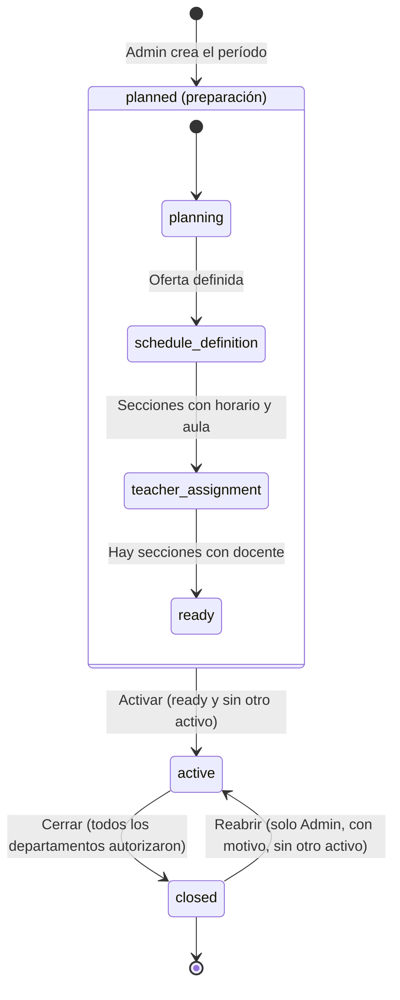

# Ciclo de vida del período académico

| Estado | Qué se permite | Quién |
|---|---|---|
| **planned · planning** | Elegir asignaturas que se ofrecen; ver la proyección de grupos ([[RF10]]) | Admin, Jefe, Coordinador |
| **planned · schedule_definition** | Crear secciones con horario, aula y cupos, sin choques ([[RF08]]) | Admin, Coordinador |
| **planned · teacher_assignment / ready** | Asignar docentes; configurar claves de matrícula por asignatura | Coordinador |
| **active** | Matrícula, contenidos, evaluaciones y asistencia. Cambio de grupo hasta la **3.ª semana** ([[Flujo Matrícula y cambio de grupo]]) | Todos según su rol |
| **closed** | Solo lectura, exportación e histórico. Las notas solo las corrige el **Coordinador**, con motivo | Coordinador, Admin |

## Reglas
- Modelo v2: `academic_periods.status` (`planned`, `active`, `closed`) + `preparation_stage` ([[Modelo entidad-relación]]).
- **Solo un período `active`** a la vez (índice único parcial); activar otro se rechaza. El siguiente período **sí puede prepararse** (`planned`) mientras otro está activo.
- **Reabrir:** solo el Administrador, con motivo obligatorio y auditoría; se notifica a los Coordinadores. Se conservan las autorizaciones de cierre y los resultados congelados; al volver a cerrar se recalculan ([[ADR-059 Reapertura de un período cerrado]]).
- **Antes de cerrar:** cada docente publica su acta, el Coordinador la valida y el Jefe autoriza su departamento ([[Flujo Validación de actas y cierre]], [[RF34]]). El Administrador solo puede cerrar cuando **todos** los departamentos autorizaron.
- Al **cerrar**: se calculan y congelan los resultados en `enrollment_results` con `policy_snapshot` ([[Flujo Cálculo de nota final]]). El trigger `fn_block_closed_period` bloquea nuevas matrículas, notas y asistencia; solo la corrección auditada del Coordinador pasa. Se genera el histórico exportable.
- Todo cambio de estado queda en la auditoría ([[RF05]]).
