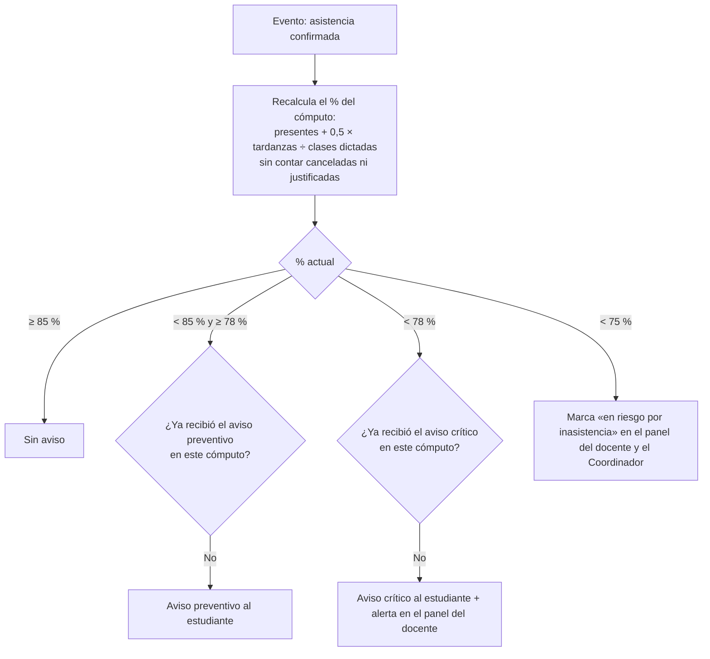

# Flujo · Alerta de inasistencias

**Disparador:** cada vez que se confirma un registro de asistencia (QR, código, manual, Meet o justificación), por estudiante y cómputo.

## Reglas
| Umbral | Acción |
|---|---|
| **85 %** | Aviso **preventivo**, una vez por cómputo |
| **78 %** | Aviso **crítico** al estudiante y alerta al docente, una vez por cómputo |
| **< 75 %** | Estado «en riesgo por inasistencia» (mínimo reglamentario) |

- Los umbrales son configurables por si el reglamento cambia.
- Los avisos se guardan en `academic_alerts` y no se duplican: una alerta abierta por matrícula, tipo y cómputo ([[RNF12]]).
- La tardanza vale 0,5 y las justificadas no cuentan como falta ([[ADR-030 Matrícula ampliada]]).
- Las clases canceladas ([[RF32]]) y las inasistencias justificadas no cuentan como falta.
