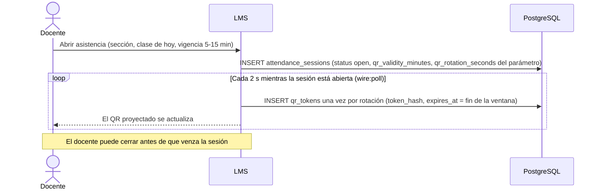
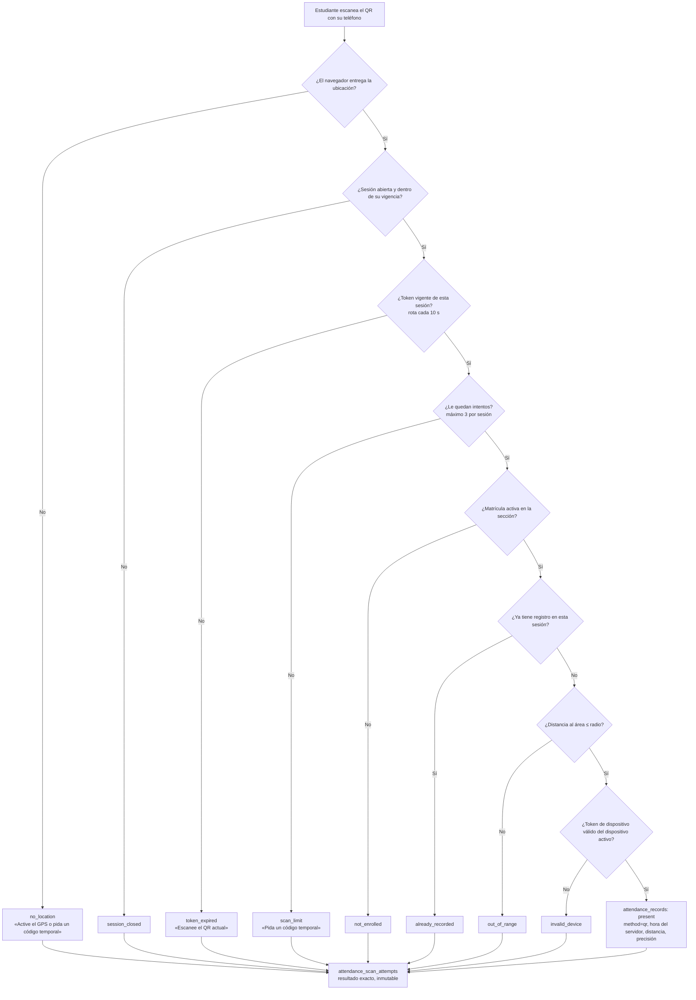

# Flujo · Asistencia presencial con QR

**Actores:** [[Docente]], [[Estudiante]]. **Precondición:** el estudiante está matriculado y tiene un dispositivo registrado ([[Flujo Registro y cambio de dispositivo]]).

## Apertura y rotación del token

## Escaneo y validaciones
El Service `AsistenciaQrService` corre dentro de `DbContext` (una transacción). **Siempre confirma**, porque los intentos rechazados también deben quedar guardados.

## Reglas
- `UNIQUE (session_id, enrollment_id)` impide duplicados, incluso con doble clic o reintentos.
- La hora que vale es la del **servidor**. El token de dispositivo lo verifica Laravel (compara su SHA-256 con el del dispositivo activo, [[ADR-045 Token de dispositivo]]); PostgreSQL no puede hacerlo.
- **Tardanza:** con QR no hay tardanza: toda marca aceptada queda `present` ([[ADR-046 Lector QR en la página y rotación por polling]]). La tardanza (0,5 en el porcentaje, [[ADR-030 Matrícula ampliada]]) queda para el registro manual y el código temporal.
- **Token del QR:** vale el vigente y el inmediatamente anterior; se deriva con HMAC de la sesión y la ventana de rotación, y solo se guarda su hash ([[ADR-046 Lector QR en la página y rotación por polling]]).
- No se guardan coordenadas: solo la distancia, la precisión y si estaba dentro del área.
- Quien no puede escanear: [[Flujo Código temporal]] o marcado manual (auditado).
- Al cerrar la sesión, los matriculados sin registro quedan `absent`.
- Los tokens vencidos se purgan a los 7 días; los intentos se conservan.
