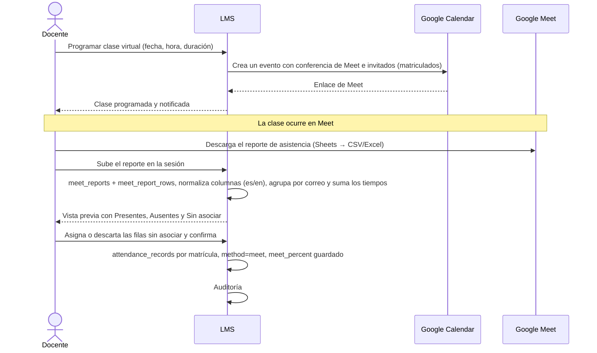
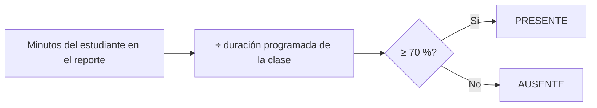

# Flujo · Asistencia virtual con el reporte de Meet

## Cálculo

## Validaciones
| Caso | Resultado |
|---|---|
| La fecha del reporte no coincide con la sesión | Se rechaza el archivo |
| Columnas no reconocidas | Se rechaza, indicando las columnas esperadas |
| Fila con correo `@ues.edu.sv` matriculado | Se asocia sola |
| Fila sin correo o con un correo ajeno | Va a **Sin asociar** |
| Matriculado que no aparece | **Ausente** |
| Se sube un segundo reporte | Reemplaza al anterior (auditado) |

## Pendientes
- Confirmar con TI que la edición de Workspace de la UES genera este reporte.
- Definir las columnas exactas con un reporte real.
