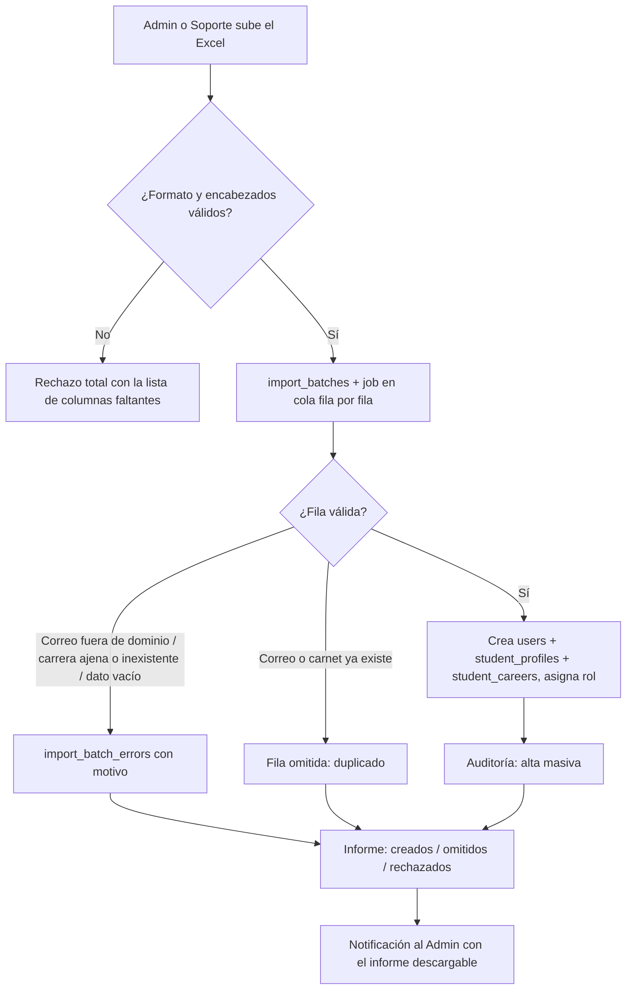

# Flujo · Carga masiva de usuarios

**Actores:** [[Administrador]] y [[Soporte Técnico]], ambos de cualquier carrera ([[ADR-047 Carreras visibles y carga masiva sin el Coordinador]], que modifica [[ADR-030 Matrícula ampliada]]; el Coordinador ya no importa). **Cuándo:** al iniciar cada período, con los estudiantes de nuevo ingreso.

## Formato (Excel, también se acepta CSV)
| Columna | Obligatoria | Validación |
|---|---|---|
| `carnet` | No | Sale del correo (`rr19118@ues.edu.sv` → `rr19118`); si viene, debe coincidir. Único |
| `nombres` | Sí | |
| `apellidos` | Sí | |
| `correo` | Sí | Único; termina en `@ues.edu.sv` |
| `rol` | Sí | Uno de los 6 roles |
| `carrera` | Para estudiantes | Debe existir en el catálogo |
| `plan` | Para estudiantes | `98` o `25` |
| `ciclo` | Para estudiantes | Número de ciclo actual |

## Reglas
- Cada fila va en su propio SAVEPOINT: una fila mala no detiene las demás; se guardan las válidas y se reportan las erróneas.
- El Administrador y Soporte dan de alta estudiantes de **cualquier carrera**; Soporte no puede crear otros roles ([[ADR-037 Jerarquía de creación y asignación de roles]]).
- No se envían contraseñas: el usuario entra con Google ([[Flujo Inicio de sesión con Google]]).
- Volver a subir el mismo archivo es seguro: los duplicados se omiten.
