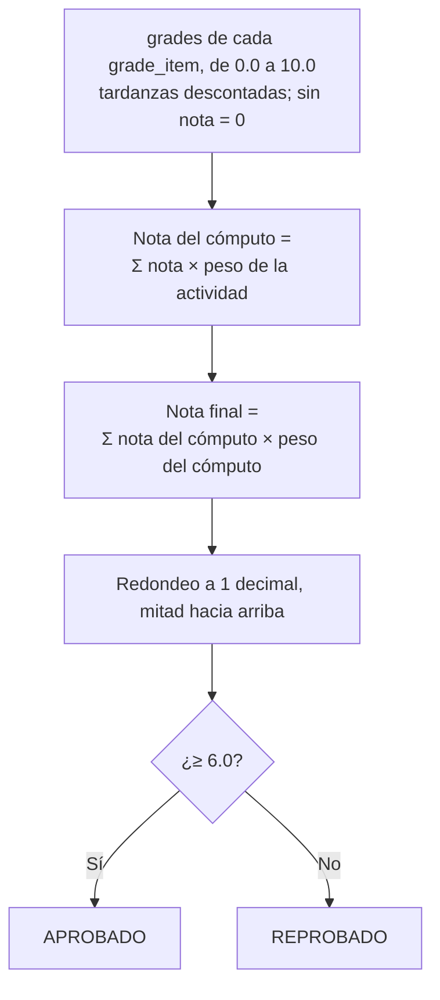
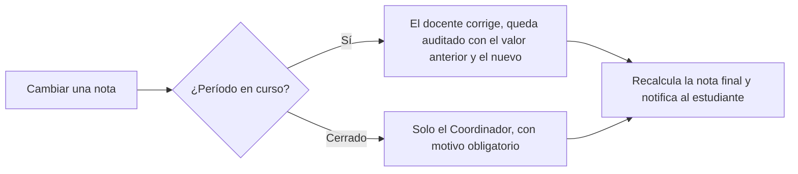

# Flujo · Cálculo de nota final

## Fórmula (parámetros provisionales)

| Parámetro | Valor provisional | Configurable |
|---|---|---|
| Escala | 0.0–10.0 | No |
| Nota mínima de aprobación | **6.0** | Sí |
| Redondeo | **1 decimal, mitad hacia arriba** (5.95 pasa a 6.0) | Sí |
| Pesos | Deben sumar 100 % en cada nivel | — |
| Nota faltante | **Cuenta como 0** ([[ADR-030 Matrícula ampliada]]) | Sí |

> [!warning] Pendiente
> Confirmar con el reglamento académico de la UES: nota mínima, redondeo, número de cómputos y si hay examen de reposición.

## Cuándo se calcula
- **En vivo:** al publicar cualquier nota, como nota «parcial acumulada» y para el estado «en riesgo» (< 6.0 proyectado).
- **Al cerrar el período:** se congela en `enrollment_results`, con `policy_snapshot` (los parámetros aplicados) ([[Ciclo de vida del período académico]]).

## Corrección

