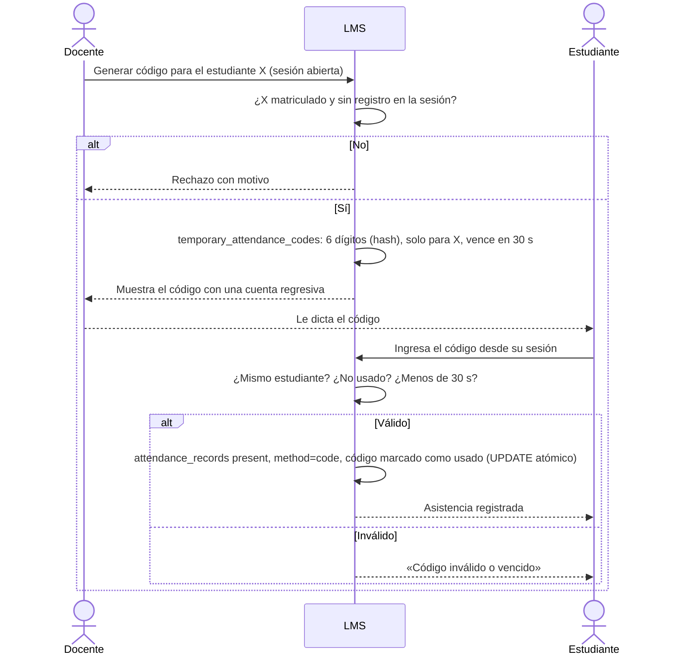

# Flujo · Código temporal de asistencia

Es el respaldo del QR para un estudiante concreto: sin teléfono registrado, sin GPS o con una falla.

## Reglas
- El código está ligado a **una cuenta**: otro estudiante no puede usarlo aunque lo vea.
- Es de un solo uso y vence a los 30 s; el docente puede generar otro.
- No exige GPS ni dispositivo: la presencia la avala el docente, y queda como evidencia del método.
