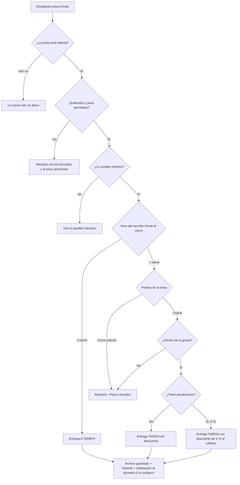

# Flujo · Entrega de tarea

## Reglas
- **Grupal:** una entrega por equipo; cualquier integrante entrega y vale para todos.
- El estudiante puede **cancelar** la entrega mientras la tarea esté abierta; queda en el historial.
- El descuento se aplica **al calificar** y se muestra al estudiante: nota = nota de la rúbrica × (1 − X %).
- La hora de corte es la del servidor.
