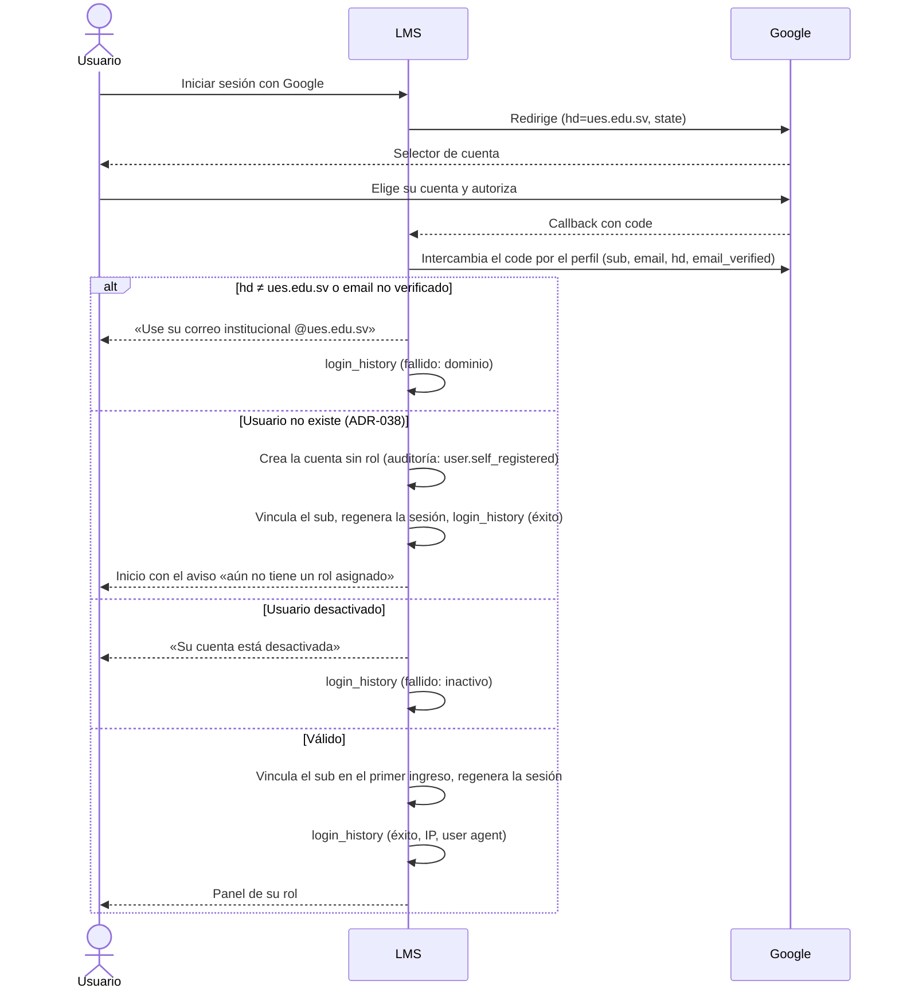

# Flujo · Inicio de sesión con Google

**Actores:** cualquier usuario, Google. **Precondición:** ninguna. Si la cuenta `@ues.edu.sv` no existe, se crea sin rol ([[ADR-038 Autorregistro sin rol]]); el alta previa ([[Flujo Carga masiva de usuarios]]) sirve para que entre ya con su rol.

## Reglas
- El dominio se valida **en el servidor**; el parámetro `hd` de la URL solo filtra el selector.
- Se compara el parámetro `state` para evitar CSRF en OAuth.
- La sesión expira a los 30 minutos de inactividad ([[RNF01]]).

## Alterno: cuenta de emergencia
Ruta aparte, con contraseña y TOTP. Cada ingreso se audita y se avisa a los Administradores. Ver [[Operación - Cuenta de emergencia]].

## Postcondición
Sesión activa con el rol del usuario y un registro en `login_history`.
