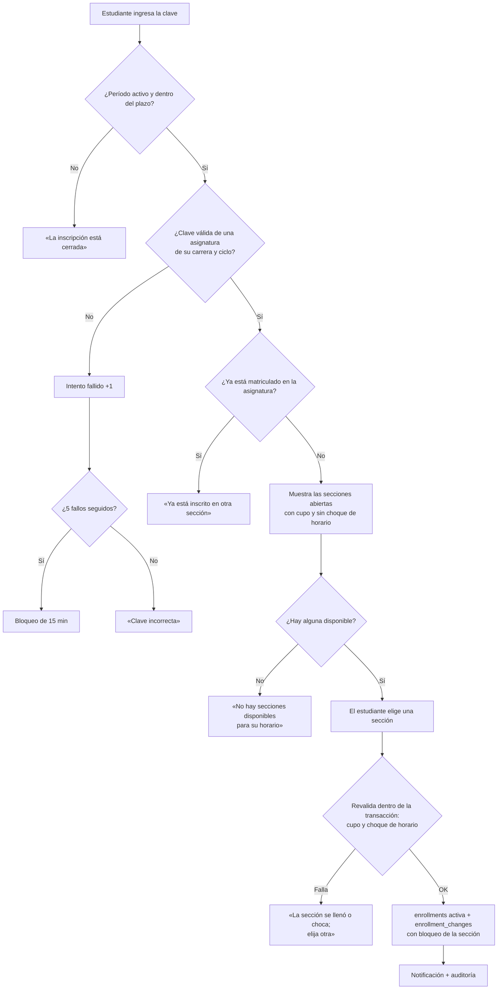
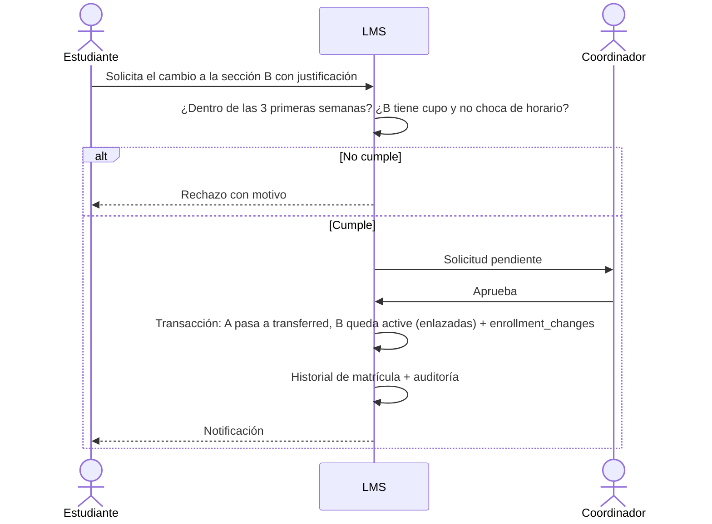

# Flujo · Matrícula y cambio de grupo

## Auto-matrícula con clave de la asignatura
La clave es **por asignatura y período** ([[ADR-032 Ajustes por el documento de roles]]): el estudiante elige la sección.

## Matrícula por otros roles
Según [[ADR-030 Matrícula ampliada]], inscriben o retiran con motivo, dentro de su ámbito:
- el **Docente**, en sus secciones;
- el **Coordinador**, en su carrera;
- el **Jefe**, en su departamento;
- el **Administrador**, en cualquiera.

**Soporte Técnico no matricula**: no tiene privilegios académicos ([[ADR-032 Ajustes por el documento de roles]]).

Cada alta, retiro o traslado escribe `enrollment_changes`, un historial inmutable. Las mismas validaciones (cupo, duplicado, choque de horario) aplican a todos. **Los prerrequisitos no se validan.**

## Cambio de grupo

## Reglas
- El cupo se descuenta con bloqueo de fila, para evitar sobrecupos cuando dos estudiantes se inscriben a la vez.
- El plazo de cambio (**3 semanas**) es configurable por período.
- Las entregas y notas del estudiante se conservan al cambiar de grupo: quedan en la matrícula anterior, enlazada a la nueva con `transferred_to_id`, y **la lectura recorre esa cadena** ([[ADR-062 Notas y entregas en un cambio de grupo]]). No se mueve ni se copia ninguna fila.
- Las notas se heredan **por cómputo**, no por actividad: las actividades son propias de cada sección, y lo comparable entre los dos grupos es el cómputo, que ambos copian de la plantilla del período. En cuanto el docente del grupo nuevo califica ese cómputo, manda el suyo.
- Las entregas del grupo anterior se ven de **solo lectura**, con su grupo de origen. La **asistencia no se encadena**: cada sección cuenta sus propias sesiones.
