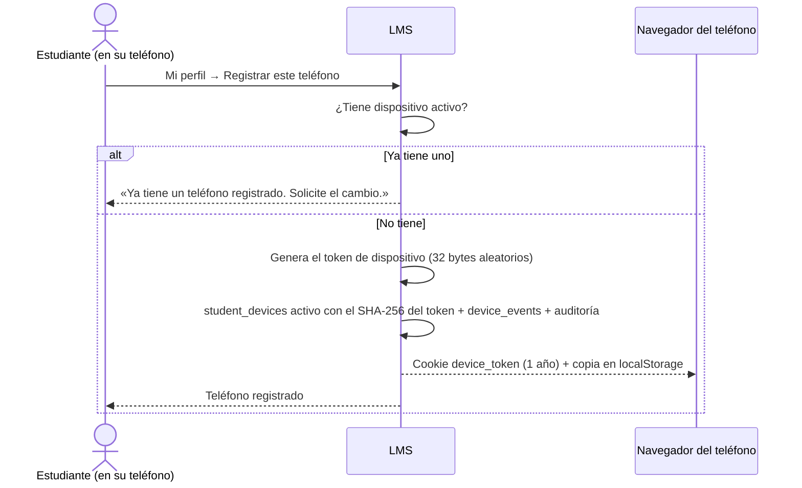
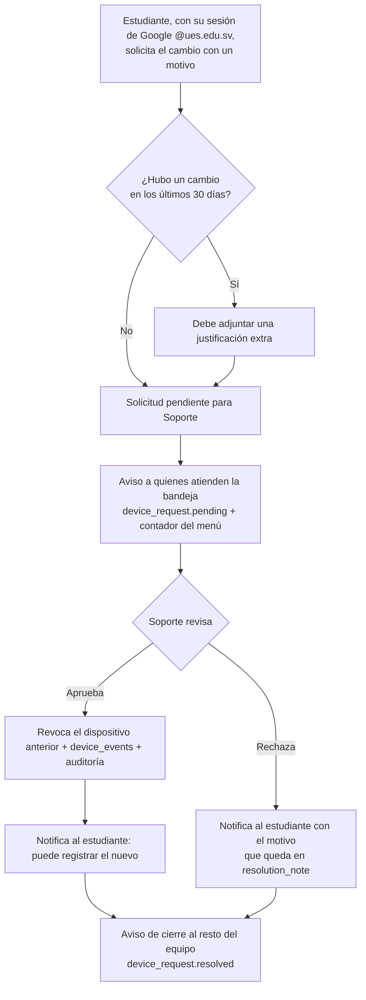

# Flujo · Registro y cambio de dispositivo

**Actores:** [[Estudiante]], [[Soporte Técnico]].

## Primer registro

## Cambio de teléfono

## Reglas
- La identidad del estudiante la garantiza su sesión de Google `@ues.edu.sv`; Soporte solo da el visto bueno.
- Máximo **un cambio cada 30 días** sin justificación extra.
- El servidor guarda solo el hash del token; la cookie `device_token` y su copia en `localStorage` valen si cualquiera coincide con el dispositivo activo ([[ADR-045 Token de dispositivo]]). Si se pierden ambas, el estudiante solicita el cambio.
- Los avisos de la bandeja van a quien tiene `dispositivos.gestionar`, no a un rol fijo. A quien resuelve no
  se le avisa de su propio cierre, y el motivo del rechazo queda guardado para verlo en «Resueltas».
- Es una solicitud puntual, no una mesa de ayuda general (P08 no se aprobó).
- Mientras no tenga dispositivo, el estudiante se registra con código temporal o de forma manual ([[RF28]], [[RF19]]).
