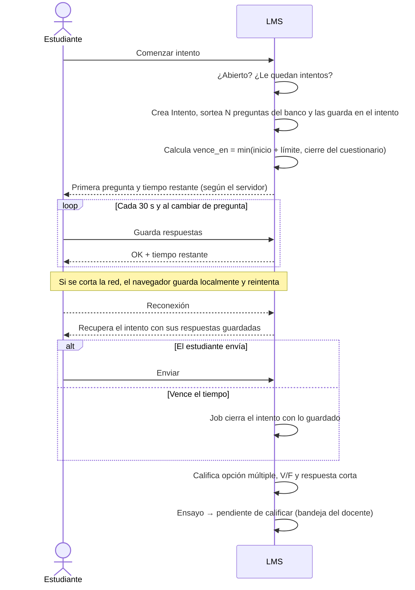

# Flujo · Resolución de cuestionario

## Reglas
- Las preguntas sorteadas **se fijan en el intento**: al recargar no cambian.
- Navegación «una a una»: el servidor rechaza respuestas a preguntas anteriores.
- La revisión (respuestas y justificación) se muestra solo cuando el docente la publica.
- Mientras tenga ensayos sin calificar, el intento queda «pendiente de calificar».
- Carga: 100 intentos simultáneos con `p95 < 2 s` ([[Pruebas de carga]]).
