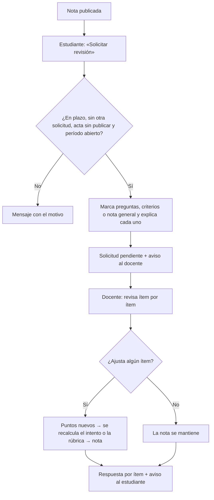

# Flujo · Solicitud de revisión

## Reglas
- Una solicitud por actividad, sin retiro; el Coordinador solo consulta.
- Cuestionario: la corrección y la solicitud se habilitan 10 minutos después del cierre.
- El docente puede dar una prórroga del plazo para pedir revisión.
- Si el acta ya se publicó, la nota solo la corrige el Coordinador ([[RF17]]).
