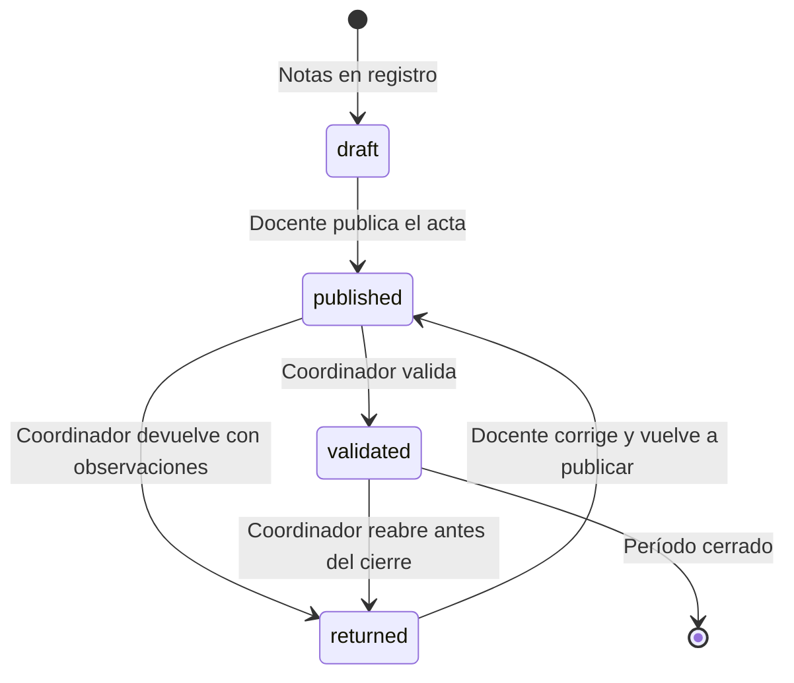
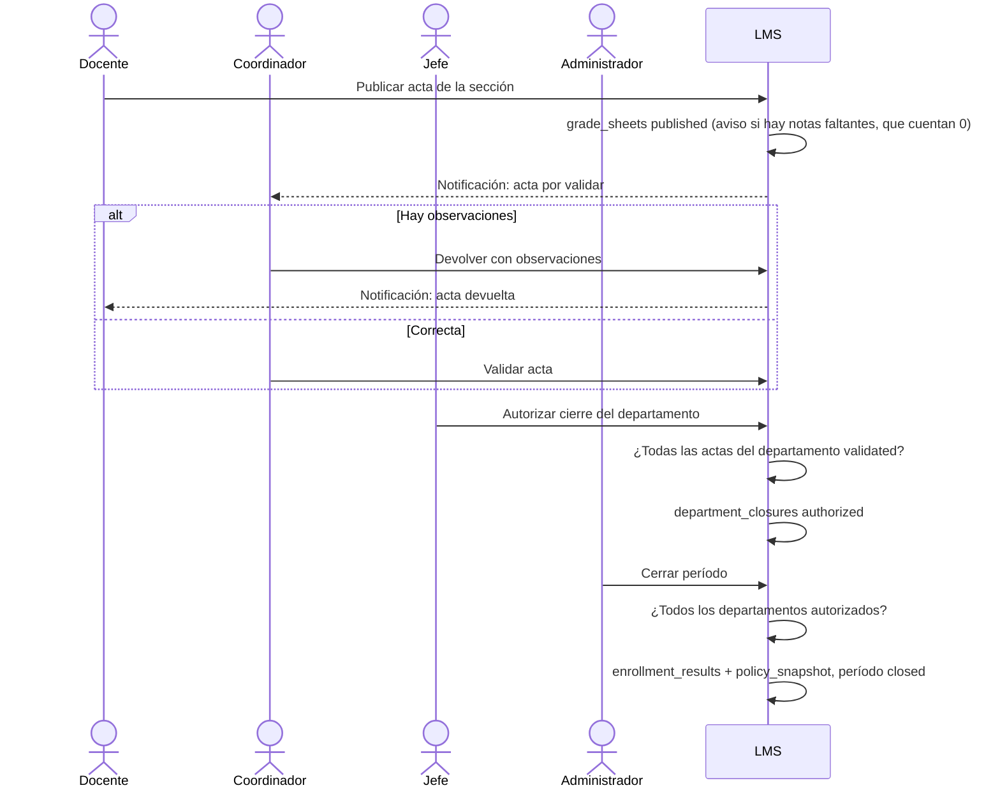

# Flujo · Validación de actas y cierre del período

**Actores:** [[Docente]], [[Coordinador]], [[Jefe de Departamento]], [[Administrador]].

## Estados del acta

## Del acta al cierre

## Reglas
- El Jefe solo autoriza su departamento (`department_heads` vigente). El Coordinador solo valida secciones de su carrera.
- Mientras el acta está `published` o `validated`, el docente no edita notas; para corregir hay que devolver el acta.
- Después del cierre, la única vía es la corrección auditada del Coordinador ([[Flujo Cálculo de nota final]]).
