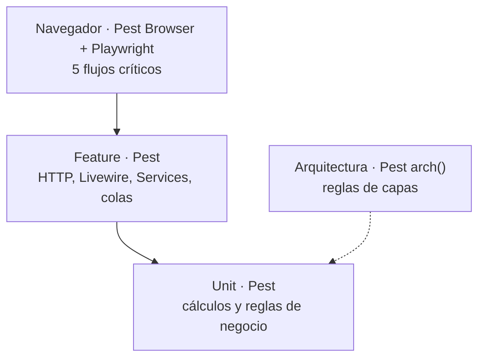

# Estrategia de pruebas

Decidida el 10/10/2026 ([[ADR-013 Pruebas con Pest]]).

## Pirámide


| Nivel | Qué prueba | Herramienta | Cuándo corre |
|---|---|---|---|
| **Unit** | Lógica pura: nota final con ponderación y redondeo, % de asistencia, suma de tiempos del reporte de Meet, penalización por tardanza, extracción aleatoria de preguntas, validación de GPS y vigencia del QR | Pest | Cada push |
| **Feature** | Rutas, componentes Livewire con su validación, Services con permiso y alcance por rol, jobs, notificaciones y eventos | Pest + `Livewire::test()` | Cada push |
| **Arquitectura** | Los controladores no usan Eloquent directo, los modelos no dependen de Livewire, no hay `dd()` ni `env()` fuera de config, **no existen clases Policy ni Gates** (salvo el Gate `viewHorizon` en `HorizonServiceProvider`) | Pest `arch()` | Cada push |
| **Navegador** | Los 5 flujos críticos de punta a punta | Pest Browser (Playwright) | PR a `test` y a `main` |
| **Carga** | 500 usuarios ([[RNF03]]) y 100 exámenes simultáneos ([[RNF10]]) | k6. Ver [[Pruebas de carga]] | Antes de cada release, contra `test` |
| **Estático** | Estilo PSR-12 y tipos | Pint + Larastan nivel 5 | Cada push |

## Flujos críticos en navegador
1. Inicio de sesión con Google: dominio válido, dominio rechazado y usuario no registrado ([[RF01]]).
2. Asistencia con QR: éxito, token rotado, sesión vencida, límite de intentos, fuera del área y dispositivo no autorizado ([[RF20]]).
3. Entrega de tarea: a tiempo, en gracia y rechazada ([[RF15]]).
4. Cuestionario con corte de red y reconexión sin pérdida ([[RF16]], [[RNF10]]).
5. Subida del reporte de Meet con filas sin asociar ([[RF21]]).

### Cómo se corren (desde el 18/10/2026)
- **Pest 4** + `pestphp/pest-plugin-browser` + Playwright (Chromium). Las pruebas viven en `tests/Browser/` y usan `Tests\BrowserTestCase`, que carga el build real de Vite. Antes de correrlas: `bun run build`.
- Comandos:
  - `vendor/bin/pest tests/Browser`: sin ventana;
  - `--headed`: se ve el navegador;
  - `--debug`: se detiene en el fallo.
- **Verlas despacio:** `php scripts/navegador.php [ruta] --speed=1.5` (o `composer test:browser -- [ruta] --speed=1.5`) abre la ventana y espera N segundos antes de cada paso (0,1 a 5; p. ej. 1, 1.5 o 2). Pest no acepta `--speed` directo; el script lo traduce a `VELOCIDAD_NAVEGADOR`, que aplica `navegar()` de `tests/Pest.php`. Las pruebas deben usar `navegar()` y no `visit()`.
  - **Límite conocido (22/10/2026):** con ventana, una corrida que pasa de ~1 min termina en «Target page, context or browser has been closed»; se reprodujo dos veces en `FlujoExamenTest` con `--speed=0.7` (a los 102 s y a los 152 s). Sin ventana, la misma prueba con `VELOCIDAD_NAVEGADOR=0.7` pasa en 54 s. Mientras no se resuelva: con ventana, use `--filter` y velocidades bajas en tramos cortos; para la prueba completa, `VELOCIDAD_NAVEGADOR=N vendor/bin/pest …` sin ventana.
- Las capturas de los fallos quedan en `tests/Browser/Screenshots` (ignorado por git).
- **Diálogos de `wire:confirm`:** Playwright los rechaza por defecto. La prueba los acepta con `$pagina->script('window.confirm = () => true')` después de cada navegación completa.
- **Datos:** los arma la propia prueba (`escenario()` y los servicios), con `RefreshDatabase`, incluso en SQLite en memoria. No usan la base local.
- **Antes de correrlas:** `bun run build` y `bunx playwright install --with-deps chromium`.
- Primera prueba: `tests/Browser/ResolverExamenTest.php`. El docente sube un examen (V/F, opción múltiple y respuesta corta) y el estudiante lo resuelve en el navegador hasta la nota. Falta la parte de corte de red del flujo 4.

## Reglas
- **Cobertura mínima de 70 %**, que **bloquea el merge**: `pest --coverage --min=70`, con PCOV, en `composer check` ([[RNF07]]); sin CI automática se corre en local antes del PR ([[ADR-061 Verificación local sin GitHub Actions]]).
- Cada criterio de aceptación de un RF tiene al menos un caso en [[Casos de prueba]].
- Todo defecto corregido lleva una prueba de regresión que lo reproduce.
- Los datos de prueba salen de factories y seeders; nunca de datos reales de estudiantes.

## Servicios externos simulados
| Servicio | Cómo se simula |
|---|---|
| Google (inicio de sesión) | `Socialite::shouldReceive()` con usuarios falsos de distintos dominios y `hd` |
| Google Calendar | Una interfaz `CalendarGateway` con implementación falsa en las pruebas |
| Correo | `Mail::fake()` / `Notification::fake()` |
| Colas y eventos | `Queue::fake()` / `Event::fake()` |
| Reverb | `Event::fake()` sobre los eventos broadcast |
| Token de dispositivo | Cookie `device_token` y `localStorage` inyectados en la petición; en navegador, Playwright fija la cookie y el `localStorage` |
| Almacenamiento | `Storage::fake()` |
| Reloj (rotación de 10 s, vigencia de la sesión, código de 30 s, cierres) | `$this->travel()` / `Carbon::setTestNow()` |
| GPS | Coordenadas inyectadas en la petición |

## Base de datos de pruebas
**SQLite en memoria por defecto, y PostgreSQL en local antes de cada PR a `main`** ([[ADR-033 Migraciones adaptativas]]).

| Suite | Local (por defecto) | Antes de `main` |
|---|---|---|
| Unit, Arch | Sin base de datos | Sin base de datos |
| Feature, Browser | SQLite `:memory:` con `RefreshDatabase` | Matriz: **SQLite** y **PostgreSQL 17** (`lms_test`) |

- Las pruebas de reglas propias de PostgreSQL (triggers, RLS, EXCLUDE, CHECK) usan `->skip(fn () => DB::connection()->getDriverName() !== 'pgsql', …)`. En SQLite se saltan; con PostgreSQL corren.
- Para correrlas en local con PostgreSQL: `DB_CONNECTION=pgsql DB_PORT=… DB_DATABASE=lms_test vendor/bin/pest tests/Feature`.
- **Las de RLS** (CP-RF05-03) se saltan también en PostgreSQL si el usuario de la conexión es superusuario o tiene `BYPASSRLS` (`rlsNoVerificable()`), que es lo normal en una base local. Para verificarlas, con un rol aparte:
  ```sql
  CREATE ROLE lms_app LOGIN PASSWORD 'lms' NOSUPERUSER NOBYPASSRLS CREATEDB;
  CREATE DATABASE lms_rls OWNER lms_app;
  -- En lms_rls, como superusuario: CREATE EXTENSION citext; CREATE EXTENSION btree_gist; GRANT ALL ON SCHEMA public TO lms_app;
  ```
  y `DB_DATABASE=lms_rls DB_USERNAME=lms_app vendor/bin/pest --filter=CP-RF05-03` (sin `--parallel`).
- Ejemplo vigente: `tests/Feature/Database/SchemaTest.php`, con tablas, únicos parciales, FK compuestas y vistas en ambos motores, y auditoría solo en PostgreSQL.
- Las escrituras de prueba en tablas auditadas usan `DbContext::system()`.
