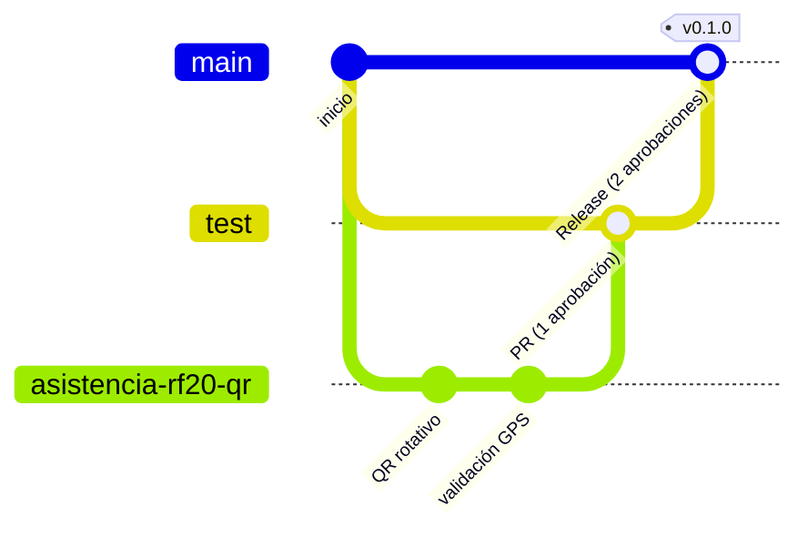

# Flujo de ramas y CI

Decidido el 10/10/2026 ([[ADR-014 Ramas y CI en GitHub Actions]]).

## Ramas
| Rama | Propósito | Protección |
|---|---|---|
| `main` | Producción | **Protegida.** Solo recibe PR desde `test`. Exige **2 aprobaciones**, CI en verde, navegador y k6 en verde. Sin push directo ni force-push |
| `test` | Integración y pruebas | Protegida. Recibe PR desde las ramas de módulo. Exige **1 aprobación** y CI en verde |
| `<modulo>-rfxx-<corto>` | Una por RF, creada desde `test`, p. ej. `asistencia-rf20-qr`. El nombre está en la propiedad `rama` de cada RF; la base técnica es `base-h0-tecnica` | Libre |
| `hotfix/<desc>` | Urgencias de producción | PR a `main` (2 aprobaciones); luego se une de vuelta a `test` |



## Pipeline (GitHub Actions)

> [!warning] Sin GitHub Actions desde el 31/10/2026 ([[ADR-061 Verificación local sin GitHub Actions]], pendiente)
> El workflow se borró. Las etapas de esta tabla se corren en local y su resultado va en la descripción del PR; «CI en verde» quiere decir esa verificación local.
| Etapa | PR a `test` | PR a `main` |
|---|---|---|
| Pint (`--test`) | ✅ | ✅ |
| Larastan nivel 5 | ✅ | ✅ |
| Pest unit, feature y arch con cobertura ≥ 70 % | ✅ | ✅ |
| Pest Browser (5 flujos críticos) | ✅ | ✅ |
| k6 contra **staging** | — | ✅ |
| Revisión humana | 1 | 2 |

```yaml
# .github/workflows/ci.yml (borrador)
name: CI
on:
  pull_request:
    branches: [test, main]
jobs:
  calidad:
    runs-on: ubuntu-latest
    strategy:
      matrix:
        db: [sqlite, pgsql]   # ADR-033: SQLite por defecto, PostgreSQL completo
    services:
      postgres:
        image: postgres:17-alpine
        env: { POSTGRES_DB: lms_test, POSTGRES_USER: lms, POSTGRES_PASSWORD: lms }
        ports: ['5432:5432']
        options: --health-cmd pg_isready --health-interval 5s --health-retries 10
    steps:
      - uses: actions/checkout@v4
      - uses: shivammathur/setup-php@v2
        with: { php-version: '8.4', coverage: pcov }
      - run: composer install --no-interaction --prefer-dist
      - run: cp .env.example .env && php artisan key:generate
      - run: vendor/bin/pint --test
      - run: vendor/bin/phpstan analyse --level=5
      - run: vendor/bin/pest --parallel --coverage --min=70
        env:
          DB_CONNECTION: ${{ matrix.db }}
          DB_HOST: 127.0.0.1
          DB_DATABASE: ${{ matrix.db == 'pgsql' && 'lms_test' || ':memory:' }}
          DB_USERNAME: lms
          DB_PASSWORD: lms
  navegador:
    needs: calidad
    runs-on: ubuntu-latest
    steps:
      - uses: actions/checkout@v4
      - uses: shivammathur/setup-php@v2
        with: { php-version: '8.4' }
      - uses: oven-sh/setup-bun@v2
      - run: composer install --no-interaction && bun install --frozen-lockfile && bun run build
      - run: bunx playwright install --with-deps chromium
      - run: vendor/bin/pest --group=browser
```

> [!info] Entornos ([[ADR-019 Entornos]])
> `test` se despliega en **staging** y `main` en **producción**. No hay previews por PR.

## Revisión de código
Lo que debe confirmar el revisor:
- [ ] El título del PR lleva el RF y `OP#<ID>` del paquete de trabajo de OpenProject, p. ej. `RF20 · Validación GPS (OP#123)` ([[OpenProject]]).
- [ ] Hay pruebas para cada criterio de aceptación tocado.
- [ ] Los Services exigen el permiso y aplican el alcance del rol ([[Matriz RBAC]]); no se agregaron Policies.
- [ ] Los cambios a entidades críticas quedan auditados ([[RNF02]]).
- [ ] Los textos están en español ([[RNF11]]).
- [ ] No hay secretos ni datos reales en el código.
