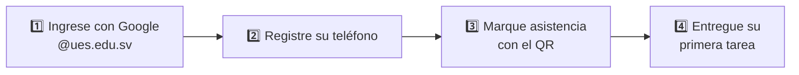
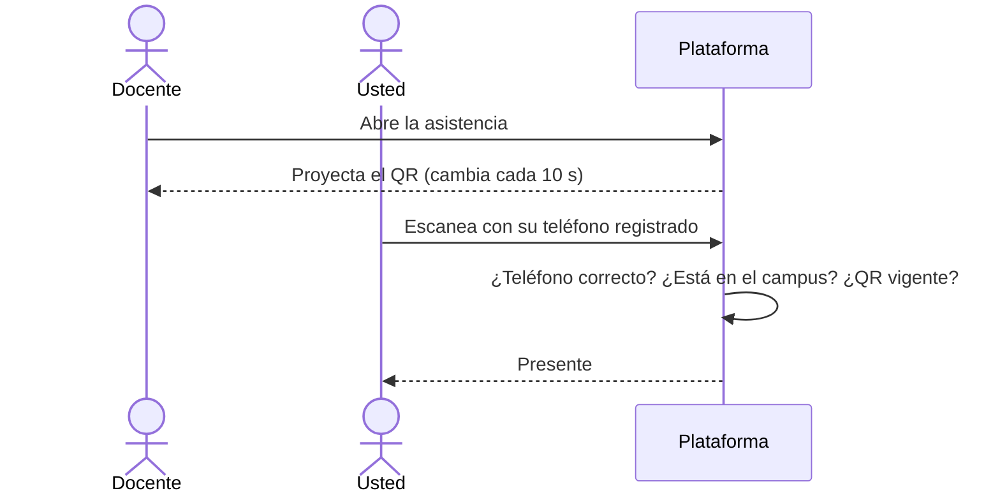

# Bienvenido a la plataforma

Guía corta para estudiantes de nuevo ingreso. Se hizo porque la pidieron en la [[Encuesta estudiantes]]: «una guía de uso amigable para los de nuevo ingreso, con dibujos».

## Sus primeros 4 pasos

### 1. Ingrese con su cuenta institucional
Pulse **Iniciar sesión con Google** y elija su correo **@ues.edu.sv** (por ejemplo `rr19118@ues.edu.sv`). Otras cuentas no funcionan.
> [!example] Ilustración pendiente
> Botón «Iniciar sesión con Google» y el selector de cuentas con la cuenta @ues.edu.sv resaltada.

### 2. Registre su teléfono (una sola vez)
Desde su teléfono: **Mi perfil → Dispositivo de asistencia → Registrar este teléfono**. No necesita huella ni PIN.
> [!warning] Solo un teléfono
> Si lo cambia o lo pierde, pida a Soporte Técnico que autorice el nuevo.

### 3. Marque asistencia en clase

En clases virtuales por Meet, entre **con su cuenta @ues.edu.sv** y permanezca al menos el 70 % de la clase.

### 4. Entregue su primera tarea
Abra la tarea, arrastre su archivo y pulse **Enviar entrega**. Revise antes la fecha límite y los formatos permitidos.
> [!example] Ilustración pendiente
> Tarjeta de la tarea con la fecha límite y la zona para arrastrar archivos.

## Dónde está cada cosa
| Quiero… | Vaya a… |
|---|---|
| Ver qué debo entregar | **Inicio**, en la lista de pendientes |
| Ver mis notas | **Mis notas** |
| Ver mi asistencia | **Mi asistencia** |
| Inscribirme con una clave | **Mis materias → Inscribirme con clave** |
| Elegir mis avisos | **Mi perfil → Notificaciones** |
| Ver de qué me avisan | Pulse el aviso en la **campana** o en **Notificaciones**: queda leído y lo lleva a la pantalla del evento |

Manual completo: [[Manual Estudiante]].
