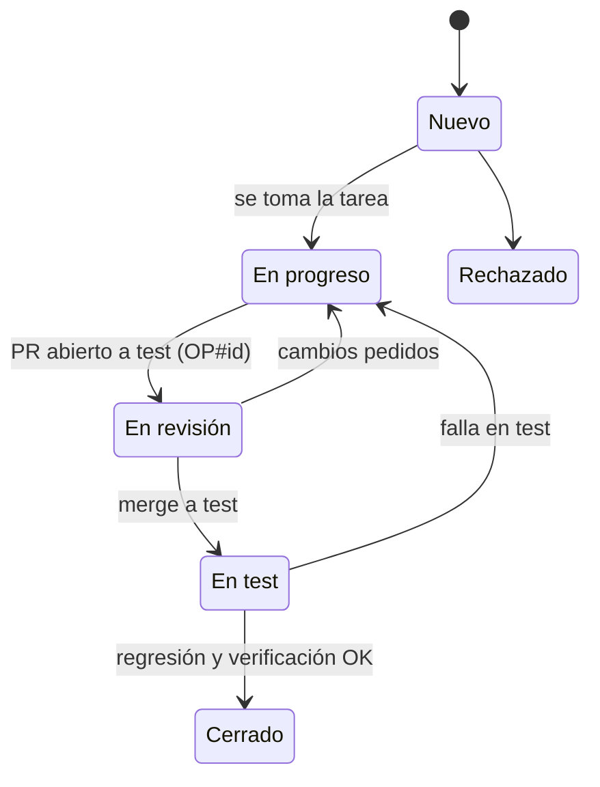

# OpenProject

**OpenProject es la fuente de verdad del trabajo:** tareas, hitos, defectos, horas y estado ([[ADR-025 OpenProject como gestor del trabajo]]). GitHub Issues y Projects **no se usan**.

## Instancia del proyecto
| Dato | Valor |
|---|---|
| URL | `https://project-api.drippshop.store` (OpenProject 15.5, detrás de Cloudflare) |
| Proyecto | **Plataforma LMS Académica**, identificador `plataforma-lms-academica` (id 4) |
| Desarrollo | Summary task **«Fase 4: Desarrollo del sistema»** (OP#356), junto a las fases 1–3 académicas |
| Base técnica | OP#368 |
| Carga inicial | 10/10/2026: 157 paquetes (1 fase, 2 hitos, 9 épicas, 33 features, 112 tareas), 5 versiones H0–H4 y 66 relaciones *follows* |
| ID por RF | Propiedad `op` de cada RF del vault (p. ej. RF20 → `op: 449`) |
| Campos personalizados | **No existen** en esta instancia: el equipo, el módulo, el hito y la rama van en la descripción de cada paquete. Si se crean después, el script los usará |
| Versión «Sprint 1» | Preexistente; no se usa en el desarrollo |

> [!note] Cloudflare
> El servidor rechaza el *User-Agent* por defecto de Python (error 1010). El script envía `lms-ues-openproject/1.0`.

## Quién es dueño de qué
| Dato | Dónde |
|---|---|
| Qué se construye: RF, criterios, ADR, ER, flujos | Vault (`docs/`) |
| Tareas, asignación, fechas, hitos, horas, estado, **defectos** | **OpenProject** |
| Código, PR, revisiones, CI | GitHub, con `OP#<ID>` |

## Configuración (admin, edición Community)
### 1. Proyecto
- Cree el proyecto **«LMS UES»** con el identificador `lms-ues`.
- Módulos: Paquetes de trabajo, **Gantt**, **Versiones**, Tableros, **Control de tiempo**, Wiki (opcional) y **GitHub**.
- Miembros: cree los grupos **Equipo 1** a **Equipo 5** y agréguelos al proyecto con el rol *Member*. Los líderes, con el rol *Project admin*.

### 2. Tipos (Administración → Paquetes de trabajo → Tipos)
Active en el proyecto: **Epic**, **Feature**, **Task**, **Bug** y **Milestone**. Vienen en la instalación por defecto; si su instancia está en español, el script también reconoce Épica, Funcionalidad, Tarea, Error e Hito.

| Tipo | Uso |
|---|---|
| Epic | Un módulo del vault (9) |
| Feature | Un RF (32) + «BASE · Base técnica» |
| Task | Back / Front / Test de cada RF, tareas de la base, widgets y reportes por equipo |
| Bug | Defectos, hijos del Feature del RF |
| Milestone | «Congelado del desarrollo» (18/11) y «Entrega LMS» (25/11) |

### 3. Campos personalizados (Administración → Campos personalizados → Paquetes de trabajo)
| Nombre exacto | Formato | Valores | Tipos |
|---|---|---|---|
| **RF** | Texto | p. ej. `RF20` | Epic, Feature, Task, Bug |
| **Módulo** | Lista | Los 9 módulos del vault, con sus nombres exactos | Epic, Feature, Task, Bug |
| **Equipo** | Lista | Equipo 1, Equipo 2, Equipo 3, Equipo 4, Equipo 5 | Epic, Feature, Task, Bug |

Marque los tres como «para todos los proyectos» o actívelos en el proyecto `lms-ues`.

### 4. Estados y flujo (Administración → Paquetes de trabajo → Estados / Flujo)


### 5. Prioridades
| Del vault | En OpenProject |
|---|---|
| Alta, Media-Alta | High |
| Media | Normal |
| Severidad de bug Crítica / Alta / Media / Baja | Immediate / High / Normal / Low |

### 6. Integración con GitHub
1. En OpenProject: *Administración → GitHub*, o el módulo GitHub del proyecto, y siga las instrucciones para el **webhook**.
2. En GitHub: *Settings → Webhooks* del repositorio, con la URL y el secreto que indica OpenProject, eventos **Pull requests** y **Check runs**.
3. Desde entonces, un PR o commit que contenga `OP#123` aparece en la pestaña **GitHub** del paquete de trabajo 123, con su estado y la CI.

### 7. Vistas recomendadas
- **Gantt** de todo el proyecto, filtrado por tipo Feature y Milestone: la ruta crítica del [[00 Plan de desarrollo]].
- **Un tablero o lista por equipo**: filtro `Equipo = Equipo N`, agrupado por estado.
- **Bugs abiertos** agrupados por prioridad.
- **Por hito**: agrupado por versión.

## Carga inicial desde el vault
Script: `scripts/openproject.py` ([[Plantilla del repositorio]]). Solo usa la biblioteca estándar de Python 3.

```bash
export OP_URL="https://openproject.su-dominio"      # Windows: $env:OP_URL="..."
export OP_TOKEN="<token>"                           # Mi cuenta → Tokens de acceso → API
export OP_PROYECTO="plataforma-lms-academica"
export LMS_VAULT="docs"

python scripts/openproject.py cargar --dry-run      # se conecta, solo lee, y muestra qué crearía
python scripts/openproject.py cargar                # crea lo que falta
```
Crea:
- 5 versiones (H0 a H4) y 2 milestones.
- 9 épicas, una por módulo.
- La Feature «Base técnica» con 8 tareas.
- 32 Features de RF, cada una con sus tareas Back, Front y Test. Test lleva como checklist los IDs `CP-RFxx-NN`.
- 8 tareas transversales de paneles y reportes.
- Relaciones **follows** según la propiedad `depende` de cada RF, y todas siguen a la Base.

Las fechas se fijan con *scheduleManually* para que las relaciones no las muevan.

> [!tip] Es idempotente
> Si se agrega un RF o cambia una dependencia en el vault, vuelva a correr `cargar`: solo crea lo que falta. **No borra ni modifica** lo existente; eso se hace en OpenProject.

## Uso diario
| Acción | Cómo |
|---|---|
| Tomar una tarea | Asígnesela y póngala en *En progreso* |
| Rama | La de la propiedad `rama` del RF, p. ej. `asistencia-rf20-qr`; también va en la descripción del Feature |
| Commits y PR | Incluyen `OP#123`; título del PR: `RF20 · Validación GPS (OP#123)` |
| Cambiar estado (personas o IA) | En la interfaz, o `python scripts/openproject.py estado 123 "En test"` |
| Comentar el avance (IA) | `python scripts/openproject.py comentar 123 "CP-RF20-01..04 pasan; falta el token de dispositivo"` |
| Reportar un defecto | En OpenProject, tipo Bug, o `python scripts/openproject.py bug --rf RF20 --titulo "QR acepta fuera del área" --severidad Alta` |
| Registrar horas | Control de tiempo en el paquete de trabajo (opcional, recomendado) |

> [!warning] Por verificar en su instancia
> El script usa la API v3 estándar. Antes de la carga real, corra `cargar --dry-run` con `OP_URL` definido: solo hace lecturas y muestra qué crearía. Si su versión de OpenProject nombra distinto algún tipo o estado, ajuste las listas `TIPOS` o el nombre del estado.

## Tiempos y costos
Configurado el 11/10/2026: se miden **horas** y un **costo simulado**, para el estudio de factibilidad económica.

**Estimaciones** (cargadas en las 110 tareas abiertas de desarrollo; los Features las suman):
- Tareas `RFxx · Back / Front / Test`: **2 h, 1,5 h y 1 h por caso de prueba** del RF, con un mínimo de 4 h por tarea.
- Por complejidad:
  - × **1,5** en riesgo técnico alto: RF09, RF16, RF17, RF20, RF21, RF27, RF34.
  - × **1,25** en riesgo medio: RF01, RF04, RF05, RF11, RF15, RF23, RF25, RF33.
- Otras tareas:
  - Widgets del panel: 6 h por equipo.
  - Reportes: 5 h por equipo.
  - BASE pendientes: 6 h (OP#371), 6 h (OP#372) y 8 h (OP#375).
- **Total: 1 013 h**, unas 7,8 h por persona por semana entre el 12/10 y el 25/11. Con 20 % de contingencia: 1 216 h.
- Las tareas de las fases 1 a 3 (investigación y documento) no se estimaron.

**Costo simulado:** tarifa de referencia de **US$ 6.50/h**. Equivale a un desarrollador junior de unos US$ 900 al mes más las prestaciones (ISSS, AFP, aguinaldo y vacaciones), entre 176 h al mes. Da **US$ 6 584.50**, o US$ 7 901.40 con contingencia.

**Cada integrante:**
- registra sus horas en su tarea (*Registrar tiempo*);
- ajusta la estimación si la tarea resulta más grande o más chica.

**Pendiente en la administración de OpenProject** (no se configura por API):
1. Moneda **USD**: Administración → Costos → Moneda `USD`, formato `%u %n`.
2. Activar en el proyecto los módulos **Tiempo y costos** y **Presupuestos**: Configuración del proyecto → Módulos.
3. Tarifa por hora por defecto de **6.50** para los 20 integrantes: Administración → Usuarios → *usuario* → Tarifas.
4. Presupuesto «Desarrollo del LMS»: 1 216 h · US$ 7 901.40.
5. Formato de duración en **horas** (no en días de 24 h): Administración → Configuración del sistema → Formato de duración.
