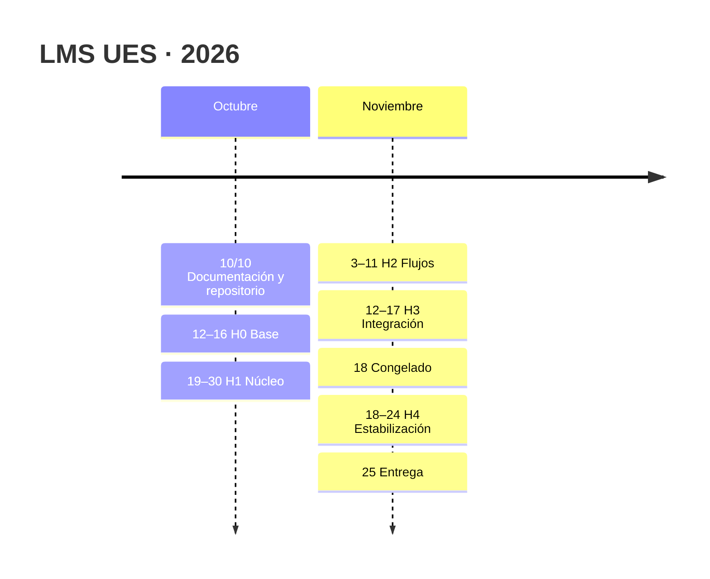

# Roadmap

Qué se entrega en cada hito y cuánto avance lleva cada módulo **en documentación y en código**. La tabla [[#Doc vs. código]] es la fuente del tablero **[Avance LMS UES](https://claude.ai/artifact/1QNY5M8X5WMjDYvNDDno98)**. El plan completo, con equipos, dependencias y riesgos, está en [[00 Plan de desarrollo]]; el trabajo diario se registra en [[OpenProject]].

## Hitos
| Hito | Fechas | Estado al 22/10 | Entrega |
|---|---|---|---|
| **H0 Base** | 12–16/10 | Cerrado, salvo CI en GitHub Actions (OP#375) y factories del resto de modelos; RF01 y RF03 listos | Base técnica completa, migraciones núcleo, roles sembrados, CI; RF01, RF03 |
| **H1 Núcleo** | 19–30/10 | En curso (día 4 de 10), adelantado: RF04, RF05, RF15 y RF16 ya funcionan; RF27 (token de dispositivo, [[ADR-045 Token de dispositivo]]) en desarrollo | RF04, RF05, RF06, RF07, RF08, RF11, RF15, RF16, RF19, RF23, RF26, RF27, RF28 |
| **H2 Flujos** | 3–11/11 | Pendiente (con código avanzado; RF35 ya implementado) | RF09, RF12, RF13, RF14, RF17, RF20, RF24, RF29, RF30, RF32, RF35 |
| **H3 Integración** | 12–17/11 | Pendiente | RF10, RF18, RF21, RF22, RF25, RF31, RF33, RF34 |
| **Congelado** | 18/11 | — | Solo correcciones desde aquí |
| **H4 Estabilización** | 18–24/11 | Pendiente | Regresión, k6, pruebas con docentes, capturas de los manuales |
| **Entrega** | **25/11** | — | `test` → `main` |

## Doc vs. código
**Corte: 22/10/2026 · commit `5e7beed` (RF01, RF16 y RF35, fusionados en `test` y `main`).**

| N.º | Módulo | Equipo | RF | CP | Peso | Doc. | Funcional | Hecho | Falta |
|---|---|---|---|---|---|---|---|---|---|
| M0 | Base técnica | E1 + E2 | — | — | 3 | 83 % | 75 % | Laravel 12, Livewire 4, Horizon, Reverb, Pest 4 con Playwright y Boost; migraciones del modelo v2 adaptativas con auditoría, inmutabilidad y RLS; Matriz RBAC sembrada; demo realista; layouts por rol; `Alcance`; 255 pruebas definidas, 18 de navegador (suite en verde al 18/10 según la Bitácora); zona horaria de El Salvador (ADR-041); PHP fijado en 8.4.27; Docker y Coolify (OP#518) | Factories del resto de modelos y CI en GitHub Actions (OP#375; `.github/` no tiene workflows). Doc.: hosting y archivos (ADR-020) |
| M1 | [[Identidad y acceso]] | E1 | RF01, RF03, RF04, RF27 | 34 | 7 | 83 % | 85 % | **RF01 completo** (OP#377): Google @ues.edu.sv con `hd` validado en el servidor, autorregistro sin rol (ADR-038), foto de Google (ADR-039); **RF04 completo** (OP#385): alta, edición, varios roles con su asignación, relevo con histórico, jerarquía de creación y asignación (ADR-037), auditoría de asignaciones y de permisos directos, desactivar cierra sesiones; RF03 roles y permisos; carga CSV por carrera; solicitudes de cambio de teléfono | Token de dispositivo (RF27), carga desde Excel y en cola. Doc.: aceptar ADR-036 y ADR-039, 2 puntos de la Matriz RBAC, cliente OAuth con TI |
| M2 | [[Gestión académica]] | E2 | RF06–RF10, RF29 | 33 | 6,5 | 83 % | 77 % | Períodos, catálogo, secciones sin choques, matrícula por ámbito, claves de auto-matrícula, cambio de grupo, estadísticas de oferta | Cerrar y reabrir el período, Google Calendar, Excel/PDF, notificaciones. Doc.: fórmula de proyección (RF10), calendario de evaluaciones, prioridad de RF29 |
| M3 | [[Contenidos]] | E3 | RF11–RF14 | 15 | 3 | 83 % | 67 % | Unidades, recursos, video, papelera, registro de aperturas, importación de unidades | Carpetas .zip, editor HTML, arrastrar y soltar, purga a 30 días. Doc.: flujo propio (subida, papelera, .zip) |
| M4 | [[Actividades y evaluaciones]] | E4 | RF15, RF16 | 15 | 3 | 100 % | 93 % | Tareas con tardías y rúbricas, cuestionarios con banco, tiempo en servidor y estadísticas; flujo del examen sin depender de Reverb (ADR-042): cierre automático de intentos vencidos, autoguardado inmediato y monitor del docente; prórrogas; revisión visible; 18 pruebas de navegador del examen | Entregas grupales. Doc.: aceptar ADR-042 |
| M5 | [[Calificaciones y progreso]] | E4 | RF17, RF18, RF34, RF35 | 31 | 6 | 83 % | 82 % | Cómputos, libro de notas, boleta, «en riesgo» y flujo de actas; **cierre del período por el Administrador** con el congelado de resultados (RF34-07 y 08, RF17-04; en `test`, sin contar en el corte del 22/10); **RF35 completo**: solicitud de revisión de una calificación con corrección a los 10 min y respuesta del docente (ADR-040) | Excel/PDF, finalización automática, bloqueo de notas con el acta publicada. «En riesgo» hoy solo se lee (nada crea las alertas). Doc.: reglamento académico, aceptar ADR-040 |
| M6 | [[Asistencia]] | E5 | RF19–RF22, RF26, RF28, RF32 | 39 | 8 | 83 % | 45 % | Sesiones, marcado manual, código temporal, justificaciones, clases canceladas, áreas, alertas en paneles | QR rotativo con GPS y token de dispositivo (RF20), Meet (RF21), envío de alertas (RF22). Doc.: reporte de Meet en el Workspace |
| M7 | [[Comunicación y notificaciones]] | E3 | RF23, RF30, RF31 | 11 | 2 | 67 % | 32 % | Bandeja de notificaciones, preferencias y foros | Envío por Reverb y correo, mensajería condicional (RF31). Doc.: flujo, prioridades de RF30 y RF31 |
| M8 | [[Dashboards y reportes]] | E1 + E2 | RF24, RF25, RF33 | 9 | 2 | 58 % | 83 % | Paneles por rol, reportes CSV por ámbito, reportes programados, KPIs docentes | Calendario del estudiante, envío de reportes en cola, Excel/PDF. Doc.: flujo, manual, fórmula de KPIs, prioridad de RF33 |
| M9 | [[Auditoría]] | E1 | RF05 | 5 | 1 | 67 % | 100 % | Triggers inmutables, consulta con filtros, CSV y RLS por departamento | Nada en código. Doc.: flujo y retención |

**Ponderados al corte:** documentación **81,9 %** · funcional **72,0 %** (Σ pesos = 41,5; 192 casos de prueba; 137,5 de 192 funcionan). En el vault, 47 de 192 casos figuran en `pasa`: RF01 (6), RF03 (1), RF04 (18), RF05 (1), RF08 (2), RF09 (2), RF15 (2), RF16 (6), RF29 (1) y RF35 (8).

> [!note] Cómo se obtuvo este corte
> - **Funcional:** se partió de la calificación del 15/10 y se sumaron los casos nuevos, todos con código en `main`: M1 +6,5 (4 de RF04 y 2,5 de RF01, que pasó de parcial a completo), M2 +3 (RF08 y RF09), M4 +3 (RF15 y RF16), M5 +8 (RF35); de 117 a 137,5. Los 2,5 de RF01 son una estimación, porque el corte anterior no desglosaba RF01. No se volvió a calificar caso por caso los módulos sin cambios.
> - **Documentación:** los porcentajes por módulo no cambian; el ponderado sube de 81,5 % a 81,9 % solo porque cambian los pesos. ADR-036, 039, 040, 041 y 042 siguen `pendiente`; si cuentan como decisión pendiente (criterio 6), M4 baja a 83 % y el ponderado a 81,5 %.
> - **Pruebas:** 255 definidas (`pest --list-tests`). El 22/10, tras `composer update`, la corrida con `--exclude-testsuite=Browser` dio 244 pasan y 8 saltadas (las que exigen PostgreSQL), sin fallos; las de navegador no se corrieron.

## Cómo se calcula
- **Peso:** los casos de prueba del módulo ÷ 5, redondeado a 0,5. Mide cuánto hay que construir. La base técnica pesa 3 por sus 8 tareas habilitantes.
- **Documentación:** 6 criterios por módulo, cada uno vale 1/6:
  1. RF con criterios de aceptación;
  2. casos de prueba (CP);
  3. al menos un flujo en `08 Flujos/`;
  4. su sección en el diagrama ER;
  5. tareas en el manual de usuario;
  6. **sin decisiones ni insumos pendientes**.
- **Funcional:** desde el corte del 11/10, cada caso CP vale 1 si funciona en `main`, 0,5 si funciona en parte y 0 si falta; el módulo es la suma entre sus casos. En la base técnica, sus 8 tareas en OpenProject. Los casos en `pasa` (automatizados con su ID) se informan aparte.
- **Ponderado** = Σ (avance × peso) ÷ Σ pesos.

## Cómo se actualiza
1. Cada **viernes**, y al cerrar cada hito, el líder técnico (o la IA a pedido) actualiza la tabla con un nuevo corte: fecha y commit de `test`.
2. El avance funcional se cuenta caso por caso contra `main`; los CP en `pasa` se marcan al automatizar ([[Directrices de IA]]).
3. Se agrega una fila al historial y se republica el [tablero](https://claude.ai/artifact/1QNY5M8X5WMjDYvNDDno98) con los mismos datos.

## Historial de cortes
| Fecha | Commit | Doc. | Código / funcional | Nota |
|---|---|---|---|---|
| 10/10/2026 | `af5811b` | 80,9 % | 2,5 % | Línea base: documentación completa en primera versión, repositorio creado, plan en OpenProject |
| 10/10/2026 | (sin commit) | 81,0 % | 2,3 % | Modelo de datos v2 (diseño de @Alex), ADR-027 a ADR-031; 148 CP; los pesos se recalcularon |
| 10/10/2026 | (sin commit) | 81,5 % | 2,1 % | Revisión del documento de roles (ADR-032): nuevo RF34 (actas), 166 CP |
| 11/10/2026 | (sin commit) | 81,5 % | 3,3 % | Migraciones adaptativas del modelo v2 (ADR-033), probadas en SQLite y PostgreSQL |
| 11/10/2026 | `390f7bf` | 81,5 % | 4,1 % | Seeders: roles y permisos, estructura institucional y demo realista |
| 11/10/2026 | (sin commit) | 81,5 % | 5,1 % | Layouts, menú unificado, componentes UI e inicio de sesión de desarrollo (OP#370, OP#374) |
| 11/10/2026 | `6d78ac2` | 81,5 % | 66,7 % | Cambio de método a «funcional» (casos que funcionan en `main`, aunque la prueba aún no lleve su ID); cierres rápidos RF03 RF05 RF09 RF16 RF29 |
| 15/10/2026 | `f0c34c8` | 81,5 % | 68,1 % | RF04 completo (OP#385): 14 CP en `pasa`; CP-RF04 pasa de 6 a 14 casos (174 en total) y M1 pesa 6 |
| 22/10/2026 | `5e7beed` | 81,9 % | 72,0 % | RF01 completo (OP#377), RF04 con jerarquía (ADR-037), RF35 completo y flujo del examen de RF16 (ADR-042); 192 CP (47 en `pasa`), pesos recalculados (Σ 41,5); pruebas de navegador con Pest 4; PHP fijado en 8.4.27 |
