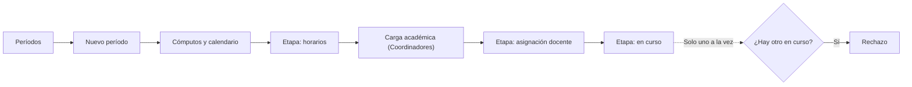
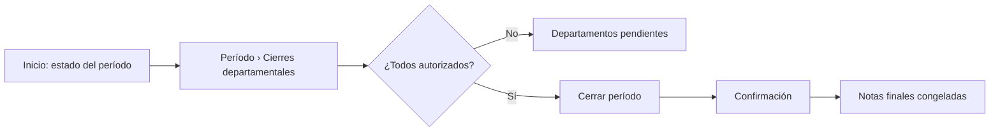
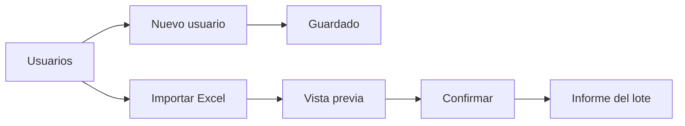
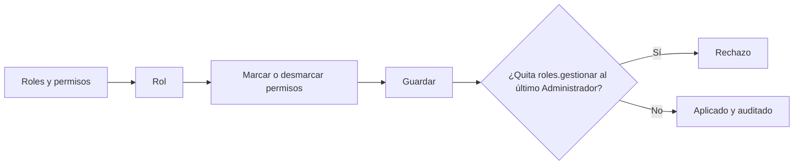

# Layout · Administrador

Usa el [[Layout base#Layout Aplicación|Layout Aplicación]]. Permisos con alcance **G** (global) ([[Matriz RBAC]]). **No ve contenidos ni notas** de los cursos ([[ADR-032 Ajustes por el documento de roles]]): por eso no entra a la [[Vista de sección]]. Con la **cuenta de emergencia** ve el mismo layout, con la franja roja de aviso ([[ADR-007 Inicio de sesión con Google]]).

## Menú
```
Inicio
── Administración ──
Usuarios
Roles y permisos
Períodos
Catálogo
Carga académica
Matrícula
Áreas de asistencia
Clases canceladas
Integraciones
Colas
── Consultas ──
Reportes
Estadísticas de oferta
Auditoría
── Cuenta ──
Mi perfil
Ayuda
Cerrar sesión
```

## Árbol de vistas
```
Layout Aplicación · Administrador
├── Inicio ................................ /inicio ............................ RF24
│   ├── Matrícula total del período y carga docente
│   ├── Bajo rendimiento y asistencia global
│   ├── Actividad en la plataforma (usuarios activos, accesos)
│   ├── Alertas de inconsistencias
│   ├── Estado del período: etapa y cierres departamentales ........... RF06, RF34
│   └── Estado técnico: colas y trabajos fallidos (enlace a Colas)
├── Usuarios .............................. /usuarios .......................... RF04
│   ├── Listado: filtros por rol, carrera, estado y lote
│   ├── Nuevo usuario (modal): correo @ues.edu.sv, nombres, rol, carrera
│   ├── Importar Excel ................... /usuarios/importar
│   │   └── Vista previa → Confirmar → Informe del lote
│   ├── Lotes ............................ /usuarios/lotes
│   └── Usuario .......................... /usuarios/{usuario}
│       ├── Datos · roles · asignaciones vigentes e historial
│       ├── Historial de accesos
│       └── Desactivar (motivo) · Reactivar · (nunca eliminar)
├── Roles y permisos ...................... /roles ............................. RF03
│   ├── Roles con su número de usuarios
│   └── Rol → matriz de permisos (asignar o revocar; no crea permisos nuevos)
│       └── Aviso: no se puede quitar roles.gestionar al último Administrador
├── Períodos .............................. /periodos .......................... RF06
│   ├── Listado: activo, en planificación, cerrados
│   ├── Nuevo período: nombre, fechas, plantilla de cómputos
│   └── Período .......................... /periodos/{periodo}
│       ├── Etapa: planificación → horarios → asignación docente → en curso → cerrado
│       ├── Cómputos (plantilla): fechas y pesos
│       ├── Calendario de evaluaciones → sincronizar con Google Calendar
│       ├── Cierres departamentales: autorizados / pendientes ......... RF34
│       ├── Cerrar período (solo con todos autorizados)
│       ├── Reabrir (motivo obligatorio; avisa a los Coordinadores)
│       └── Exportar histórico (Excel o PDF)
├── Catálogo .............................. /catalogo
│   ├── Asignaturas ...................... /catalogo/asignaturas ............. RF07
│   │   └── Código, nombre, créditos, departamento, prerrequisitos
│   ├── Departamentos, carreras y planes
│   └── Aulas
├── Carga académica ....................... /carga-academica ................. RF08
│   └── Igual que el Coordinador, en todas las carreras (Layout Coordinador)
├── Matrícula ............................. /matricula ........................ RF09
│   └── Inscribir o retirar en cualquier carrera (sin claves ni solicitudes)
├── Áreas de asistencia ................... /areas-asistencia ................ RF26
│   └── Área → mapa: centro y radio, o polígono · margen GPS · activar
├── Clases canceladas ..................... /clases-canceladas ............... RF32
│   └── Cancelar para toda la facultad (asuetos) o una carrera
├── Integraciones ......................... /integraciones ................... RNF09
│   └── Google OAuth y Calendar · correo (SMTP)
├── Colas ................................. /horizon (panel de Horizon) ...... horizon.ver
├── Reportes .............................. /reportes ......................... RF25
├── Estadísticas de oferta ................ /oferta ........................... RF10
├── Auditoría ............................. /auditoria ........................ RF05
│   └── Todos los eventos · filtros · detalle · exportar
├── Notificaciones ........................ /notificaciones
└── Mi perfil ............................. /perfil
    ├── Datos personales · Notificaciones · Sesiones
    └── Seguridad (2FA): solo con la cuenta de emergencia
```

## Flujos de navegación
**Preparar un período nuevo** ([[Ciclo de vida del período académico]])


**Cerrar el período** ([[Flujo Validación de actas y cierre]])


**Dar de alta usuarios** ([[Flujo Carga masiva de usuarios]])


**Cambiar los permisos de un rol** ([[RF03]])

