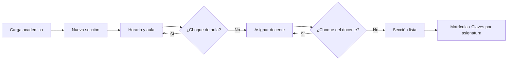
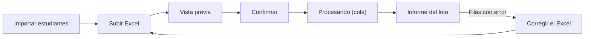
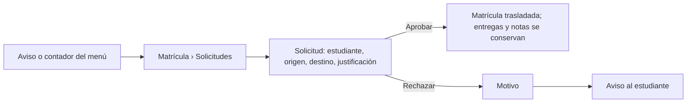
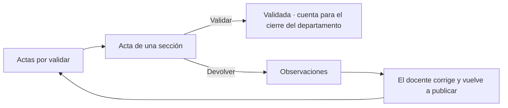

# Layout · Coordinador

Usa el [[Layout base#Layout Aplicación|Layout Aplicación]]. Permisos con alcance **C** (su carrera) ([[Matriz RBAC]]). El Coordinador de ISI **también es docente**: con el menú unificado ve los grupos **Docencia** y **Coordinación** a la vez ([[Layout Docente]]).

## Menú
```
Inicio
── Coordinación ──
Supervisión de aulas
Carga académica
Matrícula (3)
Importar estudiantes
Actas por validar (5)
Clases canceladas (1)
── Consultas ──
Reportes
Estadísticas de oferta
── Cuenta ──
Mi perfil
Ayuda
Cerrar sesión
```
Los contadores muestran lo que espera su decisión: solicitudes de cambio de grupo, actas publicadas y solicitudes de cancelación.

## Árbol de vistas
```
Layout Aplicación · Coordinador
├── Inicio ................................ /inicio ............................ RF24
│   ├── Matrícula total del período por ciclo y sección
│   ├── Carga docente: horas y secciones por docente
│   ├── Bajo rendimiento y asistencia de la carrera
│   ├── Actividad en la plataforma
│   ├── Alertas de inconsistencias: secciones sin docente, sobrecupo, choques
│   └── Pendientes: cambios de grupo · actas · cancelaciones
├── Supervisión de aulas .................. /secciones?ambito=carrera ........ RF03
│   ├── Secciones de su carrera: filtros por ciclo, asignatura y docente
│   └── Sección → Vista de sección (solo lectura)
│       ├── Contenidos · Actividades · Notas · Asistencia · Analítica (lectura)
│       ├── Notas › Corregir nota (período cerrado, motivo obligatorio) ...... RF17
│       └── Estudiantes › Inscribir · Retirar con motivo ...................... RF09
├── Carga académica ....................... /carga-academica ................. RF08
│   ├── Secciones del período por asignatura: grupo, cupo, docente, horario
│   ├── Nueva sección: asignatura, grupo, cupo mínimo y máximo
│   ├── Sección → horario (día, hora, aula) con validación de choques
│   ├── Asignar docentes (uno responsable) · Reasignar con fecha
│   └── Carga por docente
├── Matrícula ............................. /matricula
│   ├── Claves por asignatura ............ /matricula/claves ................ RF29
│   │   └── Generar o cambiar clave · vigencia · activar o desactivar
│   ├── Inscribir o retirar estudiantes .. /matricula/estudiantes ........... RF09
│   │   └── Buscar estudiante → asignatura → sección (cupo, duplicado, choque)
│   └── Solicitudes de cambio de grupo ... /matricula/solicitudes ........... RF09
│       └── Aprobar · Rechazar con motivo (plazo de 3 semanas)
├── Importar estudiantes .................. /usuarios/importar ............... RF04
│   ├── Subir Excel (carné, nombres, apellidos, correo, rol, carrera, plan, ciclo)
│   ├── Vista previa: válidos · duplicados · errores con su motivo
│   ├── Confirmar → se procesa en cola
│   └── Lotes anteriores ................. /usuarios/lotes/{lote}
├── Actas por validar ..................... /actas ............................ RF34
│   └── Acta → resumen por estudiante → Validar · Devolver con observaciones
├── Clases canceladas ..................... /clases-canceladas ............... RF32
│   ├── Solicitudes de los docentes → Aprobar · Rechazar
│   └── Cancelar clases de la carrera (fecha, motivo)
├── Reportes .............................. /reportes ......................... RF25
│   ├── Asistencia, notas, progreso, carga docente, bajo rendimiento
│   └── Programar envío por correo (semanal o mensual)
├── Estadísticas de oferta ................ /oferta ........................... RF10
│   └── Ingresados, egresados, aprobados, reprobados y propuesta de grupos
├── Notificaciones ........................ /notificaciones
└── Mi perfil ............................. /perfil
    ├── Datos personales: carrera que coordina y desde cuándo (solo lectura)
    ├── Notificaciones
    └── Sesiones
```

## Flujos de navegación
**Preparar el período: secciones y docentes** ([[Ciclo de vida del período académico]])


**Cargar estudiantes de nuevo ingreso** ([[Flujo Carga masiva de usuarios]])


**Atender un cambio de grupo** ([[Flujo Matrícula y cambio de grupo]])


**Validar actas** ([[Flujo Validación de actas y cierre]])


**Corregir una nota de un período cerrado** ([[RF17]])

