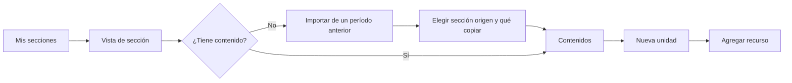
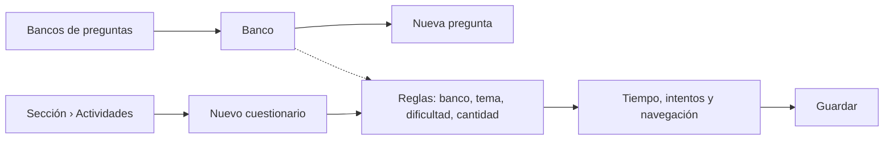
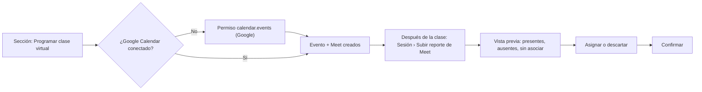
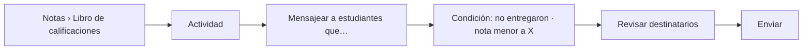
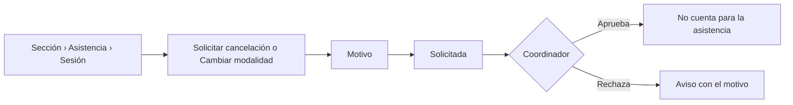

# Layout · Docente

Usa el [[Layout base#Layout Aplicación|Layout Aplicación]] y, para mostrar el QR en clase, el **Layout Proyección**. Casi todo su trabajo ocurre dentro de la [[Vista de sección]]. Permisos con alcance **S** (las secciones que imparte) ([[Matriz RBAC]]).

## Menú
```
Inicio
── Docencia ──
Mis secciones
Pendientes de calificar (12)
Bancos de preguntas
── Consultas ──
Reportes
── Cuenta ──
Mi perfil
Ayuda
Cerrar sesión
```

## Árbol de vistas
```
Layout Aplicación · Docente
├── Inicio ................................ /inicio ............................ RF24
│   ├── Clases de hoy, con [Abrir asistencia] en la que corresponde
│   ├── Pendientes de calificar: tareas y ensayos (bandeja)
│   ├── Matrícula por grupo y carga académica
│   ├── Asistencia por sección y estudiantes en alerta .................. RF22
│   ├── Bajo rendimiento: estudiantes en riesgo
│   ├── Próximas videoconferencias
│   └── Actas devueltas por el Coordinador (si hay) ..................... RF34
├── Mis secciones ......................... /secciones?ambito=propias
│   ├── Tarjetas o tabla: asignatura, grupo, horario, matriculados, alertas
│   └── Sección → Vista de sección ..... /secciones/{seccion}
│       ├── Contenidos: unidades, recursos, papelera, importar ...... RF11–RF14
│       ├── Actividades: tareas, cuestionarios, entregas ........... RF15, RF16
│       ├── Notas: libro de calificaciones, progreso, acta ...... RF17, RF18, RF34
│       ├── Asistencia: sesiones, QR, código, Meet, cancelación . RF19–RF21, RF28, RF32
│       ├── Foro: participar y moderar ................................ RF30
│       ├── Estudiantes: lista e inscribir ............................ RF09
│       └── Analítica: mapa de calor .................................. RF13
├── Pendientes de calificar ............... /pendientes-de-calificar ........ RF15, RF16
│   ├── Filtros: sección · actividad · tardías
│   └── Calificar → entrega o ensayo → siguiente (anónima si aplica)
├── Bancos de preguntas ................... /bancos-de-preguntas ............. RF16
│   ├── Mis bancos y los compartidos conmigo
│   ├── Nuevo banco (asignatura)
│   └── Banco → preguntas
│       ├── Nueva pregunta: opción múltiple · V/F · respuesta corta · ensayo
│       ├── Tema, dificultad, respuestas aceptadas y justificación
│       └── Compartir con otro docente
├── Reportes .............................. /reportes ......................... RF25
│   └── Asistencia, notas y progreso de sus secciones → Excel o PDF
├── Notificaciones ........................ /notificaciones
└── Mi perfil ............................. /perfil
    ├── Datos personales: departamento y secciones asignadas (solo lectura)
    ├── Google Calendar: conectado o no · Conectar · Desconectar
    ├── Notificaciones
    └── Sesiones
```

## Layout Proyección
`/secciones/{seccion}/asistencia/{sesion}/proyectar`, en pantalla completa para el proyector del aula ([[RF20]], [[ADR-028 QR rotativo]]).
```
┌────────────────────────────────────────────────────┐
│  PRN115 · Grupo 01 · Asistencia                    │
│                                                    │
│                ████████████████                    │
│                ██  QR (rota  ██                    │
│                ██  cada 10 s)██                    │
│                ████████████████                    │
│                                                    │
│   Cierra en 12:41          Registrados: 27 / 38    │
│                     [Salir de la proyección]       │
└────────────────────────────────────────────────────┘
```
- El QR **cambia cada 10 s** y se dibuja en el navegador; una foto compartida ya no sirve.
- **No muestra nombres** ni rechazos: esa información se ve en la vista de la sesión, en el equipo del docente, no en el proyector.
- Al vencer la sesión, la pantalla muestra «Sesión cerrada» y el resumen.

## Flujos de navegación
**Organizar el curso al inicio del período** ([[RF11]], [[RF14]])


**Crear un cuestionario** ([[Flujo Resolución de cuestionario]])


**Clase virtual** ([[Flujo Asistencia virtual con reporte de Meet]])


**Escribir a estudiantes que no entregaron** ([[RF31]])


**Cancelar o cambiar de modalidad una clase** ([[RF32]])

