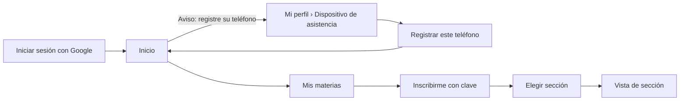
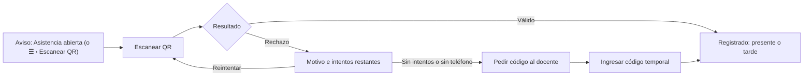
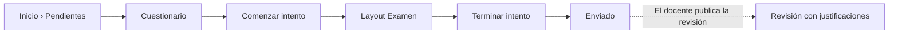
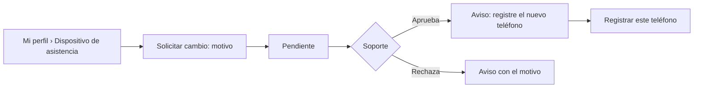
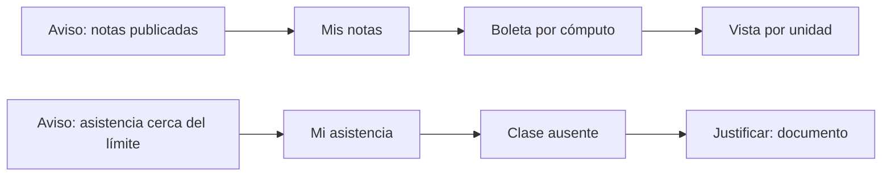

# Layout · Estudiante

Usa el [[Layout base#Layout Aplicación|Layout Aplicación]] y, al resolver un cuestionario, el **Layout Examen**. El estudiante entra sobre todo **desde el teléfono**: cada vista se diseña primero para 360 px ([[RNF05]]). Permisos con alcance **M** (sus materias) y **P** (lo propio) ([[Matriz RBAC]]).

## Menú
```
Inicio
── Estudio ──
Escanear QR
Mis materias
Mis notas
Mi asistencia
── Cuenta ──
Mi perfil
Ayuda
Cerrar sesión
```

## Árbol de vistas
```
Layout Aplicación · Estudiante
├── Inicio ................................ /inicio ............................ RF24
│   ├── [Aviso] Asistencia abierta · Marcar
│   ├── Pendientes ordenados por fecha: tareas y cuestionarios
│   ├── Calendario: evaluaciones y clases virtuales
│   ├── Mis materias: tarjeta con barra de avance ........................ RF18
│   ├── Últimas notas publicadas y retroalimentación
│   ├── Porcentaje de asistencia y alertas (85 % · 78 % · 75 %) .......... RF22
│   └── Próximas videoconferencias con su enlace de Meet ................. RF21
├── Escanear QR ........................... /asistencia/escanear ............. RF20
│   ├── Permisos: cámara y ubicación (si los niega, explica cómo activarlos)
│   ├── Lector del QR proyectado → resultado: registrado · tarde · rechazo con motivo
│   ├── Intentos restantes (máximo 3 por sesión)
│   └── Ingresar código temporal (6 dígitos, 30 s) ....................... RF28
├── Inscripción de materias ............... /inscripcion ..................... RF29
│   ├── Materias de su carrera del ciclo en curso (I: ciclos impares del plan; II: pares)
│   └── Materia ........................... /inscripcion/{asignatura}
│       ├── Descripción (la escriben sus docentes) y grupos con docente, horario y cupo
│       └── Inscribirme con clave (modal): elegir grupo con cupo y sin choque + clave
├── Mis materias .......................... /materias
│   ├── Tarjetas de las materias del período, con avance
│   ├── Períodos anteriores (solo lectura)
│   └── Materia → Vista de sección ..... /secciones/{seccion}
│       ├── Contenidos · Actividades · Notas · Asistencia · Foro
│       └── Solicitar cambio de grupo (3 primeras semanas) ............... RF09
├── Mis notas ............................. /mis-notas ......................... RF17
│   ├── Boleta del período: por materia y cómputo, con pesos
│   ├── Vista por unidad
│   └── Historial de períodos cerrados (notas finales y resultado)
├── Mi asistencia ......................... /mi-asistencia ..................... RF22
│   ├── Porcentaje por materia y cómputo, con su alerta
│   ├── Detalle por clase: presente · tarde · ausente · justificada, y método
│   └── Justificar inasistencia: motivo + documento → pendiente · aceptada · rechazada
├── Notificaciones ........................ /notificaciones .................... RF23
└── Mi perfil ............................. /perfil
    ├── Datos personales: nombre, correo, carné, carrera, plan, ciclo (solo lectura)
    ├── Dispositivo de asistencia ......... /perfil/dispositivo ............... RF27
    │   ├── Registrar este teléfono (token de dispositivo)
    │   ├── Teléfono activo: fecha de registro y último uso
    │   └── Solicitar cambio: motivo (+ justificación si cambió hace < 30 días)
    ├── Notificaciones: qué avisos recibe también por correo
    └── Sesiones: cerrar las sesiones abiertas en otros equipos
```

## Layout Examen
Al pulsar **Comenzar intento**, el cuestionario se abre en `/intentos/{intento}`, sin menú ni campana, para evitar distracciones ([[RF16]], [[Flujo Resolución de cuestionario]]).
```
┌──────────────────────────────────────────────────┐
│ Parcial 1 · PRN115          ⏱ 42:15   ✓ Guardado │
├──────────────────────────────────────────────────┤
│ Pregunta 3 de 10                                 │
│ ...                                              │
│ ○ Opción A   ○ Opción B   ○ Opción C             │
├──────────────────────────────────────────────────┤
│ [◀ Anterior]   1 2 ③ 4 5 6 7 8 9 10   [Siguiente ▶] │
│                              [Terminar intento]  │
└──────────────────────────────────────────────────┘
```
- **Temporizador del servidor**: sigue corriendo aunque cierre la página; al llegar a 0 se envía solo.
- **Autoguardado** cada 30 s, con estado visible: «Guardado», «Guardando…», «Sin conexión: se guardará al volver».
- **Navegación**: libre (con números) o **una a una** (sin «Anterior»), según el cuestionario.
- **Terminar intento**: modal que avisa cuántas preguntas quedan sin responder.

## Flujos de navegación
**Primer ingreso**


**Marcar asistencia en clase presencial** ([[Flujo Asistencia con QR]], [[Flujo Código temporal]])


**Resolver un cuestionario**


**Cambiar de teléfono** ([[Flujo Registro y cambio de dispositivo]])


**Consultar notas y justificar una falta**

