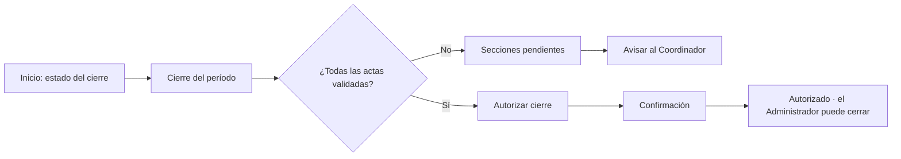
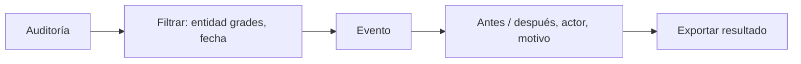

# Layout · Jefe de Departamento

Usa el [[Layout base#Layout Aplicación|Layout Aplicación]]. Permisos con alcance **D** (su departamento) ([[Matriz RBAC]]). Si además da clases, tiene el rol Docente y ve también el grupo **Docencia** ([[Layout Docente]]). No asigna docentes ([[ADR-032 Ajustes por el documento de roles]]).

## Menú
```
Inicio
── Jefatura ──
Secciones del departamento
Cierre del período
Desempeño docente
── Consultas ──
Reportes
Estadísticas de oferta
Auditoría
── Cuenta ──
Mi perfil
Ayuda
Cerrar sesión
```

## Árbol de vistas
```
Layout Aplicación · Jefe de Departamento
├── Inicio ................................ /inicio ............................ RF24
│   ├── Estado del cierre: actas validadas / total por carrera ........ RF34
│   ├── Resumen de desempeño docente del departamento ................. RF33
│   ├── Matrícula y bajo rendimiento del departamento
│   └── Últimos eventos de auditoría del departamento ................. RF05
├── Secciones del departamento ............ /secciones?ambito=departamento
│   ├── Secciones de las carreras del departamento: filtros por carrera y asignatura
│   └── Sección → Vista de sección (cabecera + Estudiantes)
│       └── Estudiantes › Inscribir ............................... RF09
├── Cierre del período .................... /cierre ........................... RF34
│   ├── Actas del departamento por carrera: publicada · validada · devuelta · pendiente
│   ├── Secciones que faltan (si hay)
│   └── Autorizar cierre (solo con todas validadas) → confirmación
├── Desempeño docente ..................... /desempeno-docente ............... RF33
│   ├── Por docente: puntualidad, recursos subidos, tiempo de revisión
│   ├── Docente → detalle por sección
│   └── Exportar a Excel o PDF
├── Reportes .............................. /reportes ......................... RF25
│   └── Del departamento · Programar envío por correo
├── Estadísticas de oferta ................ /oferta ........................... RF10
│   └── Ingresados, egresados, aprobados, reprobados y propuesta de grupos
├── Auditoría ............................. /auditoria ........................ RF05
│   ├── Solo eventos de su departamento (RLS, ADR-029)
│   ├── Filtros: usuario, fecha, acción, entidad
│   ├── Evento → valores anterior y nuevo, motivo, IP
│   └── Exportar
├── Notificaciones ........................ /notificaciones
└── Mi perfil ............................. /perfil
    ├── Datos personales: departamento que dirige y desde cuándo (solo lectura)
    ├── Notificaciones
    └── Sesiones
```

## Flujos de navegación
**Autorizar el cierre del departamento** ([[Flujo Validación de actas y cierre]])


**Revisar un evento en la auditoría** ([[ADR-029 Auditoría departamental del Jefe]])


**Revisar el desempeño docente** ([[RF33]])

