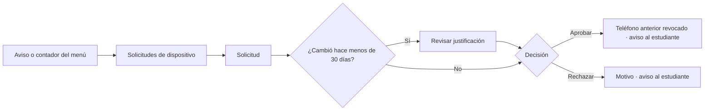
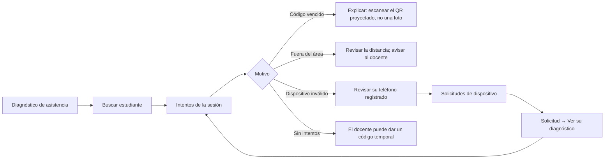

# Layout · Soporte Técnico

Usa el [[Layout base#Layout Aplicación|Layout Aplicación]]. Permisos con alcance **G**, pero **sin privilegios académicos**: no matricula ni cambia asistencia ([[ADR-032 Ajustes por el documento de roles]], [[Matriz RBAC]]). Sobre las cuentas **sí** actúa: crea y corrige estudiantes y hace la carga masiva ([[ADR-037 Jerarquía de creación y asignación de roles]], [[ADR-047 Carreras visibles y carga masiva sin el Coordinador]]), así que la opción del menú es **Usuarios**, no «Usuarios (consulta)».

## Menú
```
Inicio
── Soporte ──
Solicitudes de dispositivo (2)
Diagnóstico de asistencia
Usuarios
Importar estudiantes
── Cuenta ──
Mi perfil
Ayuda
Cerrar sesión
```
El número junto a «Solicitudes de dispositivo» son las pendientes; lo calcula `App\Support\Navegacion\Contadores` con la clave `dispositivos-pendientes` declarada en `config/navegacion.php`. El aviso que acompaña al contador es `device_request.pending`, para quien tenga `dispositivos.gestionar`.

## Árbol de vistas
```
Layout Aplicación · Soporte Técnico
├── Inicio ................................ /inicio ............................ RF24
│   ├── Solicitudes de cambio de teléfono pendientes, la más antigua primero
│   ├── Rechazos de asistencia de hoy por motivo
│   └── Estudiantes sin teléfono registrado → /usuarios?rol=estudiante&telefono=sin
├── Solicitudes de dispositivo ............ /dispositivos ..................... RF27
│   ├── Aviso al llegar una solicitud y al cierre que haga otra persona del equipo
│   ├── Pendientes · Resueltas (filtros: estado, fecha)
│   ├── Solicitud ........................ /dispositivos/solicitudes/{solicitud}
│   │   ├── Estudiante, motivo, justificación si cambió hace < 30 días
│   │   ├── Historial de teléfonos del estudiante
│   │   ├── Ver su diagnóstico → /asistencia/diagnostico?buscar={carné}
│   │   ├── Aprobar (revoca el anterior) · Rechazar con motivo, ambos con confirmación
│   │   └── Resueltas: quién la resolvió, cuándo y el motivo del rechazo
│   └── Dispositivos de un estudiante → Revocar con motivo
├── Diagnóstico de asistencia ............. /asistencia/diagnostico .......... RF20
│   ├── Buscar por estudiante (correo, carné o nombre) o por sesión
│   ├── Filtros: rango de fechas y resultado · Exportar CSV
│   └── Intentos: fecha, resultado, motivo exacto y distancia al área
│       └── Solo lectura: sin coordenadas y sin editar asistencia
├── Usuarios .............................. /usuarios ......................... RF04
│   ├── Buscar y filtrar (rol, estado, teléfono de asistencia)
│   ├── Nuevo usuario .................... /usuarios/crear (estudiantes; docentes con permiso)
│   ├── Importar estudiantes ............. /usuarios/importar (CSV)
│   └── Usuario → datos, roles y estado (desactivar es solo del Administrador)
├── Notificaciones ........................ /notificaciones
└── Mi perfil ............................. /perfil
    ├── Datos personales · Notificaciones · Sesiones
    └── Notificaciones solo lista los avisos del rol: los de las solicitudes de dispositivo (RF23)
```

## Flujos de navegación
**Atender un cambio de teléfono** ([[Flujo Registro y cambio de dispositivo]])


**Explicar por qué no marcó un estudiante** ([[Flujo Asistencia con QR]])

