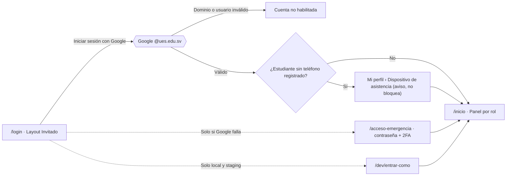

# Layout base

Define los **layouts** de la aplicación, el **menú unificado** y las **vistas comunes** a todos los roles. El detalle de cada rol está en su nota:

| Rol | Nota | Manual |
|---|---|---|
| [[Estudiante]] | [[Layout Estudiante]] | [[Manual Estudiante]] |
| [[Docente]] | [[Layout Docente]] | [[Manual Docente]] |
| [[Coordinador]] | [[Layout Coordinador]] | [[Manual Coordinador]] |
| [[Jefe de Departamento]] | [[Layout Jefe de Departamento]] | [[Manual Jefe de Departamento]] |
| [[Administrador]] | [[Layout Administrador]] | [[Manual Administrador]] |
| [[Soporte Técnico]] | [[Layout Soporte Técnico]] | [[Manual Soporte Técnico]] |

- **Vista común de un curso:** [[Vista de sección]].
- **Tabla de vistas para desarrollo** (ruta, componente, permiso y RF): [[Mapa de vistas]].
- **Decisiones:** [[ADR-034 Navegación y layouts]].
- **Colores, tipografía y prompts para generar pantallas con IA (Stitch):** [[Guía de estilo para Stitch]].
- **Maquetas de las pantallas (31, hechas con Stitch):** [[Maquetas]].
- **Cómo se construyen las vistas con Livewire (fases, patrones y orden):** [[Plan de implementación]].

> [!info] Convención de esta carpeta
> - **Rutas** en español y en minúsculas con guiones (`/mis-notas`). Las secciones se identifican por su `ulid` (`/secciones/{seccion}`), nunca por el id numérico.
> - Lo que no sale de un RF ni de un manual se decidió el 11/10/2026 ([[#Decisiones de detalle]]).

## Los 4 layouts
| Layout | Archivo Blade | Se usa en | Qué tiene |
|---|---|---|---|
| **Invitado** | `layouts/guest` | Inicio de sesión, «Cuenta no habilitada», acceso de emergencia, «Entrar como…» (solo local y staging), páginas de error | Logo de la UES FMO centrado, una tarjeta, pie con enlace a la ayuda |
| **Aplicación** | `layouts/app` | Todas las vistas con sesión iniciada | Cabecera, menú lateral, migas de pan, contenido, avisos |
| **Examen** | `layouts/exam` | Intento de un cuestionario ([[RF16]]) | Sin menú ni campana; temporizador del servidor, estado del autoguardado y navegación de preguntas |
| **Proyección** | `layouts/projection` | QR rotativo de una sesión de asistencia ([[RF20]]) | Pantalla completa, QR grande, cuenta regresiva y número de registrados; **sin nombres de estudiantes** |

### Layout Aplicación
```
┌───────────────────────────────────────────────────────────────┐
│ ☰  [UES FMO] LMS     Período 2026-II (en curso)   ? 🔔3  (KR)▾ │  cabecera
├──────────────┬────────────────────────────────────────────────┤
│ Inicio       │ Inicio › Mis materias › PRN115 · 01            │  migas de pan
│ ─ Estudio ── │ ┌───────────────────────────────────────────┐ │
│ Escanear QR  │ │ Título de la vista            [Acción]    │ │
│ Mis materias │ │                                           │ │
│ Mis notas    │ │ contenido                                 │ │
│ ─ Cuenta ─── │ │                                           │ │
│ Mi perfil    │ └───────────────────────────────────────────┘ │
│ Ayuda        │                                    [avisos]    │
└──────────────┴────────────────────────────────────────────────┘
```

**Cabecera** (siempre visible):
- **☰**: abre y cierra el menú lateral.
- **Logo y nombre** del sistema: llevan a Inicio.
- **Período activo** con su estado. Si el período de la vista está cerrado, se muestra «Período cerrado · solo lectura».
- **?**: abre la ayuda contextual de esa pantalla, p. ej. `/ayuda/docente#7-tomar-asistencia-con-qr` ([[Ayuda en la app]]).
- **🔔 Campana** con el número de avisos sin leer ([[RF23]]). Abre un panel con los últimos 10; desde ahí se va a **Notificaciones**. Llega por Reverb, con consulta cada 15 s como respaldo ([[ADR-010 Notificaciones en tiempo real]]).
  Al pulsar un aviso, en el panel o en la bandeja, queda leído y la plataforma lleva a la pantalla del evento («Ir al evento»); el aviso que no tiene una sola pantalla a la que ir no muestra el botón y se explica en su texto.
- **Menú de usuario** (iniciales o foto de Google): Mi perfil · Ayuda · Cerrar sesión.
- **Aviso de asistencia abierta**: si el estudiante tiene una sesión de asistencia abierta, aparece «Asistencia abierta · PRN115 · Marcar», que lleva a Escanear QR.
- **Cuenta de emergencia**: franja roja fija «Está usando la cuenta de emergencia» ([[ADR-007 Inicio de sesión con Google]]).

**Menú lateral**:
- Desde 1024 px queda fijo a la izquierda y se puede contraer a solo íconos. Por debajo de 1024 px se oculta y **☰** lo abre sobre el contenido (decisión: ☰ para todos los roles, [[ADR-034 Navegación y layouts]]).
- Muestra un contador en las bandejas: pendientes de calificar, actas por validar, solicitudes.
- Marca la opción actual y es navegable con teclado ([[RNF05]]).

**Contenido**:
- **Migas de pan** para volver a cualquier nivel.
- **Título** de la vista con su acción principal a la derecha (p. ej. «Nueva tarea»).
- **Avisos** (toasts) de éxito o error abajo a la derecha. Los mensajes de error usan los textos de `DbError`.

### Listados de alto fijo
Desde **1024 px** el alto de la aplicación lo fija la ventana: el desplazamiento vive en `<main>`, no en la página. Un listado se adapta con tres marcas, sin tocar su clase Livewire:
1. `lg:h-full` en el div raíz de la pantalla;
2. `ajustar` en la tarjeta que contiene la tabla, que la vuelve columna (cabecera y filtros arriba, tabla al medio, paginación abajo);
3. `ajustar` en `<x-ui.table>`, que le da el desplazamiento interno y fija los nombres de columna.

Si la tabla no está dentro de una tarjeta, basta con los puntos 1 y 3. **Por debajo de 1024 px no cambia nada**: la página se desplaza como siempre, porque anidar desplazamientos en un teléfono estorba ([[RNF05]]).

Solo se aplica a las pantallas cuyo bloque principal es **una sola tabla**. Las de detalle que la llevan dentro de una rejilla de dos columnas (sección, período, tarea, usuario) se quedan con el desplazamiento de siempre.

**Alto mínimo.** La tarjeta no baja de **36 rem** y la tabla, de **26 rem**. Antes podían encogerse sin tope: en un portátil con la barra de marcadores abierta, después del título, los indicadores y los filtros quedaban dos filas a la vista y el listado parecía roto. Cuando la ventana no da para el mínimo, el contenido crece y se desplaza `<main>`, que es el comportamiento de siempre por debajo de 1024 px.

**Mientras el componente responde**, la tabla se atenúa y muestra «Cargando…». Una tabla que tarda ya no se confunde con una tabla vacía.

**Estado vacío.** `<x-ui.table vacio="…">` escribe el aviso cuando no hay filas. La comprobación mira el contenido real del hueco (`hasActualContent()`), no si está vacío: un `@foreach` sin elementos deja saltos de línea y sangría, que cuentan como contenido.

### Botones dentro de una tabla
Una fila usa un solo juego de botones, para que todas las tablas se lean igual:

| Acción | Botón |
|---|---|
| Neutra (Horario, Cupo, Asignar docente, Ver, Validar, Restaurar) | `tamano="sm" variante="fantasma"` |
| Destructiva o que quita algo (Retirar, Desactivar, Descartar, Cancelar) | `tamano="sm" variante="peligro"` |

La acción principal de la pantalla (Nueva sección, Inscribir estudiante) **no va en la fila**: vive en el encabezado, con `variante="primario"`. Toda acción que cambie algo y no abra un formulario lleva `wire:confirm`.

### Ancho mínimo y accesibilidad
- Usable desde **360 px** ([[RNF05]]). Las tablas se convierten en tarjetas en móvil.
- WCAG 2.1 AA: foco visible, `aria-current` en el menú, modales con foco atrapado, contraste AA.
- Cada estado vacío explica qué hacer («Aún no tiene materias. Inscríbase con la clave que le dio su docente»).

## Menú unificado
Un usuario puede tener **varios roles** (el Coordinador de ISI también es docente). El menú **suma** las opciones de todos sus roles, agrupadas por secciones. No hay selector de rol ([[ADR-034 Navegación y layouts]]).

| Orden | Grupo | Rol que lo muestra | Opciones |
|---|---|---|---|
| 1 | — | Todos | Inicio |
| 2 | **Estudio** | Estudiante | Escanear QR · Mis materias · Mis notas · Mi asistencia |
| 3 | **Docencia** | Docente | Mis secciones · Pendientes de calificar · Bancos de preguntas |
| 4 | **Coordinación** | Coordinador | Supervisión de aulas · Carga académica · Matrícula · Importar estudiantes · Actas por validar · Clases canceladas |
| 5 | **Jefatura** | Jefe de Departamento | Secciones del departamento · Cierre del período · Desempeño docente |
| 6 | **Administración** | Administrador | Usuarios · Roles y permisos · Períodos · Catálogo · Carga académica · Matrícula · Áreas de asistencia · Clases canceladas · Integraciones · Colas |
| 7 | **Soporte** | Soporte Técnico | Solicitudes de dispositivo · Diagnóstico de asistencia · Usuarios · Importar estudiantes |
| 8 | **Consultas** | Según permiso | Reportes · Estadísticas de oferta · Auditoría |
| 9 | **Cuenta** | Todos | Mi perfil · Ayuda · Cerrar sesión |

Reglas:
- Cada opción se muestra con `@can('<permiso>')` de spatie (no se crean Gates; [[ADR-026 Autorización sin Policies]]). **Ocultar una opción no reemplaza la verificación**: la ruta tiene el middleware `permission:` y el Service aplica el alcance.
- Los títulos de grupo solo aparecen si el usuario tiene **dos o más** grupos; con un solo rol el menú es una lista simple.
- Si dos grupos dan la misma opción (p. ej. Carga académica al Administrador y al Coordinador), aparece **una vez**, en el primer grupo.
- Una opción con `secundaria` es una acción de la anterior (Importar estudiantes bajo Usuarios): va con sangría y una guía vertical, para que se vea de qué opción cuelga. Contraído el menú, la sangría desaparece.
- Una opción con `externa` sale de la aplicación Livewire (Colas, el panel de Horizon): se abre con una carga normal, **sin `wire:navigate`**. Con `wire:navigate` el navegador se quedaba con los estilos oscuros del panel y, al volver, la pantalla salía en negro.
- Una opción se marca activa también en sus subrutas, así que `usuarios` cubre `usuarios.importar`. Cuando coinciden dos, **gana la más precisa**: solo se resalta una.
- Al navegar, la opción activa se trae a la vista. El menú ya no aparece desplazado hasta arriba cuando se abre una opción del final.

## Vistas comunes a todos los roles
```
Layout Aplicación (todos)
├── Inicio ............................... /inicio
│   └── Panel por rol (bloques de cada rol que tenga el usuario)
├── Notificaciones ....................... /notificaciones
│   ├── Filtros: todas · sin leer · por tipo
│   └── Acciones: marcar como leída · marcar todas · abrir el elemento
├── Mi perfil ............................ /perfil
│   ├── Datos personales ................. /perfil
│   ├── Dispositivo de asistencia ........ /perfil/dispositivo        (solo Estudiante)
│   ├── Google Calendar .................. /perfil/google-calendar   (solo Docente)
│   ├── Notificaciones ................... /perfil/notificaciones
│   ├── Sesiones ......................... /perfil/sesiones
│   └── Seguridad (2FA) .................. /perfil/seguridad         (solo cuenta de emergencia)
├── Ayuda ................................ /ayuda · /ayuda/{manual}
└── Cerrar sesión
```

### Inicio
El **panel por rol** ([[RF24]]) carga en menos de 3 s ([[RNF03]]). Con varios roles, muestra un bloque por rol en el orden del menú; cada bloque se puede contraer y el sistema recuerda su estado. Los bloques de cada rol están en su nota.

### Mi perfil
| Pestaña | Qué muestra | Acciones | Permiso · RF |
|---|---|---|---|
| **Datos personales** | Nombre y foto de Google, correo institucional, roles y asignaciones vigentes (secciones, carrera o departamento). Estudiante: carné, carrera, plan y ciclo | Solo lectura: los datos vienen de Google y del registro académico | — · [[RF01]], [[RF04]] |
| **Dispositivo de asistencia** | Teléfono activo, fecha de registro y último uso; solicitudes de cambio y su estado | Registrar este teléfono · Solicitar cambio | `dispositivo.registrar`, `dispositivo.solicitar-cambio` · [[RF27]] |
| **Google Calendar** | Si el docente dio el permiso `calendar.events` | Conectar · Desconectar | `videoconferencias.gestionar` · [[ADR-018 Calendar con OAuth del docente]] |
| **Notificaciones** | Tabla de tipos de aviso con el interruptor «También por correo» | Guardar | `notificaciones.preferencias` · [[RF23]] |
| **Sesiones** | Sesiones abiertas: equipo, navegador, IP aproximada, última actividad; los últimos accesos | Cerrar una sesión · Cerrar las demás | `perfil.sesiones.cerrar` · [[RNF01]] |
| **Seguridad (2FA)** | Estado del TOTP de la cuenta de emergencia | Regenerar códigos de respaldo | Solo la cuenta de emergencia · [[ADR-007 Inicio de sesión con Google]] |

### Flujo de entrada


### Páginas de error (Layout Invitado)
| Código | Título | Acción |
|---|---|---|
| 403 | «No tiene permiso para ver esta página» | Volver a Inicio |
| 404 | «No encontramos lo que busca» | Volver a Inicio |
| 419 | «Su sesión expiró» (30 min sin actividad) | Iniciar sesión de nuevo |
| 429 | «Demasiados intentos» | Esperar e intentar |
| 500 / 503 | «Tuvimos un problema» / «En mantenimiento» | Reintentar más tarde |

## Patrones de vista
Todas las vistas se arman con los componentes de `resources/views/components/ui/` ([[Estructura del código]]):

| Patrón | Uso | Comportamiento |
|---|---|---|
| **Listado** | Usuarios, secciones, solicitudes | Tabla con búsqueda, filtros, orden, paginación y exportar cuando hay permiso de reportes; en móvil, tarjetas. **Desde 1024 px la tabla ocupa el alto que queda y se desplaza por dentro**, con los nombres de columna fijos: el título, los indicadores, los filtros y la paginación quedan siempre a la vista (ver [[#Listados de alto fijo]]) |
| **Detalle con pestañas** | Sección, período, usuario | Cabecera con datos clave y acciones; pestañas con URL propia, para enlazarlas y volver con el botón atrás |
| **Formulario** | Crear o editar | En **modal** si tiene hasta 6 campos; en **página** si es largo o si sus campos crecen con los datos. En página: tarea, cuestionario, nuevo usuario, roles y asignaciones, nueva pregunta, solicitud de revisión, agregar recurso y mensajear a estudiantes. Valida al salir de cada campo. Lo arma `<x-ui.formulario>`, que además lo lleva **por pasos** (ver [[#Formularios por pasos]]) |
| **Bandeja** | Pendientes de calificar, actas, solicitudes | Lista con contador en el menú; al resolver un elemento pasa al siguiente |
| **Confirmación** | Retirar, revocar, cerrar período | Modal con lo que va a pasar; si la acción lo exige, pide el **motivo** (queda en la auditoría) |
| **Vista previa** | Importar Excel, reporte de Meet | Muestra el resultado antes de confirmar: válidos, duplicados y errores |

## Implementación
Hecha el 11/10/2026 (OP#370). Sirve de referencia para construir cada vista:

| Pieza | Dónde | Uso |
|---|---|---|
| Layouts | `resources/views/layouts/{guest,app,exam,projection}.blade.php` | `<x-layouts::app title="…" :migas="[…]" ayuda="docente#5-…">` o `#[Layout('layouts::app')]` en Livewire |
| Menú | `config/navegacion.php` + `App\Support\Navegacion\Menu` | Se agrega una opción en el grupo de su rol con `clave`, `ruta`, `permiso` e `icono`. Las rutas que aún no existen aparecen como «Pronto» |
| Cabecera | `App\Support\Navegacion\Cabecera` | Usuario, iniciales, menú, período activo y avisos sin leer |
| Componentes | `resources/views/components/ui/` | `x-ui.button`, `x-ui.modal` (se abre con el evento `abrir-modal`), `x-ui.accordion` + `x-ui.accordion.item`, `x-ui.table`, `x-ui.field` + `x-ui.input` / `select` / `textarea`, `x-ui.card`, `x-ui.badge`, `x-ui.alert`, `x-ui.breadcrumbs`, `x-ui.empty-state`, `x-ui.icon`, `x-ui.toasts`, `x-ui.avatar`, `x-ui.dropdown`, `x-ui.tabs`, `x-ui.stat`, `x-ui.progress`, `x-ui.search`, `x-ui.skeleton`; sección: `x-seccion.cabecera`, `x-seccion.pestanas` |
| Registro de vistas | `config/vistas.php` + `App\Support\Navegacion\Vistas` | Rutas, permisos, migas y pestañas; lo que no se implementa aún se ve como «En construcción» ([[Plan de implementación#8. Plan de integración]]) |
| Avisos flotantes | `x-ui.toasts` (ya incluido en los layouts) | Desde Livewire: `$this->dispatch('aviso', tipo: 'exito', mensaje: '…')` |
| Íconos | `x-ui.icon name="…"` | 47 íconos de Heroicons (MIT) copiados como SVG; para agregar uno, copie su `<path>` al arreglo del componente |
| Color de marca | `@theme` en `resources/css/app.css` | `marca-50` … `marca-950` (rojo vino de la UES) |
| Pruebas | `tests/Feature/Support/Navegacion/` | Menú por rol, layout, cabecera, errores, examen y proyección |

## Decisiones de detalle
Dudas de diseño resueltas por el equipo el 11/10/2026, con la opción recomendada ([[ADR-034 Navegación y layouts]]).

| # | Duda | Decisión |
|---|---|---|
| 1 | ¿El usuario puede editar sus datos personales? | **Solo lectura**: nombre y foto vienen de Google; carné, carrera y ciclo, del registro académico. Un error lo corrige el Coordinador o el Administrador |
| 2 | ¿Quién mantiene **carreras, planes, departamentos y aulas**? | El **Administrador**, en **Catálogo**, junto con las asignaturas ([[RF07]]) |
| 3 | Panel del **Jefe** y de **Soporte** (no estaban en [[RF24]]) | Los bloques de [[Layout Jefe de Departamento]] y [[Layout Soporte Técnico]], agregados a [[RF24]] |
| 4 | Acceso rápido al QR con el menú ☰ | **Aviso de asistencia abierta** en la cabecera y tarjeta en el panel del estudiante |
| 5 | ¿Vista de **calendario** completa? | Por ahora, solo el calendario del panel ([[RF24]]); la vista completa, después de la entrega |
| 6 | ¿Dónde ve el docente los **mensajes condicionales** enviados? | En la sección, **Notas › Mensajes enviados** ([[RF31]]) |
| 7 | Estado de la **conexión con Google Calendar** | Visible en **Mi perfil › Google Calendar**, para reconectar si se revoca ([[ADR-018 Calendar con OAuth del docente]]) |
