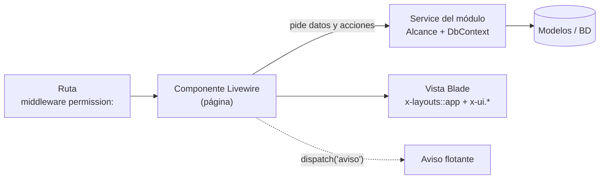

# Plan de implementación · layouts, vistas y navegación

Cómo se construyen las 68 vistas del [[Mapa de vistas]] con Livewire 4, siguiendo el modo orquesta ([[Directrices de IA]]). Las decisiones están en [[ADR-035 Vistas con Livewire]] (11/10/2026).

## 1. Decisiones
| Tema | Decisión |
|---|---|
| Navegación | **`wire:navigate`**: cambia solo el contenido, sin recargar. El menú lateral queda con **`@persist`** y la opción activa se marca con **`wire:current`**. Barra de progreso en rojo UES |
| Rutas | **Esqueleto navegable**: las 68 rutas existen desde H0, con su permiso, sus migas y una página «En construcción» que muestra la maqueta, el RF y la tarea OP. Cada equipo reemplaza la suya |
| Vista de sección | **Una página por pestaña**, cada una con su URL. Comparten la cabecera y la barra de pestañas, que son componentes Blade |
| Orden | **Por RF, de punta a punta**: Back + Front + Test en la misma rama, siguiendo el [[Roadmap]] |

## 2. Anatomía de una vista


| Capa | Archivo | Responsabilidad | No hace |
|---|---|---|---|
| **Ruta** | `app/Modules/<Modulo>/routes.php` | URL, nombre, middleware `auth` + `permission:<permiso>` | Lógica |
| **Componente** | `app/Modules/<Modulo>/Livewire/<Nombre>.php` | Estado de la pantalla (filtros, formulario, pestaña), **validación de formato**, llama al Service, emite avisos | Consultas de escritura ni reglas de negocio |
| **Service** | `app/Modules/<Modulo>/Services/<Nombre>Service.php` | Exige el permiso, aplica el **alcance** (`App\Support\Alcance`), reglas, `DbContext::run()` | Saber de la pantalla |
| **Vista** | `resources/views/modules/<modulo>/<nombre>.blade.php` | Arma la pantalla con el layout y los `x-ui.*`, igual a la maqueta | Lógica de negocio |

### Ejemplo: «Mis materias» (RF29, Equipo 2)
```php
// app/Modules/Academica/Livewire/MisMaterias.php
#[Layout('layouts::app')]
#[Title('Mis materias')]
class MisMaterias extends Component
{
    #[Validate('required|string|max:40', as: 'clave')]
    public string $clave = '';

    public ?int $seccionElegida = null;

    #[Computed]
    public function materias(): Collection
    {
        return app(MatriculaService::class)->materiasDe(auth()->user()); // alcance M
    }

    public function inscribirme(MatriculaService $matricula): void
    {
        $this->validate();                                    // formato, en la clase
        $matricula->automatricular(auth()->user(), $this->clave, $this->seccionElegida); // reglas, en el Service
        $this->reset('clave', 'seccionElegida');
        $this->dispatch('cerrar-modal', 'inscribirme');
        $this->dispatch('aviso', tipo: 'exito', mensaje: __('Quedó inscrito en la materia.'));
    }
}
```
```php
// app/Modules/Academica/routes.php
Route::livewire('/materias', MisMaterias::class)
    ->middleware(['auth', 'permission:contenidos.ver'])->name('materias');
```

## 3. Patrones de Livewire por tipo de pantalla
| Patrón | Pantallas | Cómo |
|---|---|---|
| **Listado** | Usuarios, Carga académica, Auditoría | `WithPagination`; filtros y búsqueda con **`#[Url]`** (quedan en la URL); `wire:model.live.debounce.300ms`; consulta en un `#[Computed]` que llama al Service |
| **Formulario en modal** | Inscribirme con clave, Justificar inasistencia | Propiedades con `#[Validate]` en el componente; `x-ui.modal` se abre con el evento `abrir-modal` |
| **Formulario en página** | Crear o editar tarea | Página propia; `$this->validate()`; al guardar, `redirectRoute(..., navigate: true)` con aviso |
| **Bandeja** | Pendientes de calificar, Actas, Solicitudes | Lista + detalle; al resolver un elemento se avanza al siguiente; el contador del menú se refresca con un evento |
| **Pestañas de sección** | Contenidos, Notas, Asistencia… | Un componente por pestaña + `x-seccion.cabecera` + `x-seccion.pestanas` (con `wire:navigate` y `wire:current`) |
| **Subida de archivos** | Entregar tarea, Importar Excel, Reporte de Meet | `WithFileUploads`; se valida la extensión y el peso en el componente y se guarda en el Service |
| **Bloques pesados** | Paneles de inicio, Desempeño docente | `#[Lazy]` con un *skeleton* como espera, para cumplir los 3 s ([[RNF03]]) |
| **Tiempo real** | Campana, Sesión de asistencia, Proyección | Echo + Reverb con `#[On('echo-private:…')]`; respaldo con `wire:poll.15s` ([[ADR-010 Notificaciones en tiempo real]]) |
| **Examen** | Intento de cuestionario | Layout Examen; autoguardado con `wire:poll.30s` y al cambiar de pregunta; el tiempo lo calcula el servidor |
| **Proyección** | Proyectar QR | Layout Proyección; el QR se renueva cada 10 s con `wire:poll.10s` o por Echo |

**Reglas comunes:**
- Todos los enlaces internos llevan `wire:navigate`. Los `x-ui.button` con `href` lo agregan solos.
- Usar `wire:loading` en las acciones y `wire:key` en las listas.
- Textos con `__()`, tratando al usuario de usted.
- Ninguna consulta de escritura en el componente: la regla `arch()` ya lo controla.
- Cada vista declara `title`, `migas` y `ayuda` (ancla del manual).

## 4. Fase 0 · Base de vistas (H0, Equipo 1, hasta el 16/10)
> [!success] Estado al 11/10/2026
> Hecho: 0.1, 0.2, 0.3, 0.4, 0.6, 0.8 y parte de 0.7. Faltan **0.5 (`Alcance`)** y tres componentes de 0.7. Ver [[#8. Plan de integración]].

Lo que todos los equipos necesitan antes de H1:

| # | Tarea | Detalle | Estimación |
|---|---|---|---|
| 0.1 | Ajustar el tema a la guía | Rojo UES `#AE152D` / `#8B0E13` en `@theme` y en los `x-ui.*` | 2 h |
| 0.2 | Navegación SPA | `wire:navigate` en el menú, las migas y los botones; `@persist('menu')`; `wire:current`; barra de progreso `#AE152D` | 4 h |
| 0.3 | **Registro de vistas** | `config/vistas.php` con las 68 vistas: ruta, URI, permiso, módulo, RF, OP, maqueta, título y migas. Es la fuente única del menú, del esqueleto y de las pruebas | 4 h |
| 0.4 | Esqueleto navegable | Un componente `PaginaEnConstruccion` que muestra el título, la maqueta, el RF y la tarea OP. Cada módulo registra sus vistas pendientes desde el registro, y el equipo las reemplaza con `Route::livewire(...)` usando el mismo nombre | 4 h |
| 0.5 | `App\Support\Alcance` | G/D/C/S/M/P sobre las asignaciones vigentes ([[Matriz RBAC]]). Lo usa todo Service | 8 h |
| 0.6 | Vista de sección (base) | `x-seccion.cabecera`, `x-seccion.pestanas` (pestañas según el permiso, [[Vista de sección]]) y `SeccionService::paraUsuario()` | 6 h |
| 0.7 | Componentes de las maquetas | `x-ui.tabs`, `x-ui.stat` (KPI), `x-ui.progress`, `x-ui.avatar`, `x-ui.dropdown`, `x-ui.pagination`, `x-ui.search`, `x-ui.dropzone`, `x-ui.skeleton`, `x-ui.week` (semana del calendario) | 10 h |
| 0.8 | Pruebas de la matriz | Una prueba generada desde el registro: **cada ruta × cada rol** da 200 si el rol tiene el permiso y 403 si no. Cubre las 68 rutas de una vez | 4 h |
| | | **Total** | **42 h** |

Con la fase 0 lista, el menú navega por las 68 pantallas y cada una muestra su maqueta. Desde ahí, los permisos y la navegación quedan probados para todos.

## 5. Fases 1 a 3 · Pantallas por RF
Cada equipo construye las vistas de sus RF en el hito del [[Roadmap]]. La maqueta de referencia está en [[Maquetas]].

| Hito | Equipo | Vistas (maqueta) |
|---|---|---|
| **H0** | 1 | Iniciar sesión con Google (01) · Roles y permisos (sin maqueta) |
| **H1** | 1 | Usuarios (29) · Auditoría (28) · Mi perfil › Dispositivo (16) · Solicitudes de dispositivo (30) |
| H1 | 2 | Períodos · Catálogo · Carga académica (23, 24) |
| H1 | 3 | Contenidos de la sección (06, 07) · Ver recurso · Notificaciones y campana |
| H1 | 4 | Tarea: detalle y entrega (08, 09) · Crear o editar tarea (19) · Pendientes de calificar (18) · Bancos de preguntas · Intento de cuestionario (10) |
| H1 | 5 | Sesión de asistencia (21) · Código temporal · Áreas de asistencia |
| **H2** | 2 | Matrícula · Mis materias (05) · Estudiantes de la sección |
| H2 | 3 | Video integrado · Analítica · Importar de un período anterior · Foro |
| H2 | 4 | Libro de calificaciones (20) · Mis notas (11, 12) |
| H2 | 5 | **Escanear QR (04)** · Proyectar QR (22) · Diagnóstico (31) · Clases canceladas |
| H2 | 1 + todos | Paneles de inicio (02, 03, 17): cada equipo hace sus bloques |
| **H3** | 2 | Estadísticas de oferta · Reportes · Desempeño docente (27) |
| H3 | 3 | Mensajear a estudiantes que… |
| H3 | 4 | Progreso por unidad · Acta · Actas por validar (25) · Cierre del período (26) |
| H3 | 5 | Mi asistencia (13, 14) · Justificar inasistencia (15) · Clase virtual y reporte de Meet |

## 6. Flujo por pantalla (modo orquesta)
1. **`explorador-lms`** lee el RF, sus CP, la maqueta, la fila del [[Mapa de vistas]] y la [[Matriz RBAC]], y resume qué datos, acciones y roles tiene la pantalla.
2. **Plan** con los criterios a cubrir, el Service, el componente, la vista, las pruebas y las dudas. El equipo lo aprueba.
3. **`implementador-lms`**, en este orden:
   1. el Service con sus pruebas (alcance y reglas);
   2. el componente;
   3. la vista con `x-ui.*`;
   4. el cambio de la ruta provisional por la real.
4. **`probador-lms`** escribe las pruebas `CP-RFxx-nn`:
   - `Livewire::test` de cada acción y validación;
   - render con cada rol permitido;
   - 403 con un rol denegado.
5. **`revisor-lms`** compara con la maqueta, aplicando las correcciones de [[Maquetas#Correcciones al construirlas]]. También revisa el RF, las ADR, que los textos sean de usted y la accesibilidad.
6. **Cierre:** PR a `test` con capturas, el estado en OpenProject y el CP en `pasa`.

## 7. Decisiones pendientes (dependencias nuevas)
Algunas pantallas necesitan una librería. Cada una requiere aprobación antes de su hito:

| Necesidad | Pantallas | Opción sugerida |
|---|---|---|
| Generar el QR | Proyectar QR (H2) | **Aprobada:** `chillerlan/php-qrcode` (PHP, SVG en el servidor), [[ADR-046 Lector QR en la página y rotación por polling]] |
| Leer el QR con la cámara | Escanear QR (H2) | **Aprobada:** API `BarcodeDetector` del navegador, con `barcode-detector` de respaldo, [[ADR-046 Lector QR en la página y rotación por polling]] |
| Gráficos | Paneles, Desempeño docente, Estadísticas (H2–H3) | Chart.js |
| Mapa | Áreas de asistencia (H1) | **Aprobada:** `leaflet` 1.9.4 + OpenStreetMap, [[ADR-055 Leaflet y OpenStreetMap para las áreas de asistencia]] |
| Excel | Importar estudiantes, Reportes (H1–H3) | `openspout/openspout` |
| PDF | Acta, Reportes (H3) | `barryvdh/laravel-dompdf` |
| Token de dispositivo | Mi perfil › Dispositivo (H1) | Sin librería: cookie y `localStorage` ([[ADR-045 Token de dispositivo]]) |

## 8. Plan de integración
### 8.1 Qué ya está en el código
| Pieza | Dónde | Estado |
|---|---|---|
| Tema UES | `resources/css/app.css`: `marca-*` (600 = `#AE152D`, 700 = `#8B0E13`), `fondo`, `borde`, `texto`, `texto-suave`, `acento` | ✅ |
| Layout Aplicación según la maqueta 17 | `resources/views/layouts/app.blade.php`: píldora del período, aviso «Asistencia abierta» (solo estudiantes), usuario con sus roles, menú con barra roja en la opción activa | ✅ |
| Navegación sin recarga | `wire:navigate` en el menú, las migas, las pestañas, los botones y el desplegable; menú con `@persist`; activa con `wire:current`; barra de progreso `#AE152D`; *store* de Alpine `$store.menu` | ✅ |
| Registro de vistas | `config/vistas.php` (60 rutas) + `App\Support\Navegacion\Vistas` | ✅ |
| Esqueleto navegable | `App\Support\Navegacion\EnConstruccion` + `NavegacionServiceProvider`. Cada ruta muestra la ficha (RF, OP, equipo, hito, permiso) y la maqueta. En el menú, un punto gris indica «en construcción» | ✅ |
| Permisos en las rutas | Middlewares `permission`, `role` y `role_or_permission` de spatie en `bootstrap/app.php` | ✅ |
| Vista de sección (base) | `x-seccion.cabecera`, `x-seccion.pestanas` y `App\Modules\Academica\Services\SeccionService::resumen()` | ✅ (falta el alcance) |
| Componentes nuevos | `x-ui.avatar`, `x-ui.dropdown` + `x-ui.dropdown.item`, `x-ui.tabs`, `x-ui.stat`, `x-ui.progress`, `x-ui.search`, `x-ui.skeleton`; botón `peligro` contorneado y `peligro-solido` | ✅ |
| Matriz ruta × rol | `tests/Feature/Support/Navegacion/VistasTest.php`: las 60 rutas con los 6 roles; 200 si el rol tiene el permiso y 403 si no | ✅ |
| Maquetas en el esqueleto | `/dev/maquetas/{archivo}` (solo fuera de producción) sirve las imágenes de `docs/13 Layout/Maquetas` | ✅ |

### 8.2 Lo que falta de la base (Equipo 1, antes de H1)
| # | Pendiente | Por qué es urgente | Estimación |
|---|---|---|---|
| 1 | **`App\Support\Alcance`** (G/D/C/S/M/P) | Ningún Service puede filtrar por alcance sin él. Hoy `SeccionService::resumen()` no lo aplica: con el esqueleto no expone datos sensibles, pero cada vista real debe usarlo | 8 h |
| 2 | `x-ui.pagination` | Estilo propio para `WithPagination` (publicar la vista de paginación de Livewire con la guía) | 2 h |
| 3 | `x-ui.dropzone` | Entregas, Importar Excel y reporte de Meet (H1) | 3 h |
| 4 | `x-ui.week` | Calendario semanal de los paneles (H2) | 3 h |
| 5 | Contadores del menú | Pendientes de calificar, Matrícula, Actas y Solicitudes: agregar un `contador` a las opciones de `config/navegacion.php`, resuelto por un Service del módulo | 3 h |

### 8.3 Cómo integra un equipo su vista (paso a paso)
1. **Rama** `<modulo>-rfxx-<corto>` desde `test`. Ponga la tarea Front en *In progress*.
2. **Si el módulo no tiene ServiceProvider**, créelo, con `IdentidadServiceProvider` como modelo:
   - registre sus componentes con `Livewire::component()`;
   - cargue `app/Modules/<Modulo>/routes.php` con `Route::middleware('web')->group(...)`;
   - agréguelo a `bootstrap/providers.php` **antes** de `NavegacionServiceProvider`.
3. **Service** con sus reglas y `Alcance`, y sus pruebas.
4. **Componente Livewire** de página (`#[Layout('layouts::app')]`, `#[Title(...)]`) y su vista con `x-ui.*` y `x-seccion.*`, siguiendo la maqueta y sus correcciones ([[Maquetas#Correcciones al construirlas]]).
5. **Ruta real con el mismo nombre y la misma URI** que en `config/vistas.php`:
   ```php
   Route::livewire('/carga-academica', CargaAcademica::class)
       ->middleware(['auth', 'permission:secciones.gestionar'])->name('carga-academica');
   ```
   La provisional desaparece sola, y la matriz ruta × rol sigue pasando. Si la URI o el permiso cambian, actualice `config/vistas.php` **y** el [[Mapa de vistas]].
6. **Pruebas `CP-RFxx-nn`** con `Livewire::test`: render con cada rol permitido, cada acción y validación, y el 403 de un rol denegado.
7. **PR a `test`** con capturas. El revisor compara contra la maqueta. Marque el CP en `pasa` y cierre la tarea.

### 8.4 Orden sugerido para H1 (19–30/10)
1. **Equipo 1:** `Alcance` y los pendientes de 8.2, del 12 al 16/10. Luego Usuarios (29) y Auditoría (28), que son los listados modelo para los demás.
2. **Equipo 2:** Carga académica (23, 24). Es la que crea las secciones que usan todas las pestañas.
3. **Equipos 3, 4 y 5** en paralelo: Contenidos (06), Tarea (08, 19) y Sesión de asistencia (21). Mientras falta un dato de otro equipo, usan los del seeder.

### 8.5 Decisiones pendientes antes de cada hito
Las librerías de la sección 7 (QR, cámara, gráficos, mapa, Excel y PDF) se aprueban **antes** del hito que las usa. Las de H1 son el mapa (Áreas de asistencia) y Excel (Importar estudiantes).

## 9. Estado de las vistas (11/10/2026)
**58 de 60 vistas del registro están implementadas** con Service, componente Livewire, vista, `Alcance` y pruebas. Además, el Inicio por rol tiene datos reales. Quedan provisionales:

| Vista | Por qué |
|---|---|
| Proyectar QR | Falta la librería que genera el QR (§7) |
| Mi perfil › Google Calendar | Falta el OAuth de Google Calendar (ADR-018) |

**Pruebas:** 115 pasan en SQLite y en PostgreSQL 17, incluida una **prueba de humo** (`tests/Feature/Humo`) que siembra la demo completa y abre cada vista con las 6 cuentas `*.dev`.

### Lo que falta dentro de las vistas ya hechas
Cada equipo lo completa con su RF; las vistas ya tienen el lugar donde va.

| RF | Pendiente |
|---|---|
| RF20, RF27 | Lectura del QR con cámara, GPS y token de dispositivo. Hoy **Escanear QR** solo acepta el código temporal |
| RF21 | Programar la clase virtual (Calendar + Meet) y subir el reporte de asistencia de Meet |
| RF31 | «Mensajear a estudiantes que…» desde el libro de calificaciones |
| RF23 | Envío de notificaciones: los eventos aún no crean avisos; la campana y la pantalla solo leen los existentes |
| RF22 | Recalcular las alertas de inasistencia y bajo rendimiento (hoy vienen del seeder) |
| RF06, RF34 | El Administrador aún no **cierra ni reabre** el período (congelar `enrollment_results`) |
| RF09 | Al aprobar un cambio de grupo, las entregas y notas no se trasladan a la nueva matrícula |
| RF15 | Tareas grupales: se guarda la opción, pero no se arman los equipos |
| RF11 | Las páginas se muestran como texto plano hasta aprobar un saneador de HTML (HTMLPurifier); falta la descarga de carpetas en .zip |
| RF04, RF25 | Excel (hoy CSV) y PDF; el envío de reportes programados (job en la cola `reportes`) |
| RF10, RF33 | Fórmulas **provisionales**, explicadas en pantalla; confirmarlas |
| Base | Contadores del menú, `x-ui.dropzone`, `x-ui.week` |

### Lecciones para los equipos
- **No uses `->each(fn ($x) => $x->campo = $bool)`**: `each()` se detiene cuando el callback devuelve `false`. Usa una función con bloque.
- **`pluck(DB::raw('count(*)'))` no es portable**: PostgreSQL llama a la columna `count`. Usa `selectRaw('… as total')->pluck('total', …)`.
- **Prueba siempre en PostgreSQL:** ahí actúan los triggers de auditoría (AC900 si falta el actor) y de inmutabilidad (AC902 si se borra una matrícula).
- En Livewire, una **propiedad pública con el mismo nombre que una variable de la vista la tapa**: recibe los ids de la ruta en `mount()` con otro nombre.
