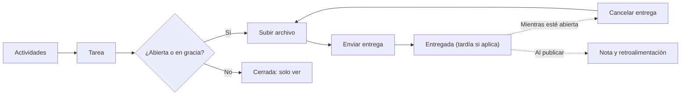
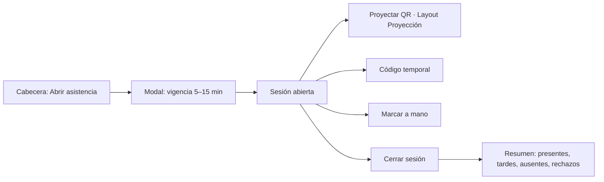
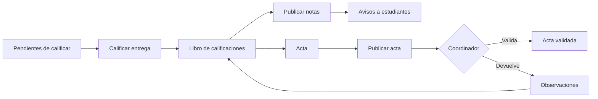

# Vista de sección

Es la vista de **un curso** (una sección de una asignatura en un período). Es **una sola vista para todos los roles**: cada pestaña y cada acción aparece según el permiso y el alcance del usuario ([[ADR-034 Navegación y layouts]]). Ruta: `/secciones/{seccion}` (ulid), dentro del [[Layout base#Layout Aplicación|Layout Aplicación]].

Se llega desde: **Mis materias** (Estudiante), **Mis secciones** (Docente), **Supervisión de aulas** (Coordinador) y **Secciones del departamento** (Jefe). El Administrador no entra al contenido ni a las notas ([[ADR-032 Ajustes por el documento de roles]]): gestiona las secciones desde **Carga académica** y **Matrícula**.

## Cabecera de la sección
```
┌──────────────────────────────────────────────────────────────────┐
│ PRN115 · Programación I · Grupo 01                2026-II        │
│ Docente: Ana Ruiz · Lun y Mié 07:00–08:40 · A-101 · Presencial   │
│ Próxima clase: mañana 07:00          [Abrir asistencia] [ ⋯ ]    │
├──────────────────────────────────────────────────────────────────┤
│ Contenidos │ Actividades │ Notas │ Asistencia │ Foro │ Estudiantes │ Analítica │
└──────────────────────────────────────────────────────────────────┘
```
- **Datos:** código y nombre de la asignatura, grupo, período, docentes (el responsable primero), horario, aula y modalidad, próxima clase o videoconferencia.
- **Avance del estudiante:** barra con su progreso en la sección ([[RF18]]).
- **Acciones según el rol:**

| Acción | Quién | Cuándo |
|---|---|---|
| Abrir asistencia | Docente | Hay clase hoy y no hay otra sesión abierta ([[RF19]]) |
| Programar clase virtual | Docente | Siempre ([[RF21]]) |
| Solicitar cambio de grupo | Estudiante | En las 3 primeras semanas del período ([[RF09]]) |
| Importar de un período anterior | Docente | La sección no tiene contenido aún ([[RF14]]) |
- **Período cerrado:** franja «Período cerrado · solo lectura»; desaparecen las acciones de edición, salvo **Corregir nota** para el Coordinador.

## Pestañas por rol
| Pestaña | Ruta | Estudiante (M) | Docente (S) | Coordinador (C) | Jefe (D) |
|---|---|---|---|---|---|
| **Contenidos** | `/secciones/{s}` | Ver y marcar avance | Gestionar | Solo lectura | — |
| **Actividades** | `/secciones/{s}/actividades` | Entregar y resolver | Gestionar y calificar | Solo lectura | — |
| **Notas** | `/secciones/{s}/notas` | Su boleta y progreso | Libro de calificaciones y acta | Lectura y corrección con período cerrado | — |
| **Asistencia** | `/secciones/{s}/asistencia` | Su historial | Sesiones | Solo lectura | — |
| **Foro** | `/secciones/{s}/foro` | Participar | Participar y moderar | — | — |
| **Estudiantes** | `/secciones/{s}/estudiantes` | — | Lista e inscribir | Lista, inscribir y retirar | Lista e inscribir |
| **Analítica** | `/secciones/{s}/analitica` | — | Mapa de calor | Mapa de calor | — |

Permisos que muestran cada pestaña: `contenidos.ver`, `contenidos.ver` (Actividades), `calificaciones.ver`, `asistencia.ver`, `foros.participar`, `matricula.gestionar` y `contenidos.analitica.ver` ([[Matriz RBAC]]).

## Árbol de la vista
```
Vista de sección /secciones/{s}
├── Contenidos
│   ├── Unidad (acordeón)
│   │   ├── Recurso: archivo · PDF · video · página · enlace · carpeta
│   │   │   └── Ver recurso ................ /secciones/{s}/recursos/{recurso}
│   │   │       ├── PDF en la página o descarga (lo decide el docente)
│   │   │       ├── Video integrado (YouTube / Drive) ............ RF12
│   │   │       ├── Carpeta: descargar como .zip
│   │   │       └── [Est] Ya lo leí (finalización manual) ......... RF18
│   │   └── [Doc] Agregar recurso · Editar · Reordenar · Eliminar
│   ├── Buscador por nombre o tipo
│   ├── [Doc] Nueva unidad · Reordenar unidades
│   ├── [Doc] Papelera (30 días) ........... /secciones/{s}/papelera
│   └── [Doc] Importar de un período anterior .......................... RF14
├── Actividades (por cómputo)
│   ├── Tarea ............................. /secciones/{s}/tareas/{tarea}
│   │   ├── [Est] Instrucciones, fechas, extensiones y peso permitidos
│   │   ├── [Est] Subir archivo · Enviar entrega · Cancelar entrega ...... RF15
│   │   ├── [Est] Nota y retroalimentación (cuando se publica)
│   │   ├── [Doc] Entregas ............... /secciones/{s}/tareas/{tarea}/entregas
│   │   │   └── Calificar entrega: rúbrica · nota · comentario (anónima si aplica)
│   │   └── [Doc] Editar · Equipos (si es grupal)
│   ├── Cuestionario ...................... /secciones/{s}/cuestionarios/{cuestionario}
│   │   ├── [Est] Comenzar intento → Layout Examen ... /intentos/{intento} . RF16
│   │   ├── [Est] Revisión con justificaciones (si se publicó)
│   │   ├── [Doc] Intentos y calificación de ensayos
│   │   └── [Doc] Editar: reglas de extracción del banco, tiempo, navegación
│   ├── [Doc] Nueva tarea ................. /secciones/{s}/tareas/crear
│   └── [Doc] Nuevo cuestionario .......... /secciones/{s}/cuestionarios/crear
├── Notas
│   ├── [Est] Mi boleta: por cómputo · por unidad · con pesos ........... RF17
│   ├── [Est] Mi progreso por unidad ..................................... RF18
│   ├── [Doc] Libro de calificaciones ... /secciones/{s}/notas
│   │   ├── Ponderaciones por cómputo (suman 100 %)
│   │   ├── Publicar notas de una actividad
│   │   ├── Mensajear a estudiantes que… (condición) ..................... RF31
│   │   └── Mensajes enviados
│   ├── [Doc] Progreso por unidad de cada estudiante ..................... RF18
│   ├── [Doc] Acta ........................ /secciones/{s}/acta ......... RF34
│   │   └── Resumen · Publicar acta · Observaciones si fue devuelta
│   └── [Coord] Corregir nota (período cerrado, motivo obligatorio) .... RF17
├── Asistencia
│   ├── [Est] Mi historial por cómputo · porcentaje · alertas .......... RF22
│   │   └── Justificar una inasistencia (adjuntar documento)
│   ├── [Doc] Sesiones (lista)
│   │   └── Sesión ........................ /secciones/{s}/asistencia/{sesion}
│   │       ├── Presencial: Proyectar QR → Layout Proyección ............ RF20
│   │       ├── Generar código temporal para un estudiante .............. RF28
│   │       ├── Marcar a mano · Corregir con motivo ..................... RF19
│   │       ├── Rechazos de la sesión con su motivo
│   │       ├── Virtual: Subir reporte de Meet → Vista previa → Confirmar RF21
│   │       ├── Revisar justificaciones
│   │       └── Solicitar cancelación · Cambiar modalidad ............... RF32
│   └── [Doc] Programar clase virtual (Google Calendar + Meet) ......... RF21
├── Foro
│   ├── Hilos (fijados primero) · Nuevo hilo
│   └── Hilo ............................. /secciones/{s}/foro/{hilo}
│       ├── Respuestas anidadas · Responder ............................ RF30
│       └── [Doc] Fijar · Cerrar · Ocultar mensaje
├── Estudiantes
│   ├── Lista: carné, nombre, estado, % de asistencia, promedio, alertas
│   ├── Inscribir (cupo, duplicado y choque de horario) ................. RF09
│   └── [Coord] Retirar con motivo
└── Analítica
    └── Mapa de calor: recursos × estudiantes (aperturas y tiempo) ..... RF13
```

## Flujos dentro de la sección
**Estudiante: entregar una tarea** ([[Flujo Entrega de tarea]])


**Docente: tomar asistencia presencial** ([[Flujo Asistencia con QR]])


**Docente: publicar notas y acta** ([[Flujo Cálculo de nota final]], [[Flujo Validación de actas y cierre]])

