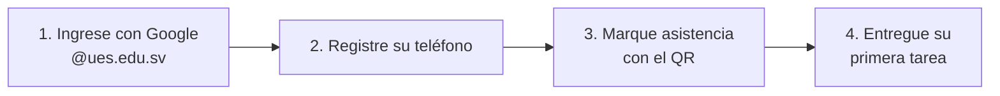
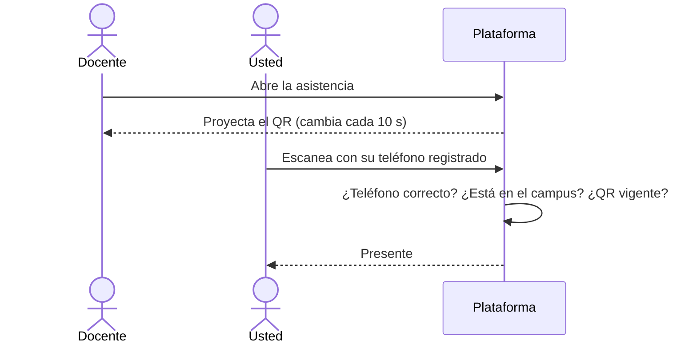

# Bienvenido a la plataforma

Esta guía es para su primera semana. En cinco minutos sabrá entrar, preparar su teléfono para la asistencia y entregar su primera tarea. Para todo lo demás está el Manual del Estudiante.

## Sus primeros 4 pasos

### 1. Ingrese con su cuenta institucional
Pulse **Iniciar sesión con Google** y elija su correo **@ues.edu.sv** (por ejemplo, `ab12345@ues.edu.sv`). Con un correo personal, como uno de Gmail, no podrá entrar.

> [!tip] Si es su primera vez
> Si al entrar no ve sus materias, es normal: su cuenta se crea al primer ingreso y la Administración le asigna el rol de estudiante. Espere un día hábil o escriba a Soporte Técnico.

### 2. Registre su teléfono (una sola vez)
Hágalo **desde su teléfono**, no desde una computadora: abra **Mi perfil → Dispositivo de asistencia** y pulse **Registrar este teléfono**. No necesita huella ni PIN.

> [!warning] Solo un teléfono
> La asistencia con QR solo funciona desde el teléfono que registró. Si lo cambia o lo pierde, pida el cambio en la misma pantalla con **Solicitar cambio de teléfono**; Soporte Técnico lo aprueba.

### 3. Marque asistencia en clase
Cuando el docente abre la asistencia, proyecta un código QR que cambia cada 10 segundos. Usted lo escanea con su teléfono registrado desde **Escanear QR**:

Active la **ubicación** del teléfono y permita que el navegador la use: sin ella, la asistencia se rechaza. En las clases virtuales por Meet, entre **con su cuenta @ues.edu.sv** y quédese al menos el 70 % de la clase.

### 4. Entregue su primera tarea
Abra la materia en **Mis materias**, vaya a **Actividades** y abra la tarea. Revise la fecha límite y los formatos permitidos, adjunte su archivo y pulse **Enviar entrega**.

## Dónde está cada cosa
| Quiero… | Vaya a… |
|---|---|
| Ver qué tengo que entregar | **Inicio**, en «Pendientes por fecha» |
| Inscribir una materia | **Inscripción de materias** |
| Ver mis materias y sus contenidos | **Mis materias** |
| Ver mis notas | **Mis notas** |
| Ver mi asistencia | **Mi asistencia** |
| Elegir qué avisos me llegan por correo | **Mi perfil → Notificaciones** |
| Ver un aviso | La **campana** de arriba: al pulsar un aviso queda leído y lo lleva a la pantalla del evento |
| Pedir ayuda | **Ayuda**, en el menú, o Soporte Técnico de la facultad |
